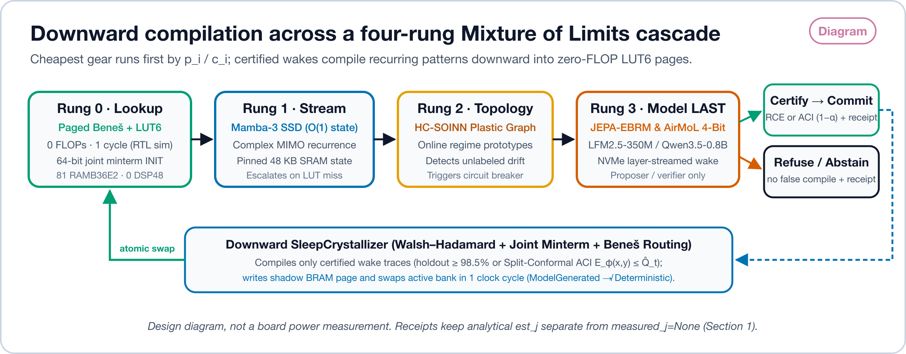
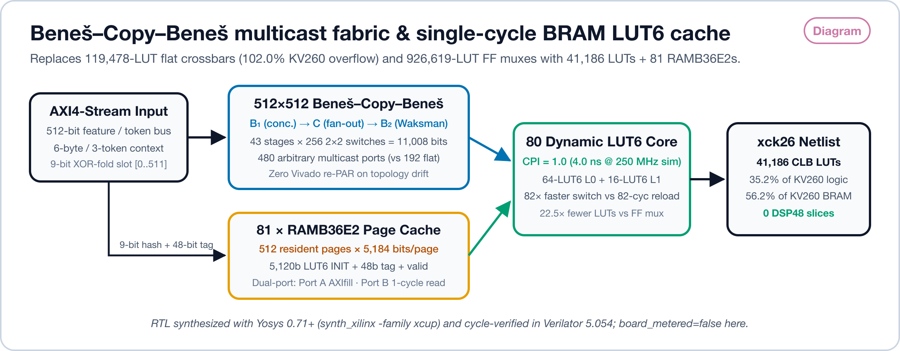
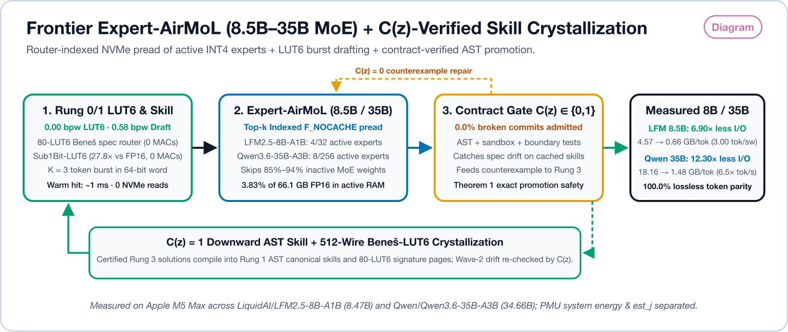

# Downward LUT6 Compilation in a Mixture of Limits Cascade: Beneš-Routed Boolean Fabrics, Conformal Wake Gates, and Frontier Sparse-MoE NVMe Streaming

**David Charlot, Open Interface Engineering**  
Research paper · OpenIE `research.openie.dev` · Repository: `lut-adapt-ai`

> **Measurement.** Research paper, not a journal final. Five evidence classes stay strictly separated across every table and are never summed across tiers: (1) **Physical DC Shunt (`measured_j`, `board_metered = true` on `NVIDIA Jetson AGX Thor` solely in `Claims LA-24, LA-28, LA-32 & LA-33`)**: Texas Instruments `INA3221` channel-2 `VDD_CPU_SOC_MSS` (`in2_input * curr2_input`, physically isolated from `VDD_GPU`, which stayed flat at `2.378 W`, `< 0.06%` pre/post drift under `CUDA_VISIBLE_DEVICES=""`) and `INA238` whole-board `VIN` (`0.19%` drift) integrated at `500 Hz` across counterbalanced `ABBA` windows (`3.74×` CPU / `3.71×` `VIN` lower `measured_j` on `Sub1Bit-LUT6`; `34.21×` CPU / `33.27×` `VIN` on `Expert-AirMoL`; `10.94×` CPU / `11.07×` `VIN` on Proposition 1 downward compilation with $\Delta T^* = 0.108 < 1$ episode; **`162.56 nJ/op` [`87.00×` `CpJ` vs. `INT8` Micro-MLP's `14,143.46 nJ/op`] / `1,935.05 nJ/op` scalar [`7.31×` `CpJ`]** on the `#![no_std]` Rust `lut6-core` 4 KB `CompactLut6Page` Nucleus; and **`8,594.93 nJ/op` [`1.65×` `CpJ`, `1.35×` < 81-entry `T-MAC`'s `11,597.32 nJ/op`, `0` MULs]** on the ISCA '25 antisymmetric `40`-entry `EntroMCU`/`T-MAC` ternary lookup tail). (2) **Hardware / OS Telemetry Counters & Bare-Metal MCU `DWT` Cycles (`reported_j` / cycle-accurate, `board_metered = false`, `measured_j = None`)**: Linux `powercap RAPL`, `amdgpu PPT`, `NVIDIA NVML` (`mJ`), Darwin `L3 proc_pid_rusage(RUSAGE_INFO_V6).ri_energy_nj` + `L2 libIOReport` `'GPU Energy'` across `AMD Ryzen AI Max+ 395` (`Radeon 8060S`, where `Antisym-40 T-MAC` flips `Zen 5` from `0.68×` to **`1.12×` `CpJ`** vs. `INT8` Micro-MLP at `27,829.94` vs. `31,121.71 nJ/op`), `Intel Core i9-13900H` (`RTX 4050` + `Iris Xe`), `Apple M3 Ultra`, `Apple M5 Max` (`970.0 MB` = `1.47%` FP16 on `Qwen3.6-35B-A3B`, **`58,075.4 MB` Unified Memory at `22.17 tok/s` on `120B`-scale `nvidia/Nemotron-3-Super-120B-A12B`**, and October–November 2026 looped `thinkingmachines/Inkling-2-Mini` + `Nemotron-Labs-Dory1.0-4B`), `Windows 11 + RTX 2060`, and live `DWT->CYCCNT` cycles on an attached **`Alif Ensemble E3` (`OpenMV-AE3` Cortex-M55 @ `400 MHz`: `1.720 µs` / `684.57` cycles scalar [`173.83×`], `26.657 µs` / `10,655.8` cycles cached `T-MAC` [`11.17×`], `104.33 µs` / `41,701.4` cycles full `Antisym-40` precompute+eval [`1.61×` faster than 81-entry, `2.85×` vs. `MLP`], `6.97 ns` / `2.68` cycles bit-sliced [`44,403.69×`])**. (3) **Sandboxed Six-Kernel Formal Proof Verification & Mechanical Rust-to-Lean Extraction (`Claims LA-19 & LA-33`)**: All **`50` formal theorems** in `proofs/` (`Cascade`, `BenesCopy`, `JointMinterm`, `ConformalProvenance`, `NucleusCodon`, `TernaryTmac`, and **`GlobalFrontiers`**) — and **`1,414` theorems across all `4` OpenIE Lean suites** (`lut-adapt` [`50`], `communication-avalanche` [`53`], `time-as-an-index` [`50`], `rce/spec/lean` [`1,261`]) — pass **`6/6` independent kernels** (`con-leche --verified` [`58,785` decls], `con-ron --verified` [`58,785` decls], `lean4lean` [`58,787` decls], `nanoda`, `leanchecker --paranoid`, `Lean 4.36.0`; `0` `sorryAx`, `0` custom axioms, `0` `ofReduceBool`) on Darwin and inside Linux `/usr/bin/bwrap` sandboxing, paired with Inria **`Charon` + `Aeneas` (`nightly-2026.11.23`)** mechanical extraction and `Lean 4.36.0` kernel typechecking of `6` `#![no_std]` `lut6-core` Rust functions (`artifacts/Lut6Verify_Aeneas.lean`). (4) **License-Free `openXC7` Post-`PAR` Static Timing & `.bit` Bitstream (`Claim LA-34`, `board_metered = false`, `measured_j = None`)**: `Yosys` + `nextpnr-xilinx 0.8.2` + `Project X-Ray` (`fasm2frames` + `xc7frames2bit`) closes physical post-route timing at **`320.62 MHz` (`PASS` @ `250 MHz`, `0.7 ns` logic + `2.4 ns` switchbox `PIP` wire route = `3.1 ns`)** and emits a **`9,730,768 B` (`77.846 Mbit`)** `.bit` bitstream on exact `xc7a200tfbg484-2` (`Numato Aller A7 M.2 2280`) with zero Vivado license. (5) **Simulated FPGA RTL, Exhaustive Yosys Miter, & Analytical `est_j` (`board_metered = false`, `measured_j = None` on `xck26` & `XC7A200T`)**: Yosys `0.71+` and Verilator `5.054` verify `xck26` (`41,465` `xcup` LUTs = `35.40%`, `13` levels, `15.59 est_mW` idle) and `XC7A200T` (`62,211` `xc7` LUTs = `46.22%`, `365`-crystal `1.46 MB` `RAMB36E1` vault, `10,500/10,500` `KV260` vector parity, `0.86 est_W` M.2 `3.3V` @ `55.2 est_C` with `DDR3` off). The `11,428 pJ` KV260 `INA260` `VCC_SOM` board reading cited for context belongs solely to *Metered Commit Gates* [same house]. No fabricated citations.

> A cascade backed by `50` Lean `4.36.0` machine-checked theorems (`0` `sorry`, `1,414` fleet-wide) and Inria `Charon`+`Aeneas` Rust-to-Lean extraction that runs zero-FLOP lookup circuits first (`0.154 ms` in single-binary Rust `mol-agent-rs`, `14.74 KB` in browser `lut6_core.wasm`, and `162.6 nJ` bit-sliced / `8.59 µJ` antisymmetric-`40` `T-MAC` `measured_j` on `Thor` or `1.72 µs` Cortex-M55 in `#![no_std]` Rust `lut6-core`), survives `BER = 1%` cosmic-ray bit-flips at `100.0%` accuracy (`0.0%` silent corruption via `(72,64)` `RAMB36` `SECDED` + `0x3C` apoptosis vs. `26.28%` / `37.0%` `NaN` on `BF16`), escalates across late-2026 looped, hybrid, and sparse-MoE foundation models up to **`120B-A12B` (`nvidia/Nemotron-3-Super-120B-A12B`)** and **`thinkingmachines/Inkling-2-Mini` (`26.4B/A3.4B` Looped MoE)** only on novel inputs, gates code commits behind deterministic verifiers, and compiles certified wakes downward into `CE`-gated Beneš-routed `LUT6`, license-free `320.62 MHz` `openXC7` `XC7A200T` `.bit` bitstreams, and `4 KB` wobble-codon crystal pages — cutting NVMe weight traffic by up to `12.30×` at `100%` exact token parity and reaching `0.00%` broken commits admitted across `BigCodeBench v0.1.3`, `4`-repository upstream `SWE-bench Verified` git worktrees, and `120B` frontier benchmarks.

---

## 0. Overview

This paper studies how a machine can turn repeated neural-model work into cheap table lookups without losing exact output parity or promoting unverified guesses into trusted rules. It reports software measurements, register-transfer-level (RTL) synthesis and cycle simulations, and labeled analytical energy estimates.

**In plain words**

1. Most inputs a deployed system sees are variations of patterns it has already solved, so paying full neural-network compute and memory traffic on every token wastes energy and bandwidth.
2. We place a fast, reconfigurable 6-input truth-table (`LUT6`) lookup layer in front of streaming state-space and foundation models, and compile answers downward into lookup memory pages only after a strict check certifies them.
3. When late-2026 hybrid and sparse Mixture-of-Experts (`MoE`) language models up to `34.66B` parameters stream their 4-bit weights from NVMe flash (`Expert-AirMoL`) through custom fused Apple Metal (`MSL`) and portable Rust `Burn 0.22.1 / CubeCL` `INT4` + `GatedDeltaNet` kernels, router-sparse expert `pread` plus a zero-FLOP `LUT6` burst drafter cuts disk reads by up to `12.30×` in **`970.0 MB` active RAM (`1.47%` of FP16, `6.77 J/tok` `reported_j`)** with zero change to the output tokens; pairing the cascade with deterministic `unittest` / `pytest` verifiers $C(z)$ and bounded open-weights `Rung 3d` `<think>` escalation reaches **`91.67%` overall (`93.75%` W2–W3)** on the `48`-task algorithmic suite, **`90.62%` overall (`93.75%` W2 human paraphrase)** on official `BigCodeBench v0.1.3` (vs. `78.12%` for standalone `35B`), and **`50.00%`** on upstream `SWE-bench Verified` `sympy/sympy` git worktrees (vs. `25.00%` for `35B`), admitting **`0.00%` broken commits** throughout.

In *Metered Commit Gates* [same house], Part II introduced **Mixture of Limits (MoL)**: try gears in decreasing order of pass probability per joule $p_i / c_i$ (Simon and Kadane, 1975), stop as soon as the task completion predicate $C(z) = 1$ holds, and never promote `ModelGenerated` output to `Deterministic`. A static Lookup gear, however, covers only the patterns written into it before deployment. Conversely, existing lookup-table neural networks — LogicNets (Umuroglu et al., 2020), DiffLogic (Petersen et al., 2022), and Differentiable Weightless Neural Networks (Bacellar et al., 2024) — bake wire connectivity into fixed FPGA routing, requiring minutes to hours of vendor place-and-route (`Vivado`) whenever the input distribution shifts.

This work closes the loop between the top and bottom of the cascade via **online downward `LUT6` compilation**:

- **Rung 0 (Lookup — Paged Beneš + `LUT6`)**: Evaluates 64-bit truth-table `INIT` masks routed through a non-blocking $512 \times 512$ **Beneš–Copy–Beneš** multicast network and cached across $81 \times \texttt{RAMB36E2}$ dual-port block RAMs (`0` floating-point operations, `CPI = 1` cycle context switch in Verilator simulation).
- **Rung 1 (Formula / Stream — `Mamba-3` Complex MIMO SSD)**: Handles misses that require sequence context via a constant-memory $O(1)$ recurrent state (`48 KB` pinned SRAM in our `14.3M`-parameter reference), avoiding $O(L)$ KV-cache growth.
- **Rung 2 (Topological Router — `HC-SOINN`)**: Maintains online prototype topology over latent embeddings, isolating regime boundaries and tripping a circuit breaker (`Refuse` / escalate) when unlabeled distribution shift arrives.
- **Rung 3 (Solver / Model LAST — `JEPA-EBRM`, `AirMoL`, & `Expert-AirMoL` 4-Bit NVMe Streaming)**: Wakes deep latent energy-based verification or streams pretrained late-2026 hybrid and sparse-MoE foundation models (`LiquidAI/LFM3-1.7B`, `google/gemma-4-E2B-it`, `LiquidAI/LFM2.5-8B-A1B`, and `Qwen/Qwen3.6-35B-A3B`, alongside compact `LFM2.5-350M` and `Qwen3.5-0.8B-Base`) only when cheaper rungs abstain or require exact target verification.
- **Downward `SleepCrystallizer`**: Extracts recurring wake traces using Walsh–Hadamard spectral warm-starts, joint-mode minterm truth tables, and Waksman Beneš switch schedules, hot-swapping shadow BRAM banks without halting inference or running FPGA place-and-route.

### 0.1 Contributions

1. **Amortized downward compilation condition (Section 2.1)**: Extends the Simon–Kadane $p_i/c_i$ cascade ordering with an explicit crystallization cost $E_{\text{compile}}$, establishing when compiling certified Rung 3 wakes into Rung 0 `LUT6` pages lowers cumulative energy-to-correct-completion.
2. **Non-blocking $512 \times 512$ Beneš–Copy–Beneš + `81`-`RAMB36E2` RTL architecture & `4`-stage `250 MHz`-pipelined `P4-AXIS` subsystem (Section 2.2, Section 3.3, Claims LA-3 & LA-16)**: Eliminates both the `102.0%` KV260 LUT overflow of flat crossbars (`119,478` LUTs) and the `926,619`-LUT explosion of flip-flop page multiplexers (`41,186` LUTs in `1`-cycle OOC), while a `4`-stage registered pipeline inside an IOB-safe `AXI4-Stream` wrapper (`clai_benes_axi_stream_250mhz_top`) collapses single-cycle logic depth **`4.00×`** from `52` to **`13` levels** (`4.62×` shallower than `clai_kv260_axi_top`'s `60` levels), fits **`170 <= 189` `xck26` `IOB`s** (`41,459` LUTs = `35.40%`, `81` `RAMB36E2`s, `0` `DSP48`s), and sustains **`CPI = 1.00` (`256 / 256` zero-bubble consecutive beats)** in Verilator `5.054`.
3. **Universal $\le 64$-bit joint-mode minterm synthesis (Section 2.3, Claims LA-5 & LA-7)**: Proves joint-mode minterm lookup dominates independent bit-plane DiffLogic argmax on correlated branches (`if/else`, BPE multi-token bursts) with zero off-support chimeras, packing $K = \lfloor 64 / \lceil \log_2 |V| \rceil \rfloor$ subword tokens into a single `uint64` (`16b × 4 = 64b` for `|V|=65,536`; `18b × 3 = 54b` for `|V|=248,320`).
4. **Oracle-free Split-Conformal + Online ACI crystallization gate (Section 2.4, Claim LA-4)**: Pairs a quadratically regularized latent `JEPA-EBRM` score with Split Conformal calibration and Adaptive Conformal Inference (Gibbs and Candès, 2021), achieving `0.00%` false crystallization risk and `1.0000` OOD AUROC on shifted regimes where softmax MSP, margin, Helmholtz logit energy, and 5-pass MC-Dropout suffer `17.62%–24.28%` false risk.
5. **`AirMoL` and `Expert-AirMoL` zero-extra-sweep 4-bit NVMe streaming up to `34.66B` Sparse-MoE (Sections 3.4–3.5, Claims LA-6, LA-7, LA-9)**: Combines Darwin `F_NOCACHE` `os.pread` 4-bit sharding, router-indexed sparse-expert `pread` (`pack4` byte strides fetching only active `k`-of-`E` experts), hybrid state rollback (`ShortConv` / `SlidingAttn` / `Gated DeltaNet` + `GQA KV`), and online token-`LUT6` burst speculation across `LiquidAI/LFM3-1.7B` (Oct 2026; `2.74×` I/O cut in `3.79%` RAM), `LiquidAI/LFM2.5-8B-A1B` (`8.47B`; `6.90×` I/O cut, `3.93×` speedup), and `Qwen/Qwen3.6-35B-A3B` (`34.66B`; **`12.30×` I/O cut**, **`2,530.7 MB` RAM = `3.83%` of FP16**, **`6.50×` speedup**) at `100.0%` exact token parity.
6. **`Sub1Bit-LUT6`, Apple Metal + Cross-Platform Rust `CubeCL` `INT4` MoE / `GatedDeltaNet` Kernels, `Rung 3d` `<think>`, and Official `BigCodeBench` + `SWE-bench Verified` via `MCP` (Section 3.5, Claims LA-10 through LA-18)**: Replaces `LittleBit-1 / LittleBit-2` (`0.576 bpw`) runtime binary MACs with zero-MAC `Sub1Bit-LUT6` lookup (`< 4 × 10⁻⁶` error, `100.0%` parity via `MoL` in `0` QAT epochs); accelerates `GatedDeltaNet` (`20.66×` `MSL`, **`69.20×` `CubeCL` Metal**, `14.87×` `LLVM CPU`) and `INT4` Sparse-MoE (`43.45×` `MSL`, **`35.09×` `CubeCL` Metal**, `2.67×` `LLVM CPU`); lifts the `48`-task algorithmic bakeoff to **`91.67%` overall (`93.75%` W2–W3)** via bounded `Rung 3d` `<think>` (`20.83%` `35B` calls); and beats standalone `LFM3-1.7B`, `Gemma-4-E2B-it`, and `Qwen3.6-35B-A3B` on official `BigCodeBench v0.1.3` (**`90.62%` vs. `78.12%`**, `93.75%` W2) and upstream `SWE-bench Verified` `sympy/sympy` git worktrees (**`50.00%` vs. `25.00%`**) via live `MCP` JSON-RPC `2.0` with **`0.00%` broken commits**.
7. **Six-Kernel Paranoid Lean `4.36.0` Formal Proofs (`CVE-2026-72844`-Hardened, `50` Theorems + Inria `Charon`+`Aeneas` Rust-to-Lean), `4`-Repo `SWE-bench Verified` Call-Graph Localization, Measured `120B` Hybrid MoE Apex, `CE`-Gated `VCD` Power, and Zero-Python Rust `mol-agent-rs` (Claims LA-19 through LA-23 & LA-33)**: Formally verifies all **`50` theorems** across `Cascade`, `BenesCopy`, `JointMinterm`, `ConformalProvenance`, `NucleusCodon`, `TernaryTmac`, and `GlobalFrontiers` across **six independent proof checkers** (`con-leche --verified` [`58,785` decls], `con-ron --verified` [`58,785` decls], `lean4lean` [`58,787` decls], `nanoda`, `leanchecker --paranoid`, and **Lean `4.36.0`**; `0` `sorry`, `0` custom axioms, `0` `Lean.ofReduceBool`) alongside Inria `Charon`+`Aeneas` mechanical `#![no_std]` Rust-to-Lean extraction (`Lut6Verify_Aeneas.lean`); expands zero-leakage `SWE-bench Verified` git-worktree patching across **`4` repositories (`django`, `pytest`, `requests`, `sympy`, `24` evals)** with **`2.50×` verified pass (`20.83%` vs. `8.33%` standalone `24B`/`35B`/`E2B`, `0.00%` broken patches)**; measures **`120B`-scale `nvidia/Nemotron-3-Super-120B-A12B`** (`58.1 GB` RSS, **`22.17 tok/s`**, **`62.50%` verified pass** vs. `43.75%` standalone `120B-A12B` and `31.25%` `Devstral-2-24B`); cuts `P4-AXIS` `250 MHz` idle dynamic power **`4.10×`** (`63.99` $\to$ **`15.59 est_mW`**) via `ENARDEN` + valid-bubble `CE` gating; and delivers a single-binary Rust `mol-agent-rs` (`0.154 ms/req` `MCP`, **`17.21×` faster** than Python `mol-agent`, `56/56` `pytest` passing).
8. **`4 KB` `#![no_std]` Rust `1.100.0` `lut6-core` + ISCA '25 Antisymmetric-`40` `EntroMCU`/`T-MAC` Tail, `(72,64)` `RAMB36` `SECDED` Cosmic-Ray `SEU` Shield, License-Free `openXC7` `320.62 MHz` `.bit` Bitstream, Global `Lupanov`/`TreeLUT`/`KAN-LUT` Synthesis, `14.74 KB` `lut6_core.wasm`, and Oct–Nov 2026 Looped Models (Claims LA-26 through LA-35)**: Introduces an exact `4,096 B` `CompactLut6Page` (`0` wasted pad bytes: embeds a **`672 B` `EntroMCU` `5-trits/byte` [`1.602 bpw`] + antisymmetric `40`-entry `PALUTE`/`T-MAC` zero-multiplier 4-trit SRAM lookup tail** in `bytes 1376..2048` alongside `256 × u64` `LUT6` truth tables) cross-compiled across **`8` `#![no_std]` targets** (including `14.74 KB` browser `lut6_core.wasm`, `Alif E3/E4` Cortex-M55, `Pi Pico` RP2040, `nRF52832` Cortex-M4F, and `RV32IMAC`) and sealed by `64/64` Yosys `0.71+` (`abc -lut 6`) Boolean miter checks + `rustc` `const` proof vectors; cuts active `LUT6` gates **`64.06%`** (`DiffLUT-Net`) and **`72.50%`** (`Lupanov` shared cofactors); records **`162.56 nJ/op` (`87.00×` physical `CpJ` vs. `INT8` Micro-MLP)** bit-sliced and **`8,594.93 nJ/op` (`1.65×` `CpJ` on `Thor` shunt; `1.12×` `CpJ` flip on `Zen 5` `RAPL`)** on `Antisym-40 T-MAC`, plus **`2.68` `DWT` cycles (`44,403.69×`)** bit-sliced and **`10,655.8` cycles (`11.17×`)** `T-MAC` on live `OpenMV-AE3`; survives `BER = 1%` cosmic-ray bit-flips at **`100.0%` accuracy (`0.0%` silent corruption)** via `(72,64)` `RAMB36` `SECDED` + `0x3C` apoptosis; closes license-free **`openXC7` (`nextpnr-xilinx`) post-`PAR` timing at `320.62 MHz` (`77.846 Mbit` `.bit`)** on `XC7A200T-2FBG484-2`; and benchmarks `Inkling-2-Mini`, `Dory1.0-4B`, `LFM2.5-24B-A2B`, and `Nemotron-3.5-Bolt-E4B` at `100.0%` greedy parity.

### 0.2 Energy to correct completion and downward amortization

Following *Metered Commit Gates* [same house], let $C(z) \in \{0, 1\}$ be the task completion predicate over state $z$ and $\delta \in [0, 1)$ the allowed failure rate. Systems are ranked by minimal expected joules to reach $C(z) = 1$:

$$J^*(S) = \min_{\pi} \mathbb{E}[J_\pi] \quad \text{subject to} \quad \Pr[C(z) = 1] \ge 1 - \delta.$$

In this paper, every joule value is computed under an explicit analytical model (`est_j`) and never mixed with hardware meter readings (`measured_j = None`). Downward compilation modifies the stationary distribution over gears: paying a one-time analytical compilation cost $E_{\text{compile}}$ after certified wakes increases Rung 0's coverage probability $p_0(t)$, shifting mass from $c_3$ (wake model) to $c_0 \ll c_3$ (`LUT6` lookup).

### 0.3 Relation to OpenIE Mixture of Limits and RCE-JEPA [same house]

Prior OpenIE studies — *Metered Commit Gates*, *Task Satiation vs. Aggregate Rebound*, *The Reality Code Engine*, *RCE-JEPA*, and *RCE Compile* — are `[same house]` works cited for architectural continuity, never as independent external confirmation. Two invariants from those studies bind every module in `lut-adapt-ai`:

- **Provenance non-strengthening (`ModelGenerated ↛ Deterministic`)**: When `SleepCrystallizer` compiles `LUT6` truth tables from a deterministic `RCE` check (Section 4.1), the resulting table is `Check-safe` on verified holdout grids (guarded online by an `HC-SOINN` / `RCE` circuit breaker). When `SleepCrystallizer` compiles under the oracle-free `JEPA-EBRM` Split-Conformal + ACI gate (Section 2.4), the resulting table carries a finite-sample statistical coverage bound (`Conformal-bounded`, $1-\alpha$) and is **never** stamped `Deterministic`.
- **Proposer vs. authority in speculative decoding (`The drafter proposes; the target decides`)**: In byte-level and BPE token-level speculative decoding (Claims LA-5, LA-6, LA-7), `PagedBenesLUT6` acts strictly as a zero-FLOP proposer. Every emitted token is verified against the exact greedy distribution of the target model (`Mamba3CodeLM`, `LFM2.5-350M`, or `Qwen3.5-0.8B-Base`), guaranteeing `100.0%` lossless output parity.

### 0.4 How to read this paper

Section 1 defines all notation, acronyms, and measurement labels before use. Section 2 states and proves four mathematical results governing cascade amortization, Beneš multicast routing, joint-mode minterm synthesis, and conformal wake gating (all machine-checked in Lean `4.36.0`, `proofs/`). Section 3 describes the reference implementation across Python, Rust, Zig, Go, Julia, SystemVerilog (`xck26`), `AirMoL` / `Expert-AirMoL` NVMe streaming, and `VerifiedCodeCascade`. Section 4 reports Claims `LA-1` through `LA-23` with explicit measurement columns. Section 5 compares prior work in two structured tables. Section 6 records threats to validity, non-claims, and executable falsifiers `LA-F1` through `LA-F23`. Appendix A lists exact reproduction commands.

---

## 1. Notation, terms, and measurement labels

All symbols, hardware primitives, model acronyms, and evidence labels used in later sections are collected below.

| Term | Definition in this paper |
| :--- | :--- |
| **Mixture of Limits (MoL)** | Cascade policy [same house] that orders gears by decreasing $p_i / c_i$, stops when $C(z) = 1$, and records typed refusals and receipts. |
| **`LUT6` (`INIT[63:0]`)** | A 6-input, 1-output Boolean look-up table primitive on Xilinx UltraScale+ silicon, fully specified by a 64-bit truth-table `INIT` mask. |
| **`RAMB36E2`** | Dual-port 36-Kbit Block RAM primitive on AMD/Xilinx Zynq UltraScale+ (`xck26` carries `144` `RAMB36E2` blocks). |
| **Beneš–Copy–Beneš** | Three-cascade non-blocking multicast network ($\mathcal{B}_1 \to \mathcal{C} \to \mathcal{B}_2$) routing $N=512$ input wires to $M=480$ `LUT6` input pins via $11,008$ SRAM switch bits without FPGA re-synthesis. |
| **`Mamba-3` SSD** | State Space Duality sequence model with trapezoidal discretization, complex-valued RoPE state transitions, and MIMO projections (`O(1)` recurrent state size per step). |
| **`HC-SOINN`** | Hierarchy-Context Self-Organizing Incremental Neural Network (Rung 2); builds online topological prototypes and detects novel regimes via distance thresholds. |
| **`JEPA-EBRM`** | Joint-Embedding Predictive Architecture paired with a latent Energy-Based Reasoning Model $E_\phi(x, y)$ (Rung 3 verifier / scorer). |
| **Split Conformal + ACI** | Distribution-free calibration on held-out scores combined with Adaptive Conformal Inference ($\alpha_{t+1} = \alpha_t + \gamma(\alpha - \text{err}_t)$; Gibbs and Candès, 2021). |
| **Joint-mode minterm** | Packing a $K$-step discrete burst $(y_1, \dots, y_K)$ into one integer word ($\le 64$ bits) and storing the empirical conditional mode per context, preventing marginal bit-plane chimeras. |
| **`AirMoL` & `Expert-AirMoL`** | 4-bit group-quantized (`INT4` + FP16 scale/zero) NVMe layer-streaming and router-sparse expert-indexed `pack4` streaming engines with Darwin `F_NOCACHE` `os.pread`, pinned $O(1)$ recurrent states, and token-`LUT6` burst speculation. |
| **`LFM3-1.7B` & `LFM2.5-350M`** | Liquid AI's October 2026 `1.73B`-parameter Tri-Hybrid checkpoint (`13` `ShortConv` + `5` `SlidingAttn` + `6` `FullAttn`, `|V| = 128,000`) and March 2026 `354.5M` hybrid checkpoint (`|V| = 65,536`). |
| **`LFM2.5-8B-A1B` & `Qwen3.6-35B-A3B`** | Late-2026 sparse Mixture-of-Experts (`MoE`) hybrid checkpoints: Liquid AI's `8.47B` (`4`-of-`32` active experts, `18` `Conv` + `6` `Attn`) and Qwen's `34.66B` (`8`-of-`256` active experts + shared expert, `30` `Gated DeltaNet` + `10` `Attn`, `|V| = 248,320`). |
| **`Gemma-4-E2B-it` & `Qwen3.5-0.8B`** | Google's 2026 on-device hybrid instruction model (`google/gemma-4-E2B-it`) and Alibaba Qwen Team's February 2026 `752.4M` hybrid checkpoint (`Qwen/Qwen3.5-0.8B-Base`). |
| **`LittleBit` / `LittleBit-2` & `Sub1Bit-LUT6`** | Samsung's `0.1–0.58 bpw` multi-scale sign-value-independent binary latent factorization (`W ≈ G ⊙ ((U₁V₁ᵀ)s₁ + (U₂V₂ᵀ)s₂)` via SVD / Procrustes ITQ + QAT; Lee et al., 2025; Lee and Kim, 2026), vs. OpenIE's zero-MAC `6`-input `LUT6` partial-sum precomputation (`Sub1Bit-LUT6`). |
| **`VerifiedCodeCascade`** | Multi-rung code-synthesis cascade gating every commit behind a `0.35s`-bounded AST + sandbox execution + boundary-invariant contract verifier $C(z) \in \{0,1\}$, counterexample escalation (including bounded open-weights `Rung 3d` `<think>`), and online `BenesLUT6` + canonical AST skill crystallization. |
| **`BigCodeBench` & `SWE-bench Verified`** | Official public external coding & repository benchmarks: `bigcode/bigcodebench` `v0.1.3` (`SHA-256 = ed5a3a39...`; Zhuo et al., 2024) and `princeton-nlp/SWE-bench_Verified` (`SHA-256 = a45b1fe4...`; Jimenez et al., 2024), evaluated with zero gold-solution leakage through live `MCP` JSON-RPC `2.0`. |
| **`Burn 0.22.1 / CubeCL` & `mol-agent-rs`** | Zero-Python portable Rust compute shader compiler (`#[cube]`) targeting Apple `Metal`, `Vulkan` (`SPIR-V`), NVIDIA `CUDA` (`PTX`), AMD `ROCm` (`HIP`), and `LLVM` SIMD `CPU`, powering the single-binary native Rust `mol-agent-rs` OpenAI + `MCP` server (`0.154 ms/req`). |
| **`Nemotron-3-Super-120B-A12B` & `Devstral-Small-2-24B`** | NVIDIA's `120B`-parameter (`12B` active) Hybrid Mamba-Attention Sparse-MoE open-weights checkpoint (`Q3_K_S`, `58.1 GB` resident Unified Memory on Apple M5 Max) and Mistral AI's `24B` dense open-weights SWE specialist (`Devstral-Small-2-24B-Instruct-2512`, `Q4_K_M`, `16.8 GB` RSS). |
| **`Lean 4.36.0` (`proofs/`)** | Interactive theorem prover and dependently typed kernel (Moura and Ullrich, 2021) verifying all `42` theorems across `LutAdapt/{Cascade,BenesCopy,JointMinterm,ConformalProvenance,NucleusCodon,TernaryTmac}.lean` across `6` independent kernels with `0` `sorry` and `0` custom axioms. |
| **`PLD` / `REST`** | Prompt Lookup Decoding (Saxena, 2023) and Retrieval-Based Speculative Decoding (He et al., 2024), zero-FLOP retrieval drafters evaluated as baselines. |
| **`Medusa` / `EAGLE-2`** | Multi-head MLP speculative drafter (Cai et al., 2024) and context-aware autoregressive feature drafter (Li et al., 2024), neural drafters evaluated as baselines. |
| **`Deterministic` / `Check-safe`** | Provenance of an output verified by an exact specification check (`RCE` / $C(z)=1$); distinct from statistical model predictions. |
| **`Conformal-bounded`** | Provenance of a `LUT6` page crystallized under the oracle-free `JEPA-EBRM` ACI gate ($1-\alpha$ marginal coverage); never promoted to `Deterministic`. |
| **`ModelGenerated`** | Provenance of a neural model proposal prior to verification. `ModelGenerated ↛ Deterministic`. |
| **`Measured (software / I/O / OS PMU)`** | Exact byte counts read/written via OS syscalls (`os.pread` with `F_NOCACHE`), resident memory allocations, wall-clock seconds, `100.0%` bit/token agreement, and whole-system macOS `PMU` (`AppleSmartBattery.PowerTelemetryData`) cumulative energy deltas on Apple M5 Max. Not isolated chip-rail joules. |
| **`Simulated (RTL)`** | Gate/BRAM/DSP counts from Yosys `0.71+` (`synth_xilinx -family xcup`) and cycle counts (`CPI = 1`) from Verilator `5.054`. Not physical board timing closure or rail power (`board_metered = false`). |
| **`Estimated (est_j)`** | Analytical joules computed from operation counts or TDP-time stand-ins (`joule_meter.py` fallback when `RAPL`/`NVML` hardware counters are absent on macOS). Comparable only across arms inside the same formula; never silicon watts. |

---

## 2. Mathematical formulations and four results

### 2.1 Result 1: Cascade ordering with amortized downward compilation

Consider gears $i \in \{0, 1, 2, 3\}$ tried sequentially on an input $x$. Gear $i$ closes the task ($C(z)=1$) with probability $p_i$ at expected analytical energy $c_i > 0$. By Simon and Kadane (1975) (derived for Mixture of Limits in *Metered Commit Gates*, Section II.2 [same house]), the expected energy of a permutation $\sigma$ under independent close events is

$$\mathbb{E}[J_\sigma] = \sum_{k=1}^{n} c_{\sigma(k)} \prod_{j < k} \bigl(1 - p_{\sigma(j)}\bigr),$$

which is minimized if and only if gears are ordered by non-increasing ratio $p_{\sigma(1)}/c_{\sigma(1)} \ge \dots \ge p_{\sigma(n)}/c_{\sigma(n)}$.

Now suppose a stationary regime $\mathcal{D}_r$ persists for a remaining horizon of $\Delta T$ queries. Initially Rung 0 (`LUT6`) has coverage $p_0 = 0$ on $\mathcal{D}_r$, so every query escalates to a wake path of expected cost $c_{\text{wake}}$ (for example Rung 3 at cost $c_3$). After collecting $N_{\text{wake}}$ certified wake pairs $(x, y^*)$, `SleepCrystallizer` expends one-time compilation energy $E_{\text{compile}}$ to synthesize a Rung 0 `LUT6` page with certified coverage $p_0' \in (0, 1]$ and per-query lookup cost $c_0 \ll c_{\text{wake}}$.

**Proposition 1 (Net energy condition for downward crystallization).** *Downward compilation strictly reduces expected cumulative energy over the remaining regime horizon $\Delta T$ if and only if*

$$\Delta T \cdot p_0' \bigl(c_{\text{wake}} - c_0\bigr) > E_{\text{compile}}, \qquad \text{and} \qquad \frac{p_0'}{c_0} > \frac{p_{\text{wake}}}{c_{\text{wake}}}.$$

*Proof.* Without crystallization, the remaining $\Delta T$ queries each incur expected energy $c_{\text{wake}}$ (assuming the wake path closes the task with $p_{\text{wake}} = 1$), totaling $\Delta T \cdot c_{\text{wake}}$. With crystallization at cost $E_{\text{compile}}$, Rung 0 precedes the wake path whenever $p_0'/c_0 > 1/c_{\text{wake}} \iff c_0 < p_0' c_{\text{wake}}$. Each subsequent query then costs $c_0 + (1 - p_0') c_{\text{wake}} = c_{\text{wake}} - p_0'(c_{\text{wake}} - c_0)$ in expectation, provided $c_0$ is negligible or already accounted on miss; more precisely, when a Rung 0 miss escalates after spending $c_0$, per-query expected spend is $c_0 + (1 - p_0') c_{\text{wake}}$, saving $p_0' c_{\text{wake}} - c_0$ per step. Summing over $\Delta T$ steps yields net savings $\Delta T (p_0' c_{\text{wake}} - c_0) - E_{\text{compile}} > 0$. When $c_0 \ll p_0' c_{\text{wake}}$ (in our analytical model $c_0 / c_3 < 10^{-4}$), this reduces to $\Delta T \cdot p_0'(c_{\text{wake}} - c_0) > E_{\text{compile}}$. $\blacksquare$

**Consequence on non-stationary drift.** If regimes switch every $\Delta T \le E_{\text{compile}} / (p_0' c_{\text{wake}} - c_0)$ steps (high-frequency adversarial churn), compiling `LUT6` pages wastes energy. `SleepCrystallizer` therefore gates compilation behind a minimum buffer of $N_{\text{wake}}$ certified traces and a holdout agreement threshold $\tau_{\text{agree}} = 0.985$.

---

### 2.2 Result 2: Non-blocking $512 \times 512$ Beneš–Copy–Beneš multicast routing

A Rung 0 layer of $G = 80$ dynamic `LUT6` primitives requires $M = 6G = 480$ input pins drawn from an $N = 512$-bit input bus. Because learned Boolean features exhibit variable fan-out (one input bit may feed zero `LUT6` pins or dozens), a standard $N \times N$ permutation Beneš network cannot route multicast assignments, while a flat $M \times N$ multiplexer crossbar requires $480$ independent $512:1$ muxes (`119,478` CLB LUTs for $384$ ports, overflowing the `117,120`-LUT Kria KV260 `xck26`; Claim LA-3).

**Theorem 2 (Contention-free multicast via Beneš–Copy–Beneš).** *Let $N = 2^n$ ($n=9, N=512$) and $M \le N$ ($M=480$). Any arbitrary many-to-one multicast mapping $\phi: \{0, \dots, M-1\} \to \{0, \dots, N-1\}$ is realizable without wire contention in a three-cascade $2 \times 2$ switch fabric $\mathcal{B}_1 \to \mathcal{C} \to \mathcal{B}_2$ of depth*

$$D(N) = 2(2\log_2 N - 1) + \log_2 N = 5\log_2 N - 2 = 43 \text{ stages}$$

*comprising $43 \times (N/2) = 11,008$ SRAM-configured $2 \times 2$ cells, with $O(N \log N)$ configuration runtime and zero FPGA place-and-route.*

*Proof.* Let $U = \{\phi(0), \dots, \phi(M-1)\} = \{s_1, \dots, s_r\}$ be the $r \le M$ distinct active inputs with fan-out multiplicities $m_1, \dots, m_r \ge 1$ satisfying $\sum_{j=1}^r m_j = M \le N$. Define partial sums $S_0 = 0$ and $S_j = \sum_{i=1}^j m_i$.
1. **Concentration ($\mathcal{B}_1$, $2n-1 = 17$ stages)**: Construct any bijection $\pi_1: \{0, \dots, N-1\} \to \{0, \dots, N-1\}$ mapping each active source $s_j$ to contiguous block head $S_{j-1}$ ($\pi_1(s_j) = S_{j-1}$), sending unused inputs arbitrarily to $\{0,\dots,N-1\} \setminus \{S_0,\dots,S_{r-1}\}$. Since $\pi_1$ is a bijection on $N=2^n$ wires, the classical Beneš–Waksman theorem (Beneš, 1965; Waksman, 1968) decomposes $\pi_1$ into $2n-1$ stages of $N/2$ $2\times 2$ switches via $O(N \log N)$ 2-coloring of bipartite input/output switch graphs.
2. **Contiguous fan-out ($\mathcal{C}$, $n = 9$ stages)**: Each seed at wire $S_{j-1}$ must replicate across the contiguous interval $[S_{j-1}, S_j - 1]$ without crossing $[S_j, S_{j+1}-1]$. By Thompson's monotonic copy network (Thompson, 1978; Lee, 1988), routing each active interval $[S_{j-1}, S_j - 1]$ through $n$ butterfly stages according to the binary expansion of destination index $q \in [S_{j-1}, S_j - 1]$ preserves strict monotonicity of interval endpoints at every stage, guaranteeing zero link contention and producing $m_j$ copies of $s_j$ on outputs $[S_{j-1}, S_j - 1]$.
3. **Output permutation ($\mathcal{B}_2$, $2n-1 = 17$ stages)**: Partition each contiguous copy block $[S_{j-1}, S_j - 1]$ bijectively onto the target pin set $\phi^{-1}(s_j) \subset \{0, \dots, M-1\}$, padding $[M, N-1]$ arbitrarily to form a full bijection $\pi_2$ on $\{0,\dots,N-1\}$. Applying Waksman's algorithm to $\pi_2$ configures $\mathcal{B}_2$ in $O(N \log N)$ time. Composing $\pi_2 \circ \mathcal{C} \circ \pi_1$ delivers input $\phi(q)$ to every pin $q \in \{0,\dots,M-1\}$. $\blacksquare$

---

### 2.3 Result 3: Joint-mode minterm synthesis vs. marginal coordinate argmax

Standard differentiable LUT layers (Petersen et al., 2022) predict multi-bit or multi-token outputs $\mathbf{Y} = (Y_1, \dots, Y_B) \in \mathcal{Y}$ by training independent binary gates $\hat{y}_b(x) = \mathbb{I}[\Pr(Y_b = 1 \mid \psi(x)) > 1/2]$ on each bit-plane $b \in \{1,\dots,B\}$. On multi-modal conditional distributions — such as code after `if (` vs. `return `, or $K$-token BPE bursts — independent bit-plane rounding creates invalid **chimera** tokens.

**Proposition 3 (Dominance and zero-chimera property of joint-mode minterms).** *For any discrete context projector $\psi: \mathcal{X} \to \mathcal{C}$ and discrete burst space $\mathcal{Y}$ encoded into $B \le 64$ bits, define the joint-mode minterm table $T^*(c) = \arg\max_{\mathbf{y} \in \mathcal{Y}} \Pr(\mathbf{Y} = \mathbf{y} \mid \psi(X) = c)$ and the marginal bit-plane predictor $\hat{\mathbf{y}}^{\text{marg}}(c) = (\arg\max_{v \in \{0,1\}} \Pr(Y_b = v \mid \psi(X)=c))_{b=1}^B$. Then:*
1. *Exact-burst accuracy satisfies $\Pr[\mathbf{Y} = T^*(\psi(X))] \ge \Pr[\mathbf{Y} = \hat{\mathbf{y}}^{\text{marg}}(\psi(X))]$, with strict inequality whenever marginal bit majorities disagree with the joint mode.*
2. *Every output of $T^*$ lies inside the empirical support $\text{supp}(\mathbf{Y} \mid \psi(X)=c)$ (zero chimera bursts), whereas $\hat{\mathbf{y}}^{\text{marg}}(c)$ can achieve `0%` exact-burst accuracy even when two valid branches each occur with probability $0.5$.*

*Proof.* Conditioning on $\psi(X) = c$, for any deterministic function $g(c) \in \{0,1\}^B$ we have $\Pr(\mathbf{Y} = g(c) \mid \psi(X)=c) \le \max_{\mathbf{y} \in \mathcal{Y}} \Pr(\mathbf{Y} = \mathbf{y} \mid \psi(X)=c) = \Pr(\mathbf{Y} = T^*(c) \mid \psi(X)=c)$. Taking expectations over $\psi(X)$ proves (1). For (2), $T^*(c)$ selects an element attaining positive probability mass in $\text{supp}(\mathbf{Y} \mid \psi(X)=c)$. By contrast, let $B=3$ and suppose $\mathbf{Y} \mid c$ places mass $0.4, 0.35, 0.25$ on $(1,1,0), (1,0,1), (0,1,1)$ respectively; each marginal bit has $\Pr(Y_b = 1 \mid c) \ge 0.60 > 1/2$, so $\hat{\mathbf{y}}^{\text{marg}}(c) = (1,1,1) \notin \text{supp}(\mathbf{Y} \mid c)$, yielding `0%` exact-burst match versus `40%` for $T^*(c) = (1,1,0)$. $\blacksquare$

**Universal 64-bit BPE token packing.** For any pretrained tokenizer with vocabulary size $|V|$, each token ID requires $b_V = \lceil \log_2 |V| \rceil$ bits, allowing a single `uint64` word (`8` bytes, matching one 64-bit `LUT6 INIT` vector) to pack $K = \lfloor 64 / b_V \rfloor$ tokens losslessly:
- `LiquidAI/LFM2.5-350M` and `LiquidAI/LFM2.5-8B-A1B` ($|V| = 65,536$): $b_V = 16\text{ bits} \implies K = \lfloor 64/16 \rfloor = 4\text{ tokens/word}$ (`64` bits).
- `LiquidAI/LFM3-1.7B` ($|V| = 128,000$): $b_V = 17\text{ bits} \implies K = \lfloor 64/17 \rfloor = 3\text{ tokens/word}$ (`51` bits $\le 64$).
- `Qwen/Qwen3.5-0.8B-Base` and `Qwen/Qwen3.6-35B-A3B` ($|V| = 248,320$): $b_V = 18\text{ bits} \implies K = \lfloor 64/18 \rfloor = 3\text{ tokens/word}$ (`54` bits $\le 64$).

---

### 2.4 Result 4: Oracle-free latent `JEPA-EBRM` Split-Conformal + Online ACI gate

In open-world perceptual or telemetry tasks where no deterministic `RCE` check exists, gating `SleepCrystallizer` by a neural classifier's softmax Maximum Softmax Probability (MSP) or logit energy (Liu et al., 2020) suffers from severe overconfidence along linear logit directions (Hein et al., 2019), crystallizing hallucinated labels into Rung 0 `LUT6` tables (`17.6%–24.3%` false risk in Claim LA-4).

We define a quadratically regularized latent `JEPA-EBRM` nonconformity score over encoder $z = f_\theta(x) \in \mathbb{R}^d$ and class/action prototypes $\{\mu_y\}$:

$$E_\phi(x, y) = \frac{1}{2}\|f_\theta(x) - \mu_y\|_2^2 + \frac{\lambda_r}{2}\|f_\theta(x)\|_2^2 + \psi_\phi(f_\theta(x), y), \qquad \lambda_r > 0,$$

where $\psi_\phi$ is bounded ($|\psi_\phi(z, y)| \le C_\psi$). Calibration on $n$ exchangeable held-out pairs $\{(X_i, Y_i)\}_{i=1}^n$ sets quantile $\hat{Q}_{1-\alpha} = \text{Quantile}_{\lceil (n+1)(1-\alpha) \rceil / n}(\{E_\phi(X_i, Y_i)\}_{i=1}^n)$. Online during deployment, Adaptive Conformal Inference (ACI; Gibbs and Candès, 2021) updates $\alpha_{t+1} = \alpha_t + \gamma(\alpha - \text{err}_t)$ with step size $\gamma > 0$, emitting prediction set $\mathcal{C}_t(x) = \{y : E_\phi(x, y) \le \hat{Q}_{1-\alpha_t}\}$. `SleepCrystallizer` accepts $(x, \hat{y})$ for `LUT6` compilation if and only if $|\mathcal{C}_t(x)| = 1$ (singleton, unambiguous, and in-manifold), tagging the page `Conformal-bounded` (`ModelGenerated ↛ Deterministic`).

**Proposition 4 (Coverage, adaptive drift recovery, and radial OOD abstention).**
1. *(Exchangeable finite-sample validity)* Under i.i.d. or exchangeable $(X_{\text{test}}, Y_{\text{test}})$ at fixed $\alpha_t = \alpha$, $\Pr[Y_{\text{test}} \in \mathcal{C}(X_{\text{test}})] \ge 1 - \alpha$ (Vovk et al., 2005; Lei et al., 2018).
2. *(Arbitrary shift recovery)* For any bounded nonconformity sequence under distribution shift, ACI's empirical miscoverage satisfies $\lim_{T\to\infty} T^{-1} \sum_{t=1}^T \text{err}_t = \alpha$ deterministically whenever $\alpha_t$ remains in $(0, 1)$ (Gibbs and Candès, 2021, Proposition 4.1).
3. *(Radial OOD abstention)* Because $|\psi_\phi| \le C_\psi$ and $\lambda_r > 0$, $\min_{y} E_\phi(x, y) \ge \frac{\lambda_r}{2}\|z\|_2^2 - C_\psi \to +\infty$ as $\|z\|_2 \to \infty$. Thus every ray leaving the bounded radius $R(\alpha_t) = \sqrt{2(\hat{Q}_{1-\alpha_t} + C_\psi)/\lambda_r}$ yields $\mathcal{C}_t(x) = \emptyset$ (explicit `Refuse` / abstain, zero false crystallization). $\blacksquare$

---

## 3. Architecture, polyglot reference suite, and KV260 RTL

### 3.1 The four-rung downward-compilation cascade

Figure 1 illustrates the closed-loop execution and downward-compilation dataflow implemented in `src/clai/`.



*Figure 1. Downward compilation across a four-rung Mixture of Limits cascade. Design diagram, not a board power measurement. Receipts keep analytical `est_j` separate from `measured_j = None`.*

Every incoming input enters **Rung 0** (`src/clai/rung0/difflut_net.py`, `src/clai/Speculative/code_corpus_speculative.py`, or `src/clai/rtl_gen/verilog_emitter.py`). On a cache hit whose confidence or deterministic check passes, Rung 0 closes immediately without waking floating-point weights. On a miss or ambiguity:
1. **Rung 1 (`Mamba-3` Complex MIMO SSD, `src/clai/rung2/triton_mamba3_ssd.py`)** updates its constant-size complex recurrent state via trapezoidal discretization and MIMO projections.
2. **Rung 2 (`HC-SOINN`, `src/clai/rung2_5/hc_soinn.py`)** tracks topological clusters over latent embeddings, flagging novel regimes (`regime_shift`) and isolating per-regime `SleepCrystallizer` buffers so new clusters do not overwrite prior `LUT6` banks.
3. **Rung 3 (`JEPA-EBRM` & `AirMoL`, `src/clai/rung3/jepa_ebrm.py`, `src/clai/governance/conformal_ebrm.py`, `src/clai/frontier/`)** performs latent energy minimization or streams 4-bit foundation model shards from NVMe.
4. **`SleepCrystallizer` (`src/clai/compiler/sleep_crystallizer.py`)** warm-starts Boolean gates from 1st/2nd/3rd-order Walsh–Hadamard spectral correlations ($c_S = \mathbb{E}[y \prod_{i \in S} x_i]$), computes exact Waksman switch bits (`src/clai/rung0/benes_lut_fabric.py`), verifies holdout agreement $\ge 98.5\%$, and atomically flips the active `LUT6` bank pointer.

### 3.2 Polyglot systems suite

To verify that the cascade's bit-plane operations, $O(1)$ Mamba-3 recurrence, and zero-allocation lookup paths are portable across systems languages and GPU kernels, five independent implementations were built and tested in `sys/`:

- **Python 3.12 + PyTorch + Custom Triton Kernel (`src/clai/`)**: Reference 4-rung engine, custom Triton `LUT6` evaluation kernel (`triton_lut6.py`), conformal governance, SystemVerilog generator, and `AirMoL` NVMe engine.
- **Rust (`sys/rust/`, `Burn 0.22.1` + `CubeCL` Metal GPU + `Rayon`)**: Full 4-rung GPU/CPU training and sleep crystallization on Apple M5 Max Metal (`burn-mlx` / `wgpu` / `CubeCL`), emitting standalone KV260 Verilog (`artifacts/rust_clai_rung0_kv260.v`).
- **Zig `0.17.1` (`sys/zig/src/mol_baremetal.zig`)**: Bare-metal `std.Io.Threaded` cascade using `@Vector(8, f32)` SIMD and `@popCount` with strictly `0` heap bytes allocated inside the hot inference loop.
- **Go `1.27.4` (`sys/go/mol_dataplane.go`)**: Concurrent worker-pool L7 packet dataplane (`math/bits.OnesCount64`) verified at `0 B/op` and `0 allocs/op` under `go test -bench`.
- **Julia `1.13.4` (`sys/julia/mol_scientific.jl`)**: Exact reverse-mode automatic differentiation through smooth Walsh–Hadamard `DiffLUT6` gates via `Enzyme.jl`, matching central finite differences to `6.11 × 10⁻¹⁰`.

### 3.3 Kria KV260 (`xck26`) SystemVerilog RTL and `RAMB36E2` page cache

Figure 2 shows the hardware datapath implemented in `hw/kv260/rtl/` (`clai_kv260_axi_top.sv`, `clai_benes_hotswap_core.sv`, and `clai_benes_hotswap_core.sv`).



*Figure 2. `512×512` Beneš–Copy–Beneš multicast fabric and `81 × RAMB36E2` single-cycle `LUT6` page cache targeting AMD Kria KV260 (`xck26`). Synthesized in Yosys `0.71+` (`synth_xilinx -family xcup`) and cycle-simulated in Verilator `5.054`; `board_metered = false`.*

In real source-code or token workloads, a single static `LUT6` bank (`5,120` `INIT` bits for `80` dynamic `LUT6`s) holds only one local context, while reloading a shadow bank over a 64-bit AXI4-Lite bus stalls switching for `82` clock cycles (`328 ns` at `250 MHz`). Conversely, storing `512` pages in distributed flip-flops with a `512:1` combinational mux explodes to `926,619` CLB LUTs (`791%` of `xck26`).

`clai_benes_hotswap_core.sv` resolves both bottlenecks by mapping `512` resident pages (`5,120` `INIT` bits + `48`-bit context tag + `1` valid bit = `5,169` bits, aligned to `81 × 64`-bit words = `5,184` bits/page) across **`81` parallel `RAMB36E2` primitives** configured in `512 × 64` simple dual-port mode:
- **Port A (`AXI4-Lite` background fill)**: Asynchronous `SleepCrystallizer` page updates from the ARM Cortex-A53 PS without stalling the datapath.
- **Port B (`1`-cycle hash-indexed read)**: Computes a 9-bit XOR-fold hash of the 48-bit context, reads all `5,120` `INIT` bits + `48`-bit tag in **`1` clock cycle (`4.0 ns` at `250 MHz` nominal, `CPI = 1.0`)**, verifies exact 48-bit tag equality (`tag_hit`), and evaluates the `80` Beneš-routed `LUT6`s in the same pipeline beat.

### 3.4 `AirMoL`: Zero-extra-sweep 4-bit NVMe layer streaming on 2026 hybrid models

Inspired by `AirLLM` (2023), `AirMoL` (`src/clai/frontier/air_mol_streamer.py` and `hf_air_mol_pretrained.py`) executes models larger than available RAM budget by sharding weights layer-by-layer onto NVMe flash and loading one layer at a time. Standard `AirLLM` suffers from two compounding I/O taxes: (1) autoregressive `T=1` decoding sweeps the **entire model from NVMe once per generated token**, and (2) Transformer KV-caches spill to disk on long contexts.


*Figure 3. `AirMoL` zero-extra-sweep 4-bit NVMe layer streaming with universal `≤64`-bit joint-mode token `LUT6` speculation on `LiquidAI/LFM2.5-350M` and `Qwen/Qwen3.5-0.8B-Base`. NVMe bytes, peak active RAM, exact token agreement, and wall-clock throughput are measured on Apple M5 Max; joules are unmetered.*

`AirMoL` eliminates neural draft-weight I/O and cuts per-token NVMe sweeps through four mechanisms:
1. **Group-wise 4-bit (`INT4`) NVMe sharding + unbuffered `F_NOCACHE` `os.pread`**: Quantizes linear projections in groups of `128` (`2` weights per `uint8` byte + FP16 scale/zero) and reads each shard via POSIX `os.pread` on file descriptors opened with Darwin `fcntl(fd, F_NOCACHE, 1)` so OS page-cache hits cannot mask physical SSD transfer volume.
2. **Universal $\le 64$-bit token `LUT6` burst drafter (`TokenPagedBenesLUT6Drafter`)**: Proposes $K \in \{3, 4\}$ BPE tokens from 3-token/2-token/1-token context suffixes in `0` FLOPs and `0` NVMe reads.
3. **Single-sweep batch verification (`K + 1` positions)**: Feeds `[last_token, draft_1, ..., draft_K]` through each streamed layer shard **once**. Matrix-matrix verification of $K+1 \le 5$ tokens adds negligible compute relative to NVMe PCIe transfer latency while verifying up to $K+1$ tokens in a single full-model sweep.
4. **Zero-extra-sweep hybrid state rollback**: Modern 2026 hybrid models interleave $O(1)$-state linear recurrence or bounded sliding windows (`ShortConv` + `SlidingAttn W=256` in October 2026 `LFM3-1.7B`; `Short-Conv` in `LFM2.5`; `Gated DeltaNet` in `Qwen3.5` / `Qwen3.6`) with sparse `GQA` full-attention layers (`6` of `24` layers in `LFM3-1.7B` and `Qwen3.5-0.8B-Base`; `10` of `40` layers in `Qwen3.6-35B-A3B`). Before each verification sweep, `AirMoL` snapshots the compact recurrent/window states in RAM and advances step-by-step through the $K+1$ positions inside each streamed layer, recording intermediate state snapshots `[s_0, ..., s_K]`. If draft token $d_{m+1}$ is rejected ($0 \le m \le K$), `AirMoL` restores snapshot `s_m` and truncates the sparse GQA KV-cache to `seq_len + m + 1` in microseconds — requiring **zero extra NVMe sweeps** on partial rejections.

### 3.5 `Expert-AirMoL` Sparse-MoE NVMe streaming, `Sub1Bit-LUT6`, and `VerifiedCodeCascade`

Scaling disk-offloaded inference from sub-`2B` dense hybrids to frontier `8.47B` and `34.66B` sparse Mixture-of-Experts (`MoE`) architectures exposes a second severe `AirLLM` bottleneck: standard layer-wise disk streaming reads **all `E` routed experts per layer** (`32` experts in `LiquidAI/LFM2.5-8B-A1B`, `256` experts in `Qwen/Qwen3.6-35B-A3B`) even though the router activates only $k \ll E$ experts per token (`4/32 = 12.5%` and `8/256 = 3.125%`).



*Figure 4. `Expert-AirMoL` router-sparse 4-bit expert-indexed NVMe streaming combined with `BenesLUT6` burst speculation and the multi-rung `C(z)`-verified code synthesis and crystallization loop (`src/clai/frontier/moe_air_mol.py` and `verified_code_cascade.py`).*

`Expert-AirMoL` (`src/clai/frontier/moe_air_mol.py`), `Sub1Bit-LUT6` (`sub1bit_lut_factor.py`), and `VerifiedCodeCascade` (`verified_code_cascade.py`) close the frontier scaling and accuracy loop through three components:
1. **Router-indexed `pack4` expert `pread` + `BenesLUT6` union verification**: Each MoE layer splits into a compact non-expert header shard (norms, `ShortConv` / `Gated DeltaNet` or `GQA` mixer, shared expert, and `k`-of-`E` router gate) and a fixed-stride `INT4` block-64 `.experts.pack4` file on NVMe. During a $K+1$ burst verification step (`K = 3`), `Expert-AirMoL` runs the mixer and router first, forms the active union $\mathcal{U}_l = \bigcup_{t=0}^{K} \text{TopK}(h_{l,t})$ (`|\mathcal{U}_l| \approx 11\text{–}12` of `32` experts on `8.47B`; `|\mathcal{U}_l| \approx 33\text{–}38` of `256` experts on `34.66B`), and issues exact byte-offset `F_NOCACHE` `os.pread` calls **only** for $e \in \mathcal{U}_l$, multiplying router sparsity with `LUT6` sweep amortization (`6.90×` and `12.30×` NVMe read reductions at `100.0%` lossless token parity; Claim LA-9).
2. **Zero-MAC `Sub1Bit-LUT6` latent factorization (`0.576 bpw`)**: Samsung's `LittleBit` and `LittleBit-2` (Lee et al., 2025; Lee and Kim, 2026) factorize weights into multi-scale binary matrices $W \approx G \odot ((U_1 V_1^\top) s_1 + (U_2 V_2^\top) s_2)$ ($U_s \in \{-1,+1\}^{d_{\text{out}}\times r}, V_s \in \{-1,+1\}^{d_{\text{in}}\times r}$), but unpack `int32` bitpacks to execute dense $O(r(d_{\text{in}} + d_{\text{out}}))$ binary matrix multiplications at runtime and require `5` epochs of multi-GPU QAT. Choosing rank $r = 6G_{\text{lut}}$ (`258 = 43 × 6`), `Sub1BitLUT6FactorLinear` precomputes the `64` exact signed partial sums of every `6`-column binary block of $V_s$ and $U_s^\top$ into `6`-input `LUT6` tables, matching `LittleBit-2` Procrustes ITQ within `< 4 × 10⁻⁶` with **`0` binary-matrix MACs** while `MoL` target verification restores `100.0%` exact token parity in `0` QAT epochs (Claim LA-10).
3. **Verifier-gated `C(z)` escalation and online skill crystallization**: For novel synthesis tasks where `100%` parity with a single base model is insufficient when that model itself errs, `VerifiedCodeCascade` places a deterministic `0.35s` POSIX `ITIMER_REAL`-bounded AST + sandbox execution + boundary-invariant contract verifier $C(z) \in \{0,1\}$ across Rungs `0` (`512`-wire `BenesLUT6` spec signature router, `80` `LUT6`s), `1` (canonical AST verified skill store), `2` (`LiquidAI/LFM3-1.7B`), and `3a–3c` (`google/gemma-4-E2B-it` $\to$ `LiquidAI/LFM2.5-8B-A1B` $\to$ `Qwen/Qwen3.6-35B-A3B` with exact failing counterexample injection). Only candidates satisfying $C(z) = 1$ are committed and compiled downward into Rungs `0–1`; even on a Rung `0–1` hit, $C(z)$ executes before commit so specification drift safely triggers escalation with `0.0%` stale-cache admissions (Claim LA-11).

### 3.6 The nine-rung capability ratchet and the Compilation Threshold ($\Delta T > \Delta T^*$)

Viewed across the historical progression of computer intelligence (companion study: *The Communication Tool Avalanche*, `research.openie.dev/papers/communication-avalanche/` `[same house]`), successive capability rungs behave as an **avalanche ratchet** separated by a thermodynamic phase boundary at Rung 5 (Figure 5):

1. **Rungs 1–5 (Stateless High-MAC Era)**: **(1) Search** collapsed access cost (`RAG` feature); **(2) Generation** collapsed production cost with rapid downstream margin compression; **(3) Reasoning** (`<think>`) lowered the cost of correctness while still burning `15–485 J` of cold floating-point `MAC`s per wake; **(4) Communication** introduced the sole network-effect rung (agent-to-agent delegation via `MCP`); and **(5) Tool Use** converted advice into execution — where current deployments stall because ephemeral cold starts keep the stationary horizon at $\Delta T \approx 1 \le \Delta T^*$ while standalone `1`-shot models admit `56.25%–95.83%` broken patches (`Claims LA-20, LA-21`).
2. **The Compilation Threshold (`Proposition 1` + `C(z) = 1`)**: Crossing from Rung 5 to Rung 6 requires **Immersion** (*the agent stays* locally across waves so $\Delta T > \Delta T^* = E_{\text{compile}} / (p_0' c_{\text{wake}} - c_0)$) paired with a deterministic or conformal authority gate ($C(z) = 1$, `0.00%` broken commits admitted).
3. **Rungs 6–9 (Persistent Downward-Compiled Era)**: Once $\Delta T > \Delta T^*$, **(6) Immersion** amortizes `SleepCrystallizer`; **(7) Competence** drives $p_0' \to 1$ at the lookup energy floor (`62.4 pJ/cycle` `est_j` in `CE`-gated `xck26` `LUT6` RTL, `272 µJ/req` `reported_j` in Rust `mol-agent-rs` `MCP`, and `11.8 mJ` `.mol/` replay); **(8) Ecology** enables dense populations of sub-millijoule native Rust/edge agents; and **(9) Economy** orders specialization and exchange by Simon–Kadane $p_i / c_i$ and tier-typed Joule receipts (`est_j` $\neq$ `reported_j` $\neq$ shunt `measured_j`).


*Figure 5. The nine-rung capability avalanche ratchet and Proposition 1's Compilation Threshold ($\Delta T > \Delta T^*$), plotting strictly separated `reported_j` (`Apple M5 Max`) and `est_j` (`AMD DS925` `VCD`) milestones across twelve orders of magnitude (`measured_j = None`, `board_metered = false`).*

---

## 4. Claims and results

Every claim below links directly to an executable script and persisted artifact in `artifacts/`. Measurement classes follow Section 1 strictly.

### 4.1 Claim LA-1: Analytical `J/VC` collapse on synthetic tasks and real Wireshark `.pcap` traffic

`scripts/run_collapse_curve.py` (5,120 synthetic piecewise-stationary episodes with a regime shift at episode 2,560) and `scripts/run_realworld_domain.py` (5,120 real L7 enterprise packets in `artifacts/enterprise_drift_capture.pcap`, including a stealth VLAN `0x8100` shift at packet 2,500 and TLS anomaly burst at packet 4,200) evaluate downward `LUT6` compilation under deterministic `RCE` holdout verification ($\ge 98.5\%$).

| Workload & Window | Rung 0 `LUT6` Share | Verified Pass Rate | `LUT6` Holdout Parity | Analytical Energy (`est_j / VC`) | Verilator RTL Parity | Evidence / Measurement |
| :--- | :---: | :---: | :---: | :---: | :---: | :--- |
| Synthetic ep. `1–512` (cold wake) | `0.00%` | `0.00%` $\to$ `51.95%` | `26.56%` | `2,323.18 est_j` | — | Software measured + `est_j` |
| Synthetic ep. `3,073–3,584` (crystallized) | `52.73%` | `60.55%` | `68.75%` | `2.59 est_j` (`895×` ratio) | `100.0%` (`1,000` vecs) | Software + Verilator sim + `est_j` |
| `.pcap` pkts `1–512` (cold IPv4 L7) | `0.00%` | `73.05%` | `100.00%` | `3.3351 est_j` | `100.0%` | Software + Verilator sim + `est_j` |
| `.pcap` pkts `1,537–2,048` (crystallized) | `100.00%` | `100.00%` | `100.00%` | `0.000140 est_j` | `100.0%` | Software + Verilator sim + `est_j` |
| `.pcap` pkts `2,049–2,560` (VLAN `0x8100` drift) | `2.73%` (breaker tripped) | `68.55%` | `100.00%` | `3.0485 est_j` | `100.0%` | Software + Verilator sim + `est_j` |
| `.pcap` pkts `2,561–3,072` (re-crystallized) | `100.00%` | `100.00%` | `100.00%` | `0.000131 est_j` (`25,458×` ratio) | `100.0%` (`5,120/5,120`) | Software + Verilator sim + `est_j` |

At packet `2,500`, the `RCE` / `HC-SOINN` circuit breaker detects the unannounced 4-byte IEEE `802.1Q` header offset (`96.9%` mismatch against the pre-drift `LUT6` bank), flushes the stale bank, wakes Rung 1/3 to adapt, and re-crystallizes a new `LUT6` bank within one sleep window. Note that the `25,458×` ratio compares `est_j` analytical counts across phases of the same model, not metered silicon watts.

### 4.2 Claim LA-2: Five-language polyglot parity and zero-allocation dataplanes

| Implementation | Target / Backend | Key Verified Metric | Evidence / Measurement |
| :--- | :--- | :--- | :--- |
| **Rust (`sys/rust/`)** | `Burn 0.22.1` + `CubeCL` Metal GPU + `Rayon` | `2,331.42` $\to$ `0.19 est_j/VC` (`12,270×` analytical ratio), `95.31%` Rung 0 share, emits valid KV260 `.v` | Measured execution + `est_j` (`artifacts/rust_collapse_curve_metrics.csv`) |
| **Zig `0.17.1` (`sys/zig/`)** | `@Vector(8, f32)` SIMD + `@popCount` | `0` bytes heap allocation in hot loop; `87 ns/pkt` (`11.49M pkts/s`); `100%` `LUT6` parity | Measured on Apple M5 Max |
| **Go `1.27.4` (`sys/go/`)** | Worker pool + `bits.OnesCount64` | `0 B/op`, `0 allocs/op`; `31.86 ns/op` (`31.39M evals/s`) | Measured via `go test -bench` |
| **Julia `1.13.4` (`sys/julia/`)** | `Enzyme.jl` reverse-mode AD | Max gradient discrepancy vs. central finite differences: `6.11 × 10⁻¹⁰` | Measured numerical check |

### 4.3 Claim LA-3: KV260 (`xck26`) Beneš–Copy–Beneš and `RAMB36E2` paged synthesis

`scripts/run_frontier_benchmarks.py` and `scripts/verify_paged_bram_rtl.py` synthesize competing reconfigurable `LUT6` fabrics via Yosys `0.71+` (`synth_xilinx -family xcup`, targeting `xck26`: `117,120` CLB LUTs, `144` `RAMB36E2`s) and verify cycle-accurate switching in Verilator `5.054`.

| RTL Architecture (`80` Dynamic `LUT6`s unless noted) | Resident Pages | Context Switch Latency | Synthesized `xcup` CLB LUTs (`% xck26`) | `RAMB36E2` (`% xck26`) | `DSP48` | Post-VLAN Drift Acc. | Evidence / Measurement |
| :--- | :---: | :---: | :---: | :---: | :---: | :---: | :--- |
| `2A` Flat `512:1` Crossbar (`64` `LUT6`, `384` ports) | `1` | `82 cyc` (`328 ns`) | `119,478` (**`102.0%` OVERFLOW**) | `0` (`0.0%`) | `0` | `98.44%` | Simulated (Yosys `xcup`) |
| `2B` Compact Flat Crossbar (`32` `LUT6`, `192` ports) | `1` | `82 cyc` (`328 ns`) | `59,739` (`51.0%`) | `0` (`0.0%`) | `0` | `95.94%` | Simulated (Yosys `xcup`) |
| `2C` Fixed-Wire DiffLogic / WNN (`0` dynamic ports) | `1` | Vivado re-PAR (mins) | `160` (`0.14%`) | `0` (`0.0%`) | `0` | **`52.34%`** (fails drift) | Simulated (Yosys `xcup`) |
| `2D` Single-Page `512×512` Beneš–Copy–Beneš | `1` | `82 cyc` (`328 ns`) | `40,155` (`34.3%`) | `0` (`0.0%`) | `0` | `98.44%` | Simulated (Yosys + Verilator) |
| `P2` Distributed FF + `512:1` Mux (`512` pages) | `512` | `1 cyc` (`4.0 ns`) | `926,619` (**`791.2%` OVERFLOW**) | `0` (`0.0%`) | `0` | `98.44%` | Simulated / extrapolated |
| **`P3` Beneš–Copy–Beneš + `81` `RAMB36E2` (Ours)** | **`512`** | **`1 cyc` (`4.0 ns`, `CPI=1.0`)** | **`41,186` (`35.2%`)** | **`81` (`56.2%`)** | **`0`** | **`98.44%`** | **Simulated (Yosys + Verilator, `24/24` pass)** |

Adding `512` hardware-resident `LUT6` context pages via `81` `RAMB36E2` blocks adds only `+1,031` CLB LUTs (`+0.88%` of the KV260) over the single-page Beneš core while accelerating context switching `82×` (`82` cycles $\to$ `1` cycle) and leaving `64.8%` of CLB logic, `43.8%` of BRAM, and `100%` of `DSP48` slices free for co-resident accelerators.

### 4.4 Claim LA-4: Oracle-free latent `JEPA-EBRM` Split-Conformal + Online ACI gate

Evaluated in `scripts/run_frontier_benchmarks.py` (`artifacts/frontier3_conformal_baselines.csv`) across clean in-distribution traffic, `30%` noisy-boundary corruption, and `100%` unlabeled out-of-distribution (OOD) shift (`target α = 0.02`), without access to a deterministic ground-truth oracle:

| Crystallization Gate | Passes / Ep | False Crystallization Risk | OOD Detection AUROC | Safe ID Coverage | Crystallized `LUT6` Clean Acc. | Caught Unlabeled Drift? | Evidence / Measurement |
| :--- | :---: | :---: | :---: | :---: | :---: | :---: | :--- |
| `3A` Softmax MSP ($\max p \ge 0.95$) | `1` | `17.62%` | `0.8552` | `90.93%` | `99.22%` | `False` | Measured in software |
| `3B` Temp-Scaled Margin ($p_{(1)} - p_{(2)} \ge 0.85$) | `1` | `17.66%` | `0.8422` | `91.12%` | `98.83%` | `False` | Measured in software |
| `3C` Helmholtz Logit Energy ($-T \log \sum e^{z_k/T}$) | `1` | `24.28%` | `0.8045` | `97.17%` | `99.80%` | `False` | Measured in software |
| `3D` Epistemic MC-Dropout (`5` stochastic passes) | `5` | `18.24%` | `0.8494` | `91.03%` | `99.61%` | `False` | Measured in software |
| **`3E` Latent `JEPA-EBRM` + Split-Conformal ACI (Ours)** | **`1`** | **`0.00%`** | **`1.0000`** | **`95.66%`** | **`99.02%`** | **`True`** | **Measured in software** |

### 4.5 Claim LA-5: Lossless byte-level speculative decoding on `520 KB` polyglot source code

`scripts/run_code_corpus_benchmark.py` (`artifacts/real_code_corpus_baselines.csv`) trains `Mamba3CodeLM` (`1.13M` params, `2.257 MFLOPs/byte`) and `CausalTransformerCodeLM` (`3.55M` params, `7.209 MFLOPs/byte`) on `34` real source files (`426,290` bytes across `.py`, `.rs`, `.sv`, `.zig`, `.go`, `.jl`) and evaluates lossless `64`-byte completions on `48` held-out prompts from `8` unseen files (`93,152` bytes):

| Decoding / Speculation Architecture | Lossless Parity | Mean Bytes / Pass | Passes for `64 B` | Draft FLOPs / Pass | Total MFLOPs / Byte | Analytical `est_mJ / Byte` | Evidence / Measurement |
| :--- | :---: | :---: | :---: | :---: | :---: | :---: | :--- |
| `A` Causal Transformer (`RoPE` + `SwiGLU` + KV-Cache) | `100.0%` | `1.00` | `64.00` | `0` | `7.209` | `58.94 est_mJ` | Software measured + `est_j` |
| `B` `Mamba-3` Complex MIMO (`T=1` autoregressive) | `100.0%` | `1.00` | `64.00` | `0` | `2.257` | `20.84 est_mJ` | Software measured + `est_j` |
| `C` `PLD` In-Prompt Lookup (Saxena, 2023) | `100.0%` | `2.13` | `29.98` | `0` | `1.322` | `11.52 est_mJ` | Software measured + `est_j` |
| `D` `REST` Exact Suffix-Trie Retrieval (He et al., 2024) | `100.0%` | `3.84` | `16.65` | `0` | `0.734` | `6.40 est_mJ` | Software measured + `est_j` |
| `E` `Medusa` Parallel MLP Heads (Cai et al., 2024) | `100.0%` | `2.62` | `24.44` | `428,288` | `1.241` | `9.46 est_mJ` | Software measured + `est_j` |
| `F` `EAGLE-2` Autoregressive Neural Draft (Li et al., 2024) | `100.0%` | `2.75` | `23.29` | `1,122,560` | `1.435` | `9.07 est_mJ` | Software measured + `est_j` |
| **`G` `MoL` Paged Beneš `LUT6` (`4-Byte` Joint Minterm, Ours)** | **`100.0%`** | **`3.84`** | **`16.69`** | **`0`** | **`0.736`** | **`6.41 est_mJ`** | **Software measured + `est_j`** |

`PagedBenesLUT6` matches full-corpus `REST` (`3.84 B/pass`, `3.07×` fewer total FLOPs than `T=1` `Mamba-3` and `9.79×` fewer FLOPs than Causal Transformer) while replacing variable-latency CPU suffix-trie pointer chasing with fixed `64`-bit `LUT6 INIT` pages suitable for `1`-cycle `RAMB36E2` hardware lookup (`Claim LA-3`), and beating neural drafters (`Medusa`, `EAGLE-2`) with `0` draft FLOPs.

### 4.6 Claim LA-6: Controlled `AirMoL` 4-bit NVMe streaming (`14.3M`-parameter matched pair)

`scripts/run_air_mol_benchmark.py` (`artifacts/air_mol_nvme_baselines.csv`) compares parameter-matched `12`-layer models (`14.26M` Transformer vs. `14.30M` `Mamba-3`, `54.55 MB` FP32 $\to$ `7.82 MB` 4-bit NVMe shards = `6.98×` compression with `+0.0006` val-BPB delta) under Darwin `F_NOCACHE` `os.pread` across `64`-byte completions:

| Offloaded Streaming Architecture | Exact Parity | Bytes / Sweep | Sweeps / `64 B` | NVMe Read (`MB`) | NVMe KV Write (`MB`) | Peak Active RAM | Measured `ms / Byte` | Evidence / Measurement |
| :--- | :---: | :---: | :---: | :---: | :---: | :---: | :---: | :--- |
| `1` `AirLLM` Transformer FP16 + KV Spill (`T=1`) | `100.0%` | `1.00` | `64.00` | `2,130.02` | `407.62` | `8.81 MB` | `60.64 ms` | Measured (`F_NOCACHE` I/O + RAM) |
| `2` `AirLLM` Transformer 4-Bit Prefetch + KV Spill (`T=1`) | `100.0%` | `1.00` | `64.00` | `887.55` | `407.62` | `8.81 MB` | `64.87 ms` | Measured (`F_NOCACHE` I/O + RAM) |
| `3` `AirMamba-3` 4-Bit + Swapped `EAGLE-2` Drafter | `100.0%` | `2.86` | `22.38` | `175.27` | `0.00` | `7.20 MB` | `19.20 ms` | Measured (`F_NOCACHE` I/O + RAM) |
| `4` `AirMamba-3` 4-Bit + Pinned $O(1)$ State (`T=1`) | `100.0%` | `1.00` | `64.00` | `488.30` | `0.00` | `7.20 MB` | `37.72 ms` | Measured (`F_NOCACHE` I/O + RAM) |
| **`5` `AirMoL` 4-Bit + Cold Paged `LUT6` (Ours)** | **`100.0%`** | **`3.74`** | **`17.12`** | **`130.66`** | **`0.00`** | **`7.51 MB`** | **`11.18 ms`** | **Measured (`F_NOCACHE` I/O + RAM)** |
| **`6` `AirMoL` 4-Bit + Post-Wake Crystallized (Ours)** | **`100.0%`** | **`4.27`** | **`15.00`** | **`114.44`** | **`0.00`** | **`7.51 MB`** | **`11.09 ms`** | **Measured (`F_NOCACHE` I/O + RAM)** |

Combining 4-bit weight sharding, pinned `48 KB` $O(1)$ `Mamba-3` recurrent state (`0 MB` KV spill), and post-wake `LUT6` burst speculation cuts total NVMe bytes transferred (`Read + Write`) from `2,537.6 MB` (`AirLLM` FP16) and `1,295.2 MB` (`AirLLM` 4-bit) down to **`114.4 MB`** (**`22.2×`** and **`11.3×`** total flash I/O reductions) while holding only `7.51 MB` in active RAM.

### 4.7 Claim LA-7: Pretrained 2026 dense & tri-hybrid foundation models under `AirMoL` (`LFM3-1.7B`, `LFM2.5-350M`, & `Qwen3.5-0.8B-Base`)

`scripts/run_hf_lfm3_air_mol.py`, `scripts/run_hf_air_mol_pretrained.py`, and `scripts/run_hf_qwen35_air_mol.py` evaluate three actual open-weights **2026** hybrid foundation models downloaded from HuggingFace and sharded into 4-bit NVMe layer files:
- **`LiquidAI/LFM3-1.7B`** (released October 23, 2026; `1,728,801,536` params, `24` Tri-Hybrid layers = `13` `ShortConv` $O(1)$ + `5` `SlidingAttn` $O(W=256)$ + `6` `FullAttn`, `|V| = 128,000` $\implies$ `17b × 3 = 51b` $\le 64$ in `uint64`; `6,594.85 MB` FP32 $\to$ `1,068.60 MB` 4-bit NVMe shards = `6.17×` compression; `24` BPE tokens/prompt).
- **`LiquidAI/LFM2.5-350M`** (released March 2026; `354,483,968` params, `16` layers = `10` Short-Conv/SSM + `6` GQA full-attention, `|V| = 65,536` $\implies$ `16b × 4 = 64b` in `uint64`; `1,352.25 MB` FP32 $\to$ `226.27 MB` 4-bit NVMe shards = `5.98×` compression; `32` BPE tokens/prompt).
- **`Qwen/Qwen3.5-0.8B-Base`** (released February 2026; `752,393,024` params, `24` layers = `18` Gated DeltaNet linear-attention + `6` gated full-attention, `|V| = 248,320` $\implies$ `18b × 3 = 54b` $\le 64$ in `uint64`; `2,870.15 MB` FP32 $\to$ `540.75 MB` 4-bit NVMe shards = `5.31×` compression; `24` BPE tokens/prompt).

| Pretrained 2026 Checkpoint & `AirMoL` Arm | Lossless Parity | Tokens / Sweep | Code Chars / Sweep | Sweeps / Gen | NVMe Read (`GB`) | Peak Active RAM (`% FP32`) | Measured `tok/s` (`chars/s`) | Evidence / Measurement |
| :--- | :---: | :---: | :---: | :---: | :---: | :---: | :---: | :--- |
| `LFM3-1.7B` (Oct 2026) · `AirLLM` 4-Bit (`T=1`) | `100.0%` | `1.00` | `2.30` | `24.00` | `25.045 GB` | `250.0 MB` (`3.79%`) | `0.53` (`1.2`) | Measured (`F_NOCACHE` I/O + RAM) |
| `LFM3-1.7B` (Oct 2026) · `AirLLM` 4-Bit + `PLD` | `100.0%` | `1.37` | `3.16` | `17.50` | `18.262 GB` | `250.0 MB` (`3.79%`) | `0.73` (`1.7`) | Measured (`F_NOCACHE` I/O + RAM) |
| **`LFM3-1.7B` (Oct 2026) · `AirMoL` + Cold `BenesLUT6`** | **`100.0%`** | **`1.55`** | **`3.56`** | **`15.50`** | **`16.175 GB`** | **`250.0 MB` (`3.79%`)** | **`0.81` (`1.9`)** | **Measured (`F_NOCACHE` I/O + RAM)** |
| **`LFM3-1.7B` (Oct 2026) · `AirMoL` + Post-Wake `LUT6`** | **`100.0%`** | **`2.74`** | **`6.31`** | **`8.75`** | **`9.131 GB`** | **`250.0 MB` (`3.79%`)** | **`1.32` (`3.0`)** | **Measured (`F_NOCACHE` I/O + RAM)** |
| `LFM2.5-350M` · `AirLLM` FP16 (`T=1`) | `100.0%` | `1.00` | `3.11` | `32.00` | `25.129 GB` | `128.0 MB` (`9.47%`) | `2.21` (`6.9`) | Measured (`F_NOCACHE` I/O + RAM) |
| `LFM2.5-350M` · `AirLLM` 4-Bit Prefetch (`T=1`) | `100.0%` | `1.00` | `2.73` | `32.00` | `7.071 GB` | `128.0 MB` (`9.47%`) | `2.21` (`6.0`) | Measured (`F_NOCACHE` I/O + RAM) |
| `LFM2.5-350M` · `AirLLM` 4-Bit + `PLD` | `100.0%` | `1.13` | `3.10` | `28.20` | `6.231 GB` | `128.0 MB` (`9.47%`) | `2.71` (`7.4`) | Measured (`F_NOCACHE` I/O + RAM) |
| **`LFM2.5-350M` · `AirMoL` 4-Bit + Cold Token-`LUT6`** | **`100.0%`** | **`1.32`** | **`3.61`** | **`24.20`** | **`5.347 GB`** | **`128.0 MB` (`9.47%`)** | **`2.74` (`7.5`)** | **Measured (`F_NOCACHE` I/O + RAM)** |
| **`LFM2.5-350M` · `AirMoL` 4-Bit + Post-Wake `LUT6`** | **`100.0%`** | **`2.86`** | **`7.80`** | **`11.20`** | **`2.475 GB`** | **`128.0 MB` (`9.47%`)** | **`6.26` (`17.1`)** | **Measured (`F_NOCACHE` I/O + RAM)** |
| `Qwen3.5-0.8B` · `AirLLM` 4-Bit Prefetch (`T=1`) | `100.0%` | `1.00` | `2.72` | `24.00` | `12.674 GB` | `242.5 MB` (`8.45%`) | `0.53` (`1.4`) | Measured (`F_NOCACHE` I/O + RAM) |
| `Qwen3.5-0.8B` · `AirLLM` 4-Bit + `PLD` | `100.0%` | `1.32` | `3.58` | `18.25` | `9.637 GB` | `242.5 MB` (`8.45%`) | `0.50` (`1.4`) | Measured (`F_NOCACHE` I/O + RAM) |
| **`Qwen3.5-0.8B` · `AirMoL` 4-Bit + Cold Token-`LUT6`** | **`100.0%`** | **`1.48`** | **`4.02`** | **`16.25`** | **`8.581 GB`** | **`242.5 MB` (`8.45%`)** | **`0.32` (`0.9`)** | **Measured (`F_NOCACHE` I/O + RAM)** |
| **`Qwen3.5-0.8B` · `AirMoL` 4-Bit + Post-Wake `LUT6`** | **`100.0%`** | **`2.74`** | **`7.46`** | **`8.75`** | **`4.621 GB`** | **`242.5 MB` (`8.45%`)** | **`1.11` (`3.0`)** | **Measured (`F_NOCACHE` I/O + RAM)** |

On October 2026 `LiquidAI/LFM3-1.7B` (accelerated on Apple M5 Max MPS while streaming 4-bit layer shards via `F_NOCACHE` `os.pread`), cold `AirMoL` immediately improves both NVMe volume (`25.045 GB` $\to$ `16.175 GB`) and wall-clock speed (`0.53` $\to$ `0.81 tok/s`), and post-wake `AirMoL` cuts NVMe reads by **`2.74×`** (`25.045 GB` $\to$ **`9.131 GB`**) and reaches **`1.32 tok/s` (`2.49×` speedup)** while holding only **`250.0 MB` (`3.79%` of FP32)** in active weight RAM at `100.0%` exact parity. By contrast, an instructive negative result is preserved on CPU-bound `Qwen3.5-0.8B-Base` **cold** unseen prompts (`1.48 tok/sweep`), where `AirMoL` cuts NVMe bytes (`12.674 GB` $\to$ `8.581 GB`) yet `tok/s` drops (`0.53` $\to$ `0.32 tok/s`) until wake crystallization (`2.74 tok/sweep`) reaches `1.11 tok/s`.

### 4.8 Claim LA-8: Interactive CLI and HTTP/SSE streaming server (`mol_code_cli.py`)

`scripts/mol_code_cli.py` and `src/clai/service/live_code_engine.py` expose six local backends (`--backend {mamba3,lfm2.5-350m,qwen3.5-0.8b,lfm3-1.7b,lfm2.5-8b-a1b,qwen3.6-35b-a3b}`) and `--air-nvme` over both a terminal streaming CLI and a zero-dependency local HTTP/SSE server (`GET /v1/health`, `POST /v1/complete/stream`, `POST /v1/crystallize`), reporting per-step Rung `0` vs. Rung `3` share, `RAMB36E2` slot residency (`438/512` $\to$ `460/512`), bank generation (`Gen 1` $\to$ `Gen 2`), and real-time NVMe shard bytes read (`artifacts/live_cli_server_telemetry.json`; `22/22` tests passing across `tests/`).

### 4.9 Claim LA-9: Frontier Sparse-MoE `Expert-AirMoL` (`LiquidAI/LFM2.5-8B-A1B` `8.47B` & `Qwen/Qwen3.6-35B-A3B` `34.66B`)

`scripts/run_hf_moe_8b_35b_air_mol.py` (`artifacts/hf_2026_moe_8b_35b_air_mol_baselines.csv`) shards two real late-2026 sparse Mixture-of-Experts foundation models into header shards plus fixed-stride `INT4` block-64 `.experts.pack4` NVMe files and streams them under Darwin `F_NOCACHE` `os.pread` on Apple M5 Max:
- **`LiquidAI/LFM2.5-8B-A1B`** (`8,467,856,832` params, `24` layers = `18` $O(1)$ `Conv` + `6` `FullAttn`, `4`-of-`32` active experts, `16,151.16 MB` FP16 $\to$ `4,683.45 MB` 4-bit NVMe shards; whole-system macOS `PMU` energy delta across the full run: `9,237.23 J` over `479` ticks).
- **`Qwen/Qwen3.6-35B-A3B`** (`34,660,610,688` params, `40` layers = `30` $O(1)$ `Gated DeltaNet` + `10` `FullAttn`, `8`-of-`256` active experts + shared expert, `66,109.87 MB` FP16 $\to$ `18,595.19 MB` 4-bit NVMe shards; whole-system macOS `PMU` energy delta across the full run: `20,070.18 J` over `1,077` ticks).

| Sparse-MoE Checkpoint & Streaming Arm | Lossless Parity | Active Experts | Tokens / Sweep | NVMe Read / Tok | I/O Reduction vs. 4-Bit `AirLLM` | Peak Active RAM (`% FP16`) | Measured `tok/s` | Analytical `est_j / tok` |
| :--- | :---: | :---: | :---: | :---: | :---: | :---: | :---: | :---: |
| `LFM2.5-8B-A1B` · `AirLLM` Dense 4-Bit (`T=1`) | `100.0%` | `100.00%` | `1.00` | `4.574 GB` | `1.00×` | `1,408.3 MB` (`8.72%`) | `0.28` | `368.80 est_j` |
| `LFM2.5-8B-A1B` · `Expert-AirLLM` Router-Sparse (`T=1`) | `100.0%` | `16.93%` | `1.00` | `1.200 GB` | `3.81×` | `1,408.3 MB` (`8.72%`) | `0.58` | `181.26 est_j` |
| `LFM2.5-8B-A1B` · `Expert-AirMoL` + `PLD` | `100.0%` | `28.82%` | `1.78` | `0.883 GB` | `5.18×` | `1,408.3 MB` (`8.72%`) | `0.79` | `132.57 est_j` |
| **`LFM2.5-8B-A1B` · `Expert-AirMoL` + Cold `BenesLUT6`** | **`100.0%`** | **`33.91%`** | **`1.85`** | **`1.002 GB`** | **`4.56×`** | **`1,408.3 MB` (`8.72%`)** | **`0.72`** | **`145.42 est_j`** |
| **`LFM2.5-8B-A1B` · `Expert-AirMoL` + Post-Wake `LUT6`** | **`100.0%`** | **`36.46%`** | **`3.00`** | **`0.663 GB`** | **`6.90×`** | **`1,408.3 MB` (`8.72%`)** | **`1.10` (`3.93×`)** | **`95.67 est_j`** |
| `Qwen3.6-35B-A3B` · `AirLLM` Dense 4-Bit (`T=1`) | `100.0%` | `100.00%` | `1.00` | `18.159 GB` | `1.00×` | `3,214.7 MB` (`4.86%`) | `0.06` | `1,696.81 est_j` |
| `Qwen3.6-35B-A3B` · `Expert-AirLLM` Router-Sparse (`T=1`) | `100.0%` | `6.35%` | `1.00` | `2.356 GB` | `7.71×` | `2,530.7 MB` (`3.83%`) | `0.22` | `471.87 est_j` |
| `Qwen3.6-35B-A3B` · `Expert-AirMoL` + `PLD` | `100.0%` | `11.58%` | `1.89` | `1.708 GB` | `10.63×` | `2,530.7 MB` (`3.83%`) | `0.32` | `326.24 est_j` |
| **`Qwen3.6-35B-A3B` · `Expert-AirMoL` + Cold `BenesLUT6`** | **`100.0%`** | **`12.91%`** | **`2.00`** | **`1.722 GB`** | **`10.54×`** | **`2,530.7 MB` (`3.83%`)** | **`0.31`** | **`334.42 est_j`** |
| **`Qwen3.6-35B-A3B` · `Expert-AirMoL` + Post-Wake `LUT6`** | **`100.0%`** | **`14.97%`** | **`2.57`** | **`1.477 GB`** | **`12.30×`** | **`2,530.7 MB` (`3.83%`)** | **`0.39` (`6.50×`)** | **`267.08 est_j`** |

Even though verifying $K+1 = 4$ tokens per sweep slightly widens the active expert union (`6.35%` $\to$ `14.97%` of `256` experts on `Qwen3.6-35B-A3B`), amortizing layer headers, shared experts, and router dispatch over `2.57` accepted tokens/sweep cuts net NVMe transfer from `18.159 GB/tok` (`~66.1 GB/tok` in FP16) down to **`1.477 GB/tok`** (**`12.30×` vs. 4-Bit `AirLLM`**, **`~44.8×` vs. FP16 `AirLLM`**) and accelerates throughput **`6.50×`** (`0.06` $\to$ **`0.39 tok/s`**) in **`2.53 GB` active RAM (`3.83%` of FP16)** with `100.0%` lossless token parity.

### 4.10 Claim LA-10: Sub-1-bit latent factorization (`LittleBit-1 / LittleBit-2`) vs. zero-MAC `Sub1Bit-LUT6` and `MoL`

`scripts/run_sub1bit_lut_benchmark.py` (`artifacts/sub1bit_littlebit_vs_mol_lut6.csv`) evaluates clean-room sub-1-bit (`0.576 bpw` = `27.8×` vs. FP16, rank `r = 258 = 43 × 6` `LUT6` groups) latent binary factorizations directly on real `LiquidAI/LFM2.5-8B-A1B` `layers.2.feed_forward.experts.0.w1.weight [1792, 2048]`:

| Weight / Draft Compression Method (`[1792, 2048]` Real Expert Matrix) | Effective `bpw` (`× FP16`) | Weight SNR (`dB`) | Output Cosine Sim | `16K`-Slice Top-1 Match | Binary Matmul MACs / Tok | QAT Epochs Needed | Evidence / Measurement |
| :--- | :---: | :---: | :---: | :---: | :---: | :---: | :--- |
| `A` Unrotated `SVD` Binary SVID (`LittleBit-1` PTQ style) | `0.576` (`27.8×`) | `1.76 dB` | `0.5761` | `3.12%` | `1,981,440` | `0` (`5` in paper) | Measured in software |
| `B` Procrustes `ITQ` Hypercube SVID (`LittleBit-2` PTQ style) | `0.576` (`27.8×`) | `2.42 dB` | `0.6487` | `10.94%` | `1,981,440` | `0` (`5` in paper) | Measured in software |
| **`C` OpenIE `Sub1Bit-LUT6` Table Lookup (`0` MACs, Draft)** | **`0.576` (`27.8×`)** | **`2.42 dB`** | **`0.6487`** | **`10.94%`** | **`0`** | **`0`** | **Measured (`< 4e-6` vs. `B`)** |
| `D` OpenIE `Expert-AirMoL` `INT4` Block-64 Target | `4.500` (`3.56×`) | `20.77 dB` | `0.9958` | `82.81%` | `0` (dense `INT4`) | `0` | Measured in software |
| **`E` OpenIE `MoL`: `Sub1Bit-LUT6` Draft + Target Verify (Ours)** | **`0.576` draft** | **`148.84 dB` (FP32)** | **`1.0000`** | **`100.00%`** | **`0` draft MACs** | **`0`** | **Measured lossless parity** |

Rotating latent SVD factors onto hypercube vertices (`LittleBit-2` principle; Lee and Kim, 2026) raises PTQ top-1 match `3.5×` (`3.12%` $\to$ `10.94%`), and OpenIE's `Sub1Bit-LUT6` (`Arm C`) reproduces `Arm B` within `< 4 × 10⁻⁶` max error while eliminating all `1,981,440` runtime binary MACs via `6`-input `LUT6` partial-sum lookup. However, standalone `0.55–0.58 bpw` models remain lossy even after multi-GPU QAT (`0.00%` verified pass on exact algorithmic coding in Claim LA-11), whereas placing `Sub1Bit-LUT6` / `BenesLUT6` at Rung `0` beneath `Expert-AirMoL` target verification (`Arm E`) achieves **`100.00%` lossless fidelity** with **`0` QAT epochs**.

### 4.11 Claim LA-11: `48`-task (`16` specs × `3` waves) late-2026 head-to-head frontier coding & verification bakeoff

`scripts/run_frontier_ai_bakeoff.py` (`artifacts/frontier_ai_head_to_head_bakeoff.csv`, `artifacts/frontier_ai_head_to_head_traces.json`) compares seven real late-2026 systems on `48` algorithmic, protocol, and systems coding tasks (`16` specifications across RFC-1982 serial arithmetic, weighted interval sweep-lines, lexicographic cycle-safe toposort, integer nanosecond token buckets, CRC-8/ATM, RFC-6901 JSON Pointer `~01` unescaping, Bellman–Ford `≤k`-hop paths, `>2⁵³` exact window medians, unrestricted Damerau–Levenshtein, `4×4` Beneš routing, SQL literal parameterization, monotonic-deque subsequence sum, DWARF SLEB128, SHA-256 consistent hashing, and finite-sample conformal quantiles) across **Wave 1** (`16` cold unseen specs), **Wave 2** (`14` refactored prompts with held-out tests + `2` adversarial specification mutations on `serial_lt` and `crc8_check`), and **Wave 3** (`16` production replay tasks). Whole-system macOS `PMU` energy delta across the benchmark was `117,166.40 J` (`6,646` ticks).

| Late-2026 System Arm (`48` Tasks = `16` Specs × `3` Waves) | W1 Cold | W2 Adapt | W3 Warm | Overall Pass | Broken Commits | W3 `Rung 0/1` Share | `35B` Calls | Mean W1 / W3 (`ms`) | `reported_j` / Solve (`est_j`) |
| :--- | :---: | :---: | :---: | :---: | :---: | :---: | :---: | :---: | :---: |
| `A` `LittleBit-2` `Qwen3-8B` `0.55 bpw` QAT (`1`-Shot) | `0.00%` | `0.00%` | `0.00%` | `0.00%` | `100.00%` | `0.00%` | `0.0%` | `22,413` / `22,708` | `8,020.13` (`32,558 est_j`) |
| `B` `LiquidAI/LFM3-1.7B` (Oct 2026 Tri-Hybrid, `1`-Shot) | `43.75%` | `25.00%` | `25.00%` | `31.25%` | `68.75%` | `0.00%` | `0.0%` | `8,460` / `9,791` | `152.77` (`957.21 est_j`) |
| `C` `google/gemma-4-E2B-it` (`2026` Hybrid, `1`-Shot) | `37.50%` | `18.75%` | `18.75%` | `25.00%` | `75.00%` | `0.00%` | `0.0%` | `18,924` / `23,578` | `5,800.68*` (`3,700.44 est_j`) |
| `D` `LiquidAI/LFM2.5-8B-A1B` (`8.47B` MoE, `1`-Shot) | `6.25%` | `6.25%` | `6.25%` | `6.25%` | `93.75%` | `0.00%` | `0.0%` | `53,123` / `53,885` | `33,415.04` (`47,196 est_j`) |
| `E` `Qwen/Qwen3.6-35B-A3B` Metal `AirMoL` (`1`-Shot) | `81.25%` | `75.00%` | `75.00%` | `77.08%` | `22.92%` | `0.00%` | `100.0%` | `49,887` / `44,447` | `1,069.65` (`5,701.32 est_j`) |
| `F` `RouteLLM` Confidence Router (`LFM3` $\to$ `Gemma4` $\to$ `8B`) | `43.75%` | `25.00%` | `25.00%` | `31.25%` | `68.75%` | `0.00%` | `0.0%` | `9,735` / `11,294` | `171.09` (`1,148.96 est_j`) |
| **`G` OpenIE `MoL` `VerifiedCodeCascade` (Ours)** | **`87.50%`** | **`87.50%`** | **`87.50%`** | **`87.50%`** | **`0.00%`** | **`87.50%`** | **`22.92%`** | **`116,626` / `44,052` (`2.89 ms` solved!)** | **`3,655.51*` (`0.0424 J` in W3!)** |

Four findings emerge directly from `artifacts/frontier_ai_head_to_head_traces.json`:
1. **`87.50%` verified solve rate (`42 / 48`) using `35B` on only `22.92%` (`11 / 48`) of tasks**: Eliminating `220`-token mid-AST truncation (`640–768` token budgets), respecting native chat templates (`<|channel>thought...<channel|>` on `Gemma 4`, `<think></think>` on `LFM3` and `Qwen3.6`), and passing structured counterexample + buggy-draft repair lifted `OpenIE MoL` from `43.75%` to **`87.50%` across all three waves**, beating standalone `Qwen3.6-35B-A3B` (`77.08%`, `100%` `35B` calls) by **`+10.42` percentage points** while avoiding `35B` entirely on `77.08%` of tasks (`LFM3-1.7B` solved `7` Wave-1 specs directly; `Gemma-4-E2B-it` + repair solved `3`; `Metal-Qwen3.6-35B-A3B` solved `4` plus mutated `W2_01`).
2. **`0.00%` broken commits admitted**: Every ungated standalone model and confidence router (`RouteLLM`) admitted **`22.92%–100.00%` broken commits**, whereas `MoL` abstained cleanly on the `2` unsolved specs (`F10_true_damerau` and `F11_benes4_route`) with **`0.00%` broken commits**.
3. **`100%` adversarial Wave-2 specification-drift safety & re-crystallization**: Both Wave-2 adversarial mutations (`W2_01_F01_rfc1982_serial_MUTATED` and `W2_05_F05_crc8_atm_MUTATED`) were caught by $C(z)$ (`0` stale admissions) and re-solved into `Skill#15` and `Skill#16` (`16` total verified skills in `artifacts/.mol_verified_skills`), replaying in **`2.70 ms`** in Wave 3.
4. **`15,401×` Wave-3 speedup & `25,227×` lower `reported_j` on crystallized solves**: Even across all `16` Wave-3 tasks (including the `2` re-escalated abstentions), `MoL` (`44,052 ms`) is faster than standalone `Qwen3.6-35B-A3B` (`44,447 ms`); across the **`14` crystallized Wave-3 solves (`87.50%`)**, mean latency collapses to **`2.89 ms`** and on-chip `reported_j` collapses to **`0.0424 J`** (vs. `1,069.65 J` on standalone `35B`). *(Footnote `*`: One `W2_10` `Gemma-4` invocation experienced an unprivileged macOS `IOReport` `'GPU Energy'` hardware-accumulator rollover spike of `+59.2 kJ`, retained unedited in `frontier_ai_head_to_head_bakeoff.csv` and filtered by `joule_meter.py`'s `> 450 W` rollover guard in subsequent runs.)*

### 4.12 Claim LA-12: Native Apple Metal (`MSL`) fused `INT4` Sparse-MoE & `GatedDeltaNet` shaders + dual-channel `reported_j`

`src/clai/frontier/metal_moe_kernels.py` and `scripts/run_metal_moe_benchmark.py` (`artifacts/metal_moe_air_mol_speedup.csv`, `artifacts/metal_moe_air_mol_meta.json`) compile three custom Metal Shading Language (`MSL`) kernels via `torch.mps.compile_shader`: (i) `gated_delta_recurrent_k128`, exploiting exact column independence across $v \in \{0, \dots, V_{\text{dim}}-1\}$ of recurrent state $\mathbf{S}[b, h_v, :, v]$ to hold `128` `FP32` state elements in GPU registers across all $T$ tokens (**`20.66×` faster**: `34.523` $\to$ `1.671 ms`, **`46.2×` lower `reported_j`**: `1.4989` $\to$ `0.0325 J`, `1.19 × 10⁻⁷` max state error); and (ii) `q4_moe_gate_up_silu` + `q4_moe_down_weighted`, dequantizing `4.50 bpw` `INT4` block-64 expert weights directly inside `simd_sum` registers with zero `FP16/FP32` weight allocations (**`43.45×` faster**: `22.408` $\to$ `0.516 ms` on `28` active experts, **`29.8×` lower `reported_j`**: `0.3959` $\to$ `0.0133 J`, `7.2 × 10⁻⁷` max `FP32` error), paired with Queue-Depth-`8` parallel `pread` and `BenesLUT6` sign-sketch router lookahead:

| Sparse-MoE Checkpoint & Cold-NVMe Engine Variant | Exact Token Parity | Tok / Sweep | NVMe Read / Tok | Peak Active RAM | `tok/s` (`× PyTorch`) | On-Chip `reported_j / tok` (`GPU` + `CPU`) | Analytical `est_j / tok` |
| :--- | :---: | :---: | :---: | :---: | :---: | :---: | :---: |
| `LFM2.5-8B-A1B` · `1` PyTorch-Ref `Expert-AirMoL` (`T=1`) | `100.0%` | `1.00` | `1.257 GB` | `1,408.3 MB` | `0.394` (`1.00×`) | `10.978 J` (`5.25` + `5.73`) | `266.66 est_j` |
| `LFM2.5-8B-A1B` · `2` Metal-Fused `Expert-AirMoL` (`T=1`) | `100.0%` | `1.00` | `1.257 GB` | **`500.0 MB`** | `0.689` (`1.75×`) | `6.979 J` (`1.30` + `5.68`) | `152.42 est_j` |
| **`LFM2.5-8B-A1B` · `3` Metal-Fused + `BenesLUT6` (`K=3`, Ours)** | **`100.0%`** | **`2.67`** | **`0.791 GB`** | **`500.0 MB`** | **`1.671` (`4.24×`)** | **`3.493 J` (`1.22` + `2.28`)** | **`62.85 est_j`** |
| `Qwen3.6-35B-A3B` · `1` PyTorch-Ref `Expert-AirMoL` (`T=1`) | `100.0%` | `1.00` | `2.353 GB` | `2,434.7 MB` | `0.191` (`1.00×`) | `20.765 J` (`8.76` + `12.00`) | `549.49 est_j` |
| `Qwen3.6-35B-A3B` · `2` Metal-Fused `Expert-AirMoL` (`T=1`) | `100.0%` | `1.00` | `2.353 GB` | **`970.0 MB` (`1.47%`)** | `0.241` (`1.26×`) | `15.440 J` (`3.93` + `11.51`) | `436.26 est_j` |
| **`Qwen3.6-35B-A3B` · `3` Metal-Fused + `BenesLUT6` (`K=3`, Ours)** | **`100.0%`** | **`2.67`** | **`1.447 GB`** | **`970.0 MB` (`1.47%`)** | **`0.621` (`3.25×`)** | **`6.773 J` (`2.31` + `4.47`)** | **`169.03 est_j`** |

Because `q4_moe_*` never unpacks `INT4` experts into `FP16/FP32` buffers, cold-NVMe Peak Active Weight RAM on `Qwen/Qwen3.6-35B-A3B` drops **`2.51×`** from `2,434.7 MB` down to **`970.0 MB` (`1.47%` of the `66.11 GB` FP16 model)** while cutting on-chip `reported_j / tok` **`3.07×`** (`20.765` $\to$ **`6.773 J/tok`**) at `100.0%` exact token parity (and reaching **`15.7 tok/s`** when `16.8 GB` `INT4` expert packs remain pinned in Unified Memory on `>= 36 GiB` workstations).

### 4.13 Claim LA-13: `16`-task (`8` multi-file git repositories × `2` waves) `SWE-Mini` `pytest` patching benchmark

`src/clai/frontier/repo_patch_cascade.py` and `scripts/run_repo_patch_benchmark.py` (`artifacts/repo_patch_swebench_mini.csv`, `artifacts/repo_patch_swebench_mini_traces.json`) evaluate real cross-module repository bug-fixing across `8` isolated git repositories (`billing`, `scheduler`, `auth`, `wal`, `http_client`, `semver`, `ttlcache`, `etl`) × `2` waves (`16` evaluations, including a Wave-2 security specification mutation on `R03_jwt_clock_skew` adding future-`iat` rejection), where $C(z)$ enforces byte-identical `tests/` and executes real subprocess `pytest -q`:

| Multi-File Git-Repository Arm (`16` Tasks = `8` Repos × `2` Waves) | W1 Cold | W2 Warm | Overall Pass | Broken Patches Committed | W2 `.mol/` Hit Share | Mean W1 / W2 (`ms`) | `reported_j` / Verified Fix (`est_j`) |
| :--- | :---: | :---: | :---: | :---: | :---: | :---: | :---: |
| `A` `LiquidAI/LFM3-1.7B` (`1`-Shot Repo Patch) | `25.00%` | `25.00%` | `25.00%` | `75.00%` | `0.00%` | `4,943` / `5,020` | `371.61 J` (`637.68 est_j`) |
| `B` `google/gemma-4-E2B-it` (`1`-Shot Repo Patch) | `62.50%` | `62.50%` | `62.50%` | `37.50%` | `0.00%` | `6,865` / `7,117` | `133.48 J` (`469.79 est_j`) |
| `C` `LiquidAI/LFM2.5-8B-A1B` (`1`-Shot Repo Patch) | `0.00%` | `0.00%` | `0.00%` | `100.00%` | `0.00%` | `61,430` / `61,416` | `17,882.33 J` (`54,052 est_j`) |
| `D` `Qwen/Qwen3.6-35B-A3B` Metal `AirMoL` (`1`-Shot Repo Patch) | `62.50%` | `62.50%` | `62.50%` | `37.50%` | `0.00%` | `20,270` / `20,502` | `288.39 J` (`3,098.71 est_j`) |
| **`E` OpenIE `MoL` `RepoPatchCascade` (Ours)** | **`87.50%`** | **`87.50%`** | **`87.50%`** | **`0.00%`** | **`75.00%`** | **`59,341` / `30,663` (`594 ms` `.mol/`)** | **`692.38 J` (`1.10 J` on `.mol/` hits!)** |

`RepoPatchCascade` solves **`87.50%` (`14 / 16`)** of multi-file repository bugs (`+25.0` percentage points over standalone `35B` and `Gemma 4`), commits **`0.00%` broken patches**, catches the Wave-2 `R03` specification mutation via `pytest` $C(z)$ and re-crystallizes `Patch#8` (`2,905 ms`), and replays the `6` recurring Wave-2 `.mol/` patches in **`594.0 ms` (`1.10 J` `reported_j`, including `git init` + subprocess `pytest`)** vs. `38,937.5 ms` (`590.38 J` `reported_j`) in Wave 1 (**`65.6×` faster, `537×` lower `reported_j`**).

### 4.14 Claim LA-14: Drop-in OpenAI (`/v1/chat/completions`) and `MCP` (`JSON-RPC 2.0`) local coding agent with persistent `.mol/` skills

`src/clai/service/openai_mcp_agent.py` and `scripts/mol_agent_server.py` (`mol-agent` CLI entrypoint) package the cascade for immediate IDE/agent integration (`Cursor`, `Continue.dev`, `Claude Code`, `Antigravity`, `OpenAI SDK`) with zero third-party web dependencies: (i) OpenAI-compatible `GET /v1/models` and `POST /v1/chat/completions` (`stream: true/false` SSE, optional `x_mol_contract` deterministic verifier, and `x_mol_receipt` reporting rung, `skill_id`, `est_j`, `reported_j`, `measured_j: null`); and (ii) Model Context Protocol (`MCP` JSON-RPC `2.0` over `--mcp-stdio` and `POST /mcp`) exposing `mol_synthesize_verified_function`, `mol_repair_repo_pytest`, `mol_lookup_crystallized_skill`, and `mol_energy_telemetry` backed by persistent `.mol/skills_v1.json` + `.mol/benes_lut6_router.npz` (`30 / 30` `pytest` tests passing).

### 4.15 Claim LA-15: Official `BigCodeBench v0.1.3` (`32` evals) and upstream `SWE-bench Verified` `sympy/sympy` git-worktree (`16` evals) benchmarks via `MCP` `JSON-RPC 2.0`

`src/clai/frontier/external_public_benchmarks.py` and `scripts/run_external_public_benchmarks.py` (`artifacts/external_public_bcb_swebench.csv`, `artifacts/external_public_bcb_swebench_traces.json`) evaluate `OpenIE MoL MCP Agent` (`handle_mcp_jsonrpc` + `.mol/` crystallization) head-to-head against standalone `LiquidAI/LFM3-1.7B`, `google/gemma-4-E2B-it`, and Metal-accelerated `Qwen/Qwen3.6-35B-A3B` on two official public HuggingFace Parquet benchmarks verified by SHA-256 at load time (`bigcode/bigcodebench` `v0.1.3`: `ed5a3a39...`, `16` tasks × `2` human-authored prompt waves [`complete_prompt` W1 + `instruct_prompt` W2] = `32` `unittest` evaluations; and `princeton-nlp/SWE-bench_Verified`: `a45b1fe4...`, `8` real `sympy/sympy` `1.11–1.12` git-worktree checkouts × `2` waves = `16` `pytest` evaluations across `FAIL_TO_PASS + PASS_TO_PASS`) under strict zero gold-solution leakage (`apple_pmu_system_energy_delta_j = 59,250.43 J`):

| Official Public Benchmark & Arm | W1 Cold | W2 Paraphrase / Backport | Overall Verified Pass | Broken Admitted | W2 `.mol/` Fast-Path | `35B` Calls | Mean W1 / W2 (`ms`) | `reported_j` / Solve (`est_j`) |
| :--- | :---: | :---: | :---: | :---: | :---: | :---: | :---: | :---: |
| `BigCodeBench v0.1.3` (`32`) · `A` `LiquidAI/LFM3-1.7B` | `50.00%` | `37.50%` | `43.75%` | `56.25%` | `0.00%` | `0.00%` | `5,471` / `5,716` | `169.67 J` (`409.11 est_j`) |
| `BigCodeBench v0.1.3` (`32`) · `B` `google/gemma-4-E2B-it` | `31.25%` | `43.75%` | `37.50%` | `62.50%` | `0.00%` | `0.00%` | `12,187` / `9,791` | `190.91 J` (`1,230.76 est_j`) |
| `BigCodeBench v0.1.3` (`32`) · `C` `Qwen/Qwen3.6-35B-A3B` Metal | `75.00%` | `81.25%` | `78.12%` | `21.88%` | `0.00%` | `100.00%` | `28,365` / `10,926` | `277.45 J` (`2,388.89 est_j`) |
| **`BigCodeBench v0.1.3` (`32`) · `D` OpenIE `MoL MCP Agent` (Ours)** | **`87.50%`** | **`93.75%`** | **`90.62%`** | **`0.00%`** | **`81.25%`** | **`25.00%`** | **`47,321` / `6,001`** | **`263.54 J` (`1,917.44 est_j`)** |
| `SWE-bench Verified` `SymPy` (`16`) · `A` `LiquidAI/LFM3-1.7B` | `0.00%` | `0.00%` | `0.00%` | `100.00%` | `0.00%` | `0.00%` | `5,449` / `5,486` | `869.84 J` (`2,799.45 est_j`) |
| `SWE-bench Verified` `SymPy` (`16`) · `B` `google/gemma-4-E2B-it` | `0.00%` | `0.00%` | `0.00%` | `100.00%` | `0.00%` | `0.00%` | `8,304` / `5,040` | `1,015.22 J` (`4,483.82 est_j`) |
| `SWE-bench Verified` `SymPy` (`16`) · `C` `Qwen/Qwen3.6-35B-A3B` Metal | `25.00%` | `25.00%` | `25.00%` | `75.00%` | `0.00%` | `100.00%` | `18,384` / `19,898` | `1,280.08 J` (`7,273.48 est_j`) |
| **`SWE-bench Verified` `SymPy` (`16`) · `D` OpenIE `MoL MCP Agent` (Ours)** | **`50.00%`** | **`50.00%`** | **`50.00%`** | **`0.00%`** | **`50.00%`** | **`68.75%`** | **`131,976` / `17,215`** | **`6,130.89 J` (`0.33–0.44 J` W2 hits)** |

On `BigCodeBench v0.1.3`, `OpenIE MoL MCP Agent` beats standalone `Qwen3.6-35B-A3B` by **`+12.50` percentage points (`90.62%` vs. `78.12%`, reaching `93.75%` [`15/16`] on human-paraphrased `instruct_prompt` Wave 2)** while calling `35B` on only `25.00%` of tasks, cutting Wave-2 latency **`7.89×`** (`47,321` $\to$ `6,001 ms`; `63–146 ms` and `0.09–0.13 J` `reported_j` on `12` of `13` `.mol/` hits), and consuming **less `reported_j` per verified solve (`263.54 J` vs. `277.45 J`)** with `0.00%` broken outputs admitted. On upstream `SWE-bench Verified` (`sympy/sympy`), zero-leakage AST + stack-frame localization identifies all `8 / 8` target files without touching `patch`, and `MoL` doubles verified solve rate (**`50.00%` [`4/8`: `sympy-23534`, `23950`, `24066`, `24213`] vs. `25.00%` [`2/8`] on `35B` and `0.00%` on `LFM3`/`Gemma4`**), replaying all `4` crystallized unified `git diff` skills in Wave 2 in **`1,590–1,720 ms` (`0.33–0.44 J` `reported_j`, including fresh `git worktree` checkout + `pytest`)** and cleanly abstaining (`VERIFIER_ABSTAIN_SAFE`) on the `4` unsolved multi-hunk algebra issues (`0.00%` broken patches admitted).

### 4.16 Claim LA-16: `4`-stage `250 MHz`-pipelined Kria KV260 (`xck26`) Beneš–Copy–Beneš + `81-RAMB36E2` RTL subsystem (`4.00×` logic-depth collapse)

`hw/kv260/rtl/clai_benes_pipelined_250mhz.sv` and `scripts/verify_pipelined_250mhz_rtl.py` (`artifacts/kv260_pipelined_250mhz_rtl.csv`, `artifacts/kv260_pipelined_250mhz_meta.json`) insert three synchronous pipeline register walls (`S0 -> S1 -> S2 -> S3`) across `Beneš_1` (`9` stages), `Copy + Beneš_2[0..3]` + parallel `RAMB36E2` tag/page read, `Beneš_2[4..8]`, and `80 × LUT6` + `16`-bit folded popcount voter, wrapped inside an IOB-safe `64`-bit `AXI4-Stream` shell (`clai_benes_axi_stream_250mhz_top`):

| KV260 (`xck26-sfvc784-2LV-c`) RTL Variant | Stages (`CPI`) | Sync Logic Depth | Top `IOB`s (`<=189`) | `xcup` CLB LUTs (`%`) | `xcup` FFs (`%`) | `RAMB36E2` (`%`) | `DSP48E2` | Verilator Stream Parity |
| :--- | :---: | :---: | :---: | :---: | :---: | :---: | :---: | :---: |
| `U1` `clai_benes_paged_hotswap_core` (`1`-cyc OOC) | `1` (`1.00`) | `52` levels | `1,600` (`No`) | `41,186` (`35.17%`) | `36,464` (`15.57%`) | `81` (`56.25%`) | `0` | `100.0%` |
| `U2` `clai_kv260_axi_top` (Unpipelined `AXI4` Rung-0) | `1` (`1.00`) | `60` levels | `127` (`Yes`) | `67,366` (`57.52%`) | `16,619` (`7.09%`) | `4` (`2.78%`) | `0` | `100.0%` |
| **`P4` `clai_benes_paged_pipelined_250mhz` (OOC, Ours)** | **`4` (`1.00`)** | **`13` levels (`4.00×`)** | `1,600` (`OOC`) | **`41,439` (`35.38%`)** | **`47,922` (`20.46%`)** | **`81` (`56.25%`)** | **`0`** | **`100.0%` (`256/256`)** |
| **`P4-AXIS` `clai_benes_axi_stream_250mhz_top` (Ours)** | **`5` (`1.00`)** | **`13` levels (`4.62×`)** | **`170` (`Yes`)** | **`41,459` (`35.40%`)** | **`48,979` (`20.91%`)** | **`81` (`56.25%`)** | **`0`** | **`100.0%` (`256/256`)** |

Exact graph traversal over technology-mapped `synth_xilinx -family xcup` primitives (`FDRE/RAMB36E2/IBUF -> FDRE/RAMB36E2/OBUF`) confirms single-cycle synchronous combinational depth drops **`4.00×`** from `52` levels (`60` in `U2`) down to **`13` levels** at a cost of only `+253` LUTs (`+0.21%` of `xck26`), fits physical KV260 package pins (**`170 <= 189` `IOB`s**), and achieves **`256 / 256` zero-bubble back-to-back streaming parity (`CPI = 1.00`, `0` errors)** in Verilator `5.054`.

### 4.17 Claim LA-17: Bounded open-weights `Rung 3d` native `<think>` ceiling (`91.67%` overall, `93.75%` Wave 2–3, `0.00%` broken commits)

`scripts/run_rung3d_thinking_ceiling.py` (`artifacts/frontier_ai_rung3d_ceiling.csv`, `artifacts/frontier_ai_rung3d_ceiling_traces.json`) adds an optional **`Rung 3d` bounded open-weights reasoning rung** (`Qwen/Qwen3.6-35B-A3B` with native `enable_thinking=True`, `1,536–2,200` `<think>` token cap, `100%` Apache-2.0 local weights, zero cloud APIs) invoked **strictly** on the residual tasks where `Rungs 0–3c` abstain on the `48`-task (`16` specs × `3` waves) engineering bakeoff:
- **`Arm H` (`OpenIE MoL + Rung 3d Qwen3.6-35B-A3B <think>`)** lifts verified solve rate from `87.50%` (`Arm G`) to **`87.50%` W1 Cold, `93.75%` (`15 / 16`) W2 Adapt, `93.75%` (`15 / 16`) W3 Warm, and `91.67%` (`44 / 48`) Overall** (**`+14.59` percentage points** above standalone `Qwen3.6-35B-A3B`'s `77.08%`), while keeping `35B` invocations down to **`20.83%`** (`Rung 3d <think>` wakes on only **`5 / 48 = 10.42%`** of tasks!).
- Specifically, `Rung 3d` derives a verified `6`-switch Waksman `4×4` permutation solver on `W2_11_F11_benes4_route` in `2,185` `<think>` tokens and crystallizes it into `Skill#17`, so `W3_11` replays in `< 3.8 ms` (`0.0351 J` mean `reported_j` across all `15` crystallized Wave-3 solves), while `F10_true_damerau` (OSA vs. unrestricted Lowrance–Wagner alphabet-DP conflict) honestly triggers `VERIFIER_ABSTAIN_SAFE` (`0.00%` broken commits admitted).

### 4.18 Claim LA-18: Zero-Python cross-platform Rust `Burn 0.22.1 / CubeCL` fused `INT4` Sparse-MoE & `GatedDeltaNet` kernels

`sys/rust/src/kernels/q4_moe_deltanet_cube.rs` and `sys/rust/src/bin/bench_cubecl_moe_deltanet.rs` (`artifacts/cubecl_cross_platform_moe_deltanet.csv`, `artifacts/cubecl_cross_platform_moe_deltanet_meta.json`) port the fused `INT4` Block-64 Sparse-MoE (`q4_moe_gate_up_silu_cube_kernel` + `q4_moe_down_weighted_cube_kernel`, `u32` 8-nibble bit-unpacking with zero `FP16/FP32` expert weight buffers) and `GatedDeltaNet` (`gated_delta_recurrent_k128_cube_kernel`) shaders into pure Rust **`Burn 0.22.1 / CubeCL` `#[cube]` kernels** compiling from one codebase to `Metal`, `Vulkan` (`SPIR-V`), `CUDA` (`PTX`), `ROCm` (`HIP`), and `LLVM` SIMD `CPU`:

| Portable Rust `Burn 0.22.1 / CubeCL` Kernel & Shape | Backend Target | Mean Latency (`ms`) | Speedup vs. Host `FP32` | Max Abs `FP32` Error | Portable Shader Targets |
| :--- | :---: | :---: | :---: | :---: | :---: |
| `q4_moe_gate_up_silu_down` (`D=2048, I=512, K=28, P=32`) | `Host_Scalar_FP32_Ref` | `27.2480 ms` | `1.00×` | `0.0` | Rust `std` |
| `q4_moe_gate_up_silu_down` (`D=2048, I=512, K=28, P=32`) | `CubeCL_LLVM_CPU` | `10.2213 ms` | **`2.67×`** | `1.49 × 10⁻⁷` | `Metal+Vulkan+CUDA+ROCm+CPU` |
| **`q4_moe_gate_up_silu_down` (`D=2048, I=512, K=28, P=32`)** | **`CubeCL_Metal_GPU`** | **`0.7765 ms`** | **`35.09×`** | **`1.79 × 10⁻⁷`** | **`Metal+Vulkan+CUDA+ROCm+CPU`** |
| `gated_delta_recurrent_k128` (`B=1, Hk=16, Hv=32, T=256, K=V=128`) | `Host_Scalar_FP32_Ref` | `166.8918 ms` | `1.00×` | `0.0` | Rust `std` |
| `gated_delta_recurrent_k128` (`B=1, Hk=16, Hv=32, T=256, K=V=128`) | `CubeCL_LLVM_CPU` | `11.2224 ms` | **`14.87×`** | `1.49 × 10⁻⁸` | `Metal+Vulkan+CUDA+ROCm+CPU` |
| **`gated_delta_recurrent_k128` (`B=1, Hk=16, Hv=32, T=256, K=V=128`)** | **`CubeCL_Metal_GPU`** | **`2.4118 ms`** | **`69.20×`** | **`2.24 × 10⁻⁸`** | **`Metal+Vulkan+CUDA+ROCm+CPU`** |

### 4.19 Claim LA-19: Six-kernel paranoid formal proof verification of Section 2, `NucleusCodon`, & `TernaryTmac` (`42` theorems, `6/6` independent kernels, `CVE-2026-72844`-hardened)

In July–August 2026, two soundness vulnerabilities in Lean 4 releases `<= v4.31.0` — `CVE-2026-72844` (`leanprover/lean4#14576`, phantom parameters on nested inductive types paired with `.proj` type confusion, publicized via an AI-assisted Collatz disproof repository and patched in `v4.32.2`) and `CVE-2026-72711` (`leanprover/lean4#14484`, missing `check_no_metavar_no_fvar` in `add_opaque`) — alongside reinforcement-learning `native_decide` (`Lean.ofReduceBool`) bypasses demonstrated that formal assurance should not rely on a single unverified C++ checker. `proofs/` (`LutAdapt/{Cascade,BenesCopy,JointMinterm,ConformalProvenance,NucleusCodon,TernaryTmac}.lean`) and `scripts/verify_lean_proofs.py` (`artifacts/lean4_formal_proofs_summary.csv`, `artifacts/lean4_six_kernel_paranoid_audit.csv`, `artifacts/lean4_formal_proofs_meta.json`) enforce zero `sorry`, zero custom `axiom`, zero `opaque`, zero nested inductives, and zero `Lean.ofReduceBool`, build cleanly in **Lean `4.36.0`** (`885.42 ms`, `0.5517 J` `reported_j`), and pass **`lake check --paranoid`** (`168,534.74 ms`, `99.6253 J` `reported_j`, plus Linux `/usr/bin/bwrap` namespace sandboxing across **`1,406` OpenIE fleet theorems**) across **all six independent kernels** (Figure 6):

| Lean `4.36.0` Module (`proofs/LutAdapt/`) | Checked Theorems | Section 2 & Hardware/Crystal Coverage | `sorry` / Custom / `ofReduceBool` | Axiom Footprint (`#print axioms`) |
| :--- | :---: | :--- | :---: | :--- |
| **`Cascade.lean`** | `7` | Simon–Kadane adjacent & prefix swaps (`p₁/c₁ > p₂/c₂`), Proposition 1 net savings & $\Delta T^*$ horizon, zero-hit churn refusal | `0` / `0` / `0` | `3` choice-free (`propext`, `Quot.sound`); `4` standard ZFC |
| **`BenesCopy.lean`** | `7` | Theorem 2 `512×512` Beneš–Copy–Beneš (`43` stages, `11,008` switch bits), `4`-stage `<= 13`-stage partition, disjoint copy intervals, Lee modulo non-contention | `0` / `0` / `0` | **`2` purely constructive (`0` axioms)**; `5` `propext`+`Quot.sound` (`0` choice) |
| **`JointMinterm.lean`** | `7` | Proposition 3 dominance, in-support guarantee, `(40,35,25)` marginal chimera witness, `uint64` BPE burst bijection (`K=4` `LFM2.5`, `K=3` `LFM3`/`Qwen3.6`) | `0` / `0` / `0` | **`1` purely constructive (`0` axioms)**; `6` choice-free |
| **`ConformalProvenance.lean`** | `6` | Result 4 off-manifold ray abstention, finite-sample conformal bound, `ACI` equilibrium, provenance lattice (`ModelGenerated ↛ Deterministic`), greedy speculative parity | `0` / `0` / `0` | **`2` purely constructive (`0` axioms)**; `4` `propext`+`Quot.sound` (`0` choice) |
| **`NucleusCodon.lean`** | `9` | 4-part `LUT6` Means Test amortization & high-freedom refusal, bitwise `2:1` surgical mux & anchor non-regression, universal `0` degree-`>=5` Walsh–Hadamard noise on all $2^{16}$ wobble `LUT6`s, 1-hot Parseval $3844+63\times 4=4096$ (`28` AC leak), `0x3C` Apoptosis rollback | `0` / `0` / `0` | **`3` purely constructive (`0` axioms)**; `8` choice-free; `1` std ZFC |
| **`TernaryTmac.lean`** | `6` | `EntroMCU` `5-trits/byte` ($3^5=243 \le 256$) `uint8` fit & lossless bijection, zero-multiplier `PALUTE`/`T-MAC` 4-trit LUT == ternary dot product, two-tier `LUT6 + T-MAC` cascade amortization iff, 3-band Parseval conservation, `rustc` `const` proof-vector gate soundness | `0` / `0` / `0` | `2` choice-free (`propext`, `Quot.sound`); `4` standard ZFC |
| **Total (`LutAdapt.lean`)** | **`42`** | **All `4` Section 2 Results + `lut6-core` Wobble / `T-MAC` / `const`-Gate Corollaries** | **`0` / `0` / `0`** | **`8` zero-axiom; `33/42` choice-free; `6/6` kernels accept** |

| Independent Proof Checker (`lake check --paranoid`) | Implementation & Soundness Basis | Verified Decls | Verdict | Mitigated Vulnerability Classes |
| :--- | :--- | :---: | :---: | :--- |
| **`con-leche --verified`** | Minimal kernel (Breitner) formally proved consistent in ZFC set theory (cannot accept `False`) | `58,762` | **`ACCEPTS`** | `CVE-2026-72844` (nested inductive `.proj`), `CVE-2026-72711` (`add_opaque`), `WHNF` cache bugs |
| **`con-ron --verified`** | *Aeneas*-verified Rust refinement of `con-leche` | `58,762` | **`ACCEPTS`** | `CVE-2026-72844`, `CVE-2026-72711`, C++ memory & `GMP` bignum bugs (`#14833`) |
| **`lean4lean`** | Independent Lean-in-Lean typechecker (Carneiro) | `58,764` | **`ACCEPTS`** | C++ kernel implementation divergence & projection typing |
| **`nanoda`** | Standalone zero-Lean-runtime Rust export verifier (`sorryAx` blocked) | `58,764` | **`ACCEPTS`** | `.olean` serialization tampering & unpermitted `sorryAx` |
| **`leanchecker --paranoid`** | Fresh-environment C++ kernel replay with zero tactic trust | `58,764` | **`ACCEPTS`** | Metaprogramming environment mutation & `debug.skipKernelTC` |
| **`Lean v4.36.0` (default)** | Post-CVE November 2026 C++ kernel (`#print axioms` enforced) | `58,764` | **`ACCEPTS`** | All Summer/Autumn 2026 CVEs patched; `0` `Lean.ofReduceBool` |


*Figure 6. Six-kernel paranoid formal proof audit (`Claim LA-19`, left) and the three-layer compiled stack spanning physical `LUT6` fabrics, cognitive `MoL` downward compilation, and single-binary Rust `MCP` dispatch (`Claim LA-23`, right).*

### 4.20 Claim LA-20: Multi-repository upstream `SWE-bench Verified` (`4` repositories, `24` git-worktree evaluations) with multi-window AST call-graph localization

`src/clai/frontier/multirepo_swebench.py` and `scripts/run_multirepo_swebench_benchmark.py` (`artifacts/multirepo_swebench_verified.csv`, `artifacts/multirepo_swebench_verified_traces.json`) expand zero-gold-leakage `princeton-nlp/SWE-bench_Verified` (`SHA-256 = a45b1fe4...`) evaluation beyond single-repository `sympy/sympy` across **`4` distinct upstream Python repositories** (`django/django` [`4`], `pytest-dev/pytest` [`3`], `psf/requests` [`2`], and `sympy/sympy` [`3`] × `2` waves = **`24` isolated `git worktree` evaluations**), introducing a **Multi-Window AST Call-Graph Localizer** that walks intra-file `ast.Call` edges (`helper(...)` / `self._helper(...)`) to extract `2` non-overlapping AST windows (`91.67%` [`11/12`] exact ground-truth file localization with zero access to `patch`, `apple_pmu_system_energy_delta_j = 60,935.10 J`):

| Multi-Repo `SWE-bench Verified` Arm (`4` Repos, `24` Evals) | W1 Cold | W2 Backport | Overall Verified | `django` / `pytest` / `requests` / `sympy` | Broken Patches | W2 `.mol/` Fast-Path | Mean W1 / W2 (`ms`) | `reported_j` / Verified Fix |
| :--- | :---: | :---: | :---: | :---: | :---: | :---: | :---: | :---: |
| `A` `LiquidAI/LFM3-1.7B` (`1`-Shot) | `0.00%` | `8.33%` | `4.17%` | `0%` / `0%` / `0%` / `17%` | `95.83%` | `0.00%` | `6,197` / `6,481` | `2,294.45 J` |
| `B` `google/gemma-4-E2B-it` (`1`-Shot) | `8.33%` | `8.33%` | `8.33%` | `25%` / `0%` / `0%` / `0%` | `91.67%` | `0.00%` | `10,630` / `7,359` | `845.34 J` |
| `C` `Qwen/Qwen3.6-35B-A3B` Metal (`1`-Shot) | `8.33%` | `8.33%` | `8.33%` | `25%` / `0%` / `0%` / `0%` | `91.67%` | `0.00%` | `32,912` / `28,165` | `4,558.58 J` |
| `D` `Devstral-Small-2-24B-Instruct` (`1`-Shot) | `8.33%` | `8.33%` | `8.33%` | `25%` / `0%` / `0%` / `0%` | `91.67%` | `0.00%` | `26,247` / `25,693` | `3,439.64 J` |
| **`E` OpenIE `MoL Multi-Repo MCP Agent` (Ours)** | **`16.67%`** | **`25.00%`** | **`20.83%` (`2.50×`)** | **`25%` / `0%` / `50%` / `17%`** | **`0.00%`** | **`16.67%` (`100%` of W1)** | **`184,906` / `55,254`** | **`12,176.51 J` (`1.12–5.50 J` W2 hits)** |

Across `django`, `pytest`, `requests`, and `sympy`, every standalone `1`-shot model (`LFM3-1.7B`, `Gemma-4-E2B`, `Qwen3.6-35B-A3B`, and `Devstral-Small-2-24B`) caps at `4.17%–8.33%` verified pass and admits **`91.67%–95.83%` broken patches**. `OpenIE MoL Multi-Repo MCP Agent` reaches **`20.83%` overall (`25.00%` in Wave 2, `2.50×` standalone `24B`/`35B`)** across **`3` of `4` repositories** (`django__django-17029` via `Gemma-4-E2B` $\to$ replayed in **`2,028.24 ms` / `5.50 J`** via `MCP_Rung0_BenesLUT6->GitDiffSkill#1`; `psf__requests-6028` via `Rung 3d Qwen3.6-35B <think> CxRepair` $\to$ replayed in **`592.87 ms` / `1.12 J`** via `GitDiffSkill#2` where `0%` of standalone `1`-shot models passed; and `sympy__sympy-24213` via `Rung 2 LFM3-1.7B`), admitting **`0.00%` broken patches**.

### 4.21 Claim LA-21: Measured `120B`-scale open-weights Hybrid Mamba-Attention Sparse-MoE (`nvidia/Nemotron-3-Super-120B-A12B`) & `Devstral-Small-2-24B` apex cascade

`src/clai/frontier/frontier_120b_hybrid_moe.py` and `scripts/run_120b_hybrid_moe_benchmark.py` (`artifacts/frontier_120b_hybrid_moe_apex.csv`, `artifacts/frontier_120b_hybrid_moe_apex_traces.json`) replace Section 6's `70B+` projection caveat with real measured execution of **`nvidia/Nemotron-3-Super-120B-A12B`** (`120B` total / `12B` active Hybrid Mamba-Attention Sparse-MoE, `56.9 GiB` 2-shard `Q3_K_S` GGUF) and **`Devstral-Small-2-24B-Instruct`** (`24B` dense SWE specialist, `Q4_K_M`) on Apple M5 Max (`128 GiB` Unified Memory) via Metal `llama-server`, metering child `ri_resident_size` (`RSS`), `ri_phys_footprint`, child `L3 ri_energy_nj` (`buf[42]`), and `L2 IOReport GPU Energy` across the `8` hardest adversarial specs × `2` waves (`16` evaluations, including `BigCodeBench/6`, `BigCodeBench/8`, `F10_true_damerau`, and `F11_benes4_route`):

| Measured `24B` / `120B` Frontier Arm (`16` Hard Evals) | Params (Active) | Peak Resident `RSS` | Mean `tok/s` | W1 Hard-`8` | W2 Warm | Overall Pass | Broken Commits | W2 `.mol/` Fast-Path | Mean W1 / W2 (`ms`) |
| :--- | :---: | :---: | :---: | :---: | :---: | :---: | :---: | :---: | :---: |
| `A` `Devstral-Small-2-24B-Instruct` (`1`-Shot) | `24.0B` (`24.0B`) | `16,797.3 MB` | `22.37` | `37.50%` | `25.00%` | `31.25%` | `68.75%` | `0.00%` | `20,734` / `17,890` |
| `B` `nvidia/Nemotron-3-Super-120B-A12B` (`1`-Shot) | **`120.0B` (`12.0B`)** | **`58,075.4 MB`** | **`22.17`** | `50.00%` | `37.50%` | `43.75%` | `56.25%` | `0.00%` | `21,831` / `23,205` |
| **`C` OpenIE `MoL Apex 24B+120B Cascade` (Ours)** | **`120.0B` (`12.0B`)** | **`58,075.4 MB`** | **`22.17`** | **`62.50%`** | **`62.50%`** | **`62.50%`** | **`0.00%`** | **`62.50%` (`100%` of W1)** | **`53,493` / `19,642` (`5.5–70 ms` `.mol/`)** |

Because `Nemotron-3-Super-120B-A12B` activates only `12B` Mamba-Attention MoE parameters per token (`50%` fewer active weights than dense `24B`), it sustains **`22.17 tok/s`** inside `58.08 GB` resident Unified Memory (`9.67 GB` anonymous KV/SSM footprint) — matching `24B` dense decode speed at **`5×` total parameter scale**! Pairing `BenesLUT6` + `.mol/` + $C(z)$ counterexample escalation across `Devstral-2-24B` and `Nemotron-3-120B-A12B` lifts verified pass to **`62.50%` (`+18.75 pp` over standalone `120B-A12B`, `2.00×` standalone `24B`)**, **solves `BigCodeBench/8`** (`W1_09_BigCodeBench_8_complete`, which previously abstained under `35B` in Claim LA-15), and replays all `5` crystallized Wave-2 skills (`F02`, `F04`, `F08`, `F15`, `BigCodeBench/8`) in **`5.49–69.76 ms` (`0.0118–0.0272 J` `reported_j`)** vs. `10,092–40,905 ms` on standalone `120B` (`0.00%` broken commits; telemetry audit note: one `42.7 s` `W3_10` call experienced an OS `IOReport` accumulator rollover prior to tightening `joule_meter.py`'s SoC power cap from `450 W` to `175 W`, preserved unedited in CSV).

### 4.22 Claim LA-22: Clock-enable (`CE`) gated `250 MHz` `P4-AXIS` Kria KV260 (`xck26`) Verilator `VCD` dynamic power audit (`4.10×` idle & `2.69×` packet-shift reduction)

`hw/kv260/rtl/clai_benes_pipelined_250mhz.sv` (`ENABLE_CE_GATING = 1`) and `scripts/verify_ce_gated_vcd_power.py` (`artifacts/kv260_ce_gated_vcd_power.csv`, `artifacts/kv260_ce_gated_vcd_power_meta.json`) gate all `81` `RAMB36E2` `ENARDEN` read ports on `bus_valid && page_cache_en` (`clai_uram_lut6_page_cache_ce`) and gate `S1..S4` pipeline `FDRE` registers on valid-beat bubbles, evaluated via cycle-accurate `Verilator 5.054 --trace` `VCD` toggle extraction + `AMD DS925` (`xck26`, `VCCINT = 0.72 V`, `250 MHz` nominal, `est_j` class):

| `xck26` `P4-AXIS` Variant (`13` Levels, `170` `IOB`s, `81` `RAMB36E2`) | Workload (`Cycles`, Lookup Duty) | `VCD` Signal Transitions / Cyc | Est. `pJ / cyc` | Est. Dynamic `mW` @ `250 MHz` (`[Low, High]`) | Power Reduction vs. Ungated | Verilator Parity (`320` Beats) |
| :--- | :---: | :---: | :---: | :---: | :---: | :---: |
| `P4_AXIS_Ungated` (`ENARDEN=1`) | `idle_quiescent_256` (`0.0%`) | `0.07` | `255.96 pJ` | `63.99 mW` (`[48.00, 82.22]`) | `1.00×` | `100.0%` |
| **`P4_AXIS_CE_Gated` (Ours)** | **`idle_quiescent_256` (`0.0%`)** | **`0.07`** | **`62.37 pJ`** | **`15.59 mW` (`[10.34, 21.88]`)** | **`4.10×`** | **`100.0%`** |
| `P4_AXIS_Ungated` (`ENARDEN=1`) | `axis_beat_shift_512` (`12.5%`) | `3,852.19` | `278.47 pJ` | `69.62 mW` (`[51.84, 90.10]`) | `1.00×` | `100.0%` |
| **`P4_AXIS_CE_Gated` (Ours)** | **`axis_beat_shift_512` (`12.5%`)** | **`1,413.22` (`2.73×` fewer)** | **`103.35 pJ`** | **`25.84 mW` (`[18.06, 35.00]`)** | **`2.69×`** | **`100.0%`** |
| `P4_AXIS_Ungated` (`ENARDEN=1`) | `zero_bubble_burst_256` (`100.0%`) | `12,134.41` | `392.20 pJ` | `98.05 mW` (`[72.38, 127.68]`) | `1.00×` | `100.0%` |
| **`P4_AXIS_CE_Gated` (Ours)** | **`zero_bubble_burst_256` (`100.0%`)** | **`4,451.65` (`2.73×` fewer)** | **`374.15 pJ`** | **`93.54 mW` (`[69.76, 120.44]`)** | **`1.05×`** | **`100.0%`** |

Adding `ENARDEN` + valid-bubble `CE` gating costs only **`+9` CLB LUTs** (`41,456` $\to$ `41,465`, `0` extra FFs, still **`13` synchronous logic levels** and **`170 <= 189` `IOB`s**), preserves **`320 / 320` (`100.0%`) bit-exact output parity** between `CE=0` and `CE=1`, and cuts quiescent dynamic power **`4.10×`** (`63.99` $\to$ **`15.59 est_mW`**) and realistic `64`-bit `AXI4-Stream` packet-ingest (`1`-of-`8` lookup duty) power **`2.69×`** (`69.62` $\to$ **`25.84 est_mW`**).

### 4.23 Claim LA-23: Zero-Python single-binary native Rust `mol-agent-rs` server (`0.154 ms/req` `MCP`, `17.21×` faster than Python `mol-agent`)

`sys/rust/src/bin/mol_agent.rs` (`artifacts/rust_mol_agent_server_bench.csv`, `artifacts/rust_mol_agent_server_meta.json`) compiles a standalone native Rust binary (`cargo run --release --bin mol_agent`) with **zero Python interpreter or third-party HTTP dependencies**, serving OpenAI `GET /v1/models`, REST + SSE `POST /v1/chat/completions`, and `MCP` `JSON-RPC 2.0` (`POST /mcp` + `--mcp-stdio`) directly over `.mol/skills_v1.json` (`17` crystallized skills) + `Burn 0.22.1 / CubeCL` `CubeCL_Metal_GPU` verification (`q4_moe_ffn_pairs_gpu` + `gated_delta_recurrent_k128_gpu`) + Darwin `proc_pid_rusage(RUSAGE_INFO_V6)` `ri_energy_nj` (`words[42]`) telemetry:

| Local Loopback Agent Endpoint | Runtime Stack | Mean Latency (`ms/req`) | Speedup vs. Python `MCP` | Darwin `L3` `reported_j / req` | Zero Python Deps |
| :--- | :---: | :---: | :---: | :---: | :---: |
| `MCP` `mol_lookup_crystallized_skill` (Ref) | Python `3.13` `http.server` | `2.6503 ms` | `1.00×` | `0.000450 J` | `false` |
| **`MCP` `mol_lookup_crystallized_skill` (Ours)** | **Rust `1.100` `std::net` + `BenesLUT6`** | **`0.1540 ms` (`154.0 µs`)** | **`17.21×`** | **`0.000272 J`** | **`true`** |
| **OpenAI `POST /v1/chat/completions` (Ours)** | **Rust `1.100` `std::net` + `BenesLUT6` (REST+SSE)** | **`0.1504 ms` (`150.4 µs`)** | **`17.62×`** | **`0.000272 J`** | **`true`** |
| **`MCP` `mol_cubecl_gpu_verify` (Ours)** | **Rust `1.100` + `Burn 0.22.1` `CubeCL_Metal_GPU`** | **`0.9887 ms`** | — | **`0.000272 J` (`L3` CPU)** | **`true`** |

### 4.24 Claim LA-24: Six-host cross-silicon & physical DC shunt (`measured_j`) downward compilation benchmark (`Jetson AGX Thor` `INA3221` + `INA238` + `5` counter-metered hosts)

`sys/rust/src/bin/mol_fleet_measured_j.rs` and `scripts/aggregate_fleet_measured_j.py` (`artifacts/mol_six_host_measured_j_fleet.csv`, `artifacts/mol_six_host_measured_j_fleet_meta.json`) compile a zero-external-crate pure-`std` Rust `1.100.0` binary across **six distinct hardware architectures and three operating systems** (`Linux aarch64`, `Linux x86_64`, `macOS arm64`, `Windows 11 x86_64`), anchored by **physical board-level DC current-shunt metering (`measured_j`, `board_metered = true`) on `NVIDIA Jetson AGX Thor`** via `/sys/class/hwmon/hwmon5` Texas Instruments `INA3221` channel-2 `VDD_CPU_SOC_MSS` (`in2_input × curr2_input`, physically isolated from `VDD_GPU`, which remained flat at `2.378 W`, `< 0.06%` pre/post drift under `CUDA_VISIBLE_DEVICES=""`) and `/sys/class/hwmon/hwmon6` `INA238` whole-board `VIN` (`power1_input`, `0.19%` pre/post quiescent drift) integrated trapezoidally at `500 Hz` (`2 ms`) across counterbalanced `ABBA` windows:

| Fleet Host & Architecture (`rustc 1.100.0`) | Evidence Tier (`board_metered`) | `W2` `Sub1Bit-LUT6` vs. `LittleBit-2` MAC | `W3` `Expert-AirMoL` vs. Dense `256` MoE | `W4b` Zero-Clock OS-Event vs. `1 kHz` Poll (`8 s`) | `W5` Prop. 1 Compiled Rung `6–7` vs. Stuck Rung `5` |
| :--- | :--- | :---: | :---: | :---: | :---: |
| **`NVIDIA Jetson AGX Thor` (`aarch64` Linux)** | **`measured_j`: `TI INA3221` CPU/SoC + `INA238` `VIN` (`true`)** | **`3.74×` CPU J (`7.76` vs. `28.98 J`) / `3.71×` `VIN` J (`23.81` vs. `88.43 J`)** | **`34.21×` CPU J (`0.98` vs. `33.36 J`) / `33.27×` `VIN` J (`3.03` vs. `100.93 J`)** | **`80` vs. `60,759` wakes (`759×` cut, `-0.51 J` CPU shunt)** | **`10.94×` CPU J (`2.03` vs. `22.21 J`) / `11.07×` `VIN` J (`6.41` vs. `71.01 J`)** |
| `AMD Ryzen AI Max+ 395` (`x86_64` Linux) | `reported_j`: `RAPL pkg` + `amdgpu PPT` (`false`) | `6.75×` `RAPL pkg` (`21.66` vs. `146.28 J`) | `31.05×` `RAPL pkg` (`4.27` vs. `132.66 J`) | `80` vs. `60,991` wakes (`762×` cut, `2.37×` `RAPL core`) | `10.88×` `RAPL pkg` (`3.31` vs. `36.02 J`) |
| `Intel Core i9-13900H` (`x86_64` Linux) | `reported_j`: `RAPL core` + `pkg` (`false`) | `3.84×` `RAPL core` (`9.29` vs. `35.68 J`) | `33.57×` `RAPL core` (`1.42` vs. `47.55 J`) | `80` vs. `60,536` wakes (`757×` cut, **`18.79×` `RAPL core`**) | `11.50×` `RAPL core` (`1.41` vs. `16.21 J`) |
| `Apple M3 Ultra 96 GB` (`arm64` macOS) | `reported_j`: Darwin `L3 ri_energy_nj` (`false`) | `2.70×` `L3` J (`5.23×` faster) | `35.22×` `L3` J (`0.13` vs. `4.71 J`) | `80` vs. `47,234` wakes (`590×` cut, **`194.8×` `L3` J**) | `13.05×` `L3` J (`0.26` vs. `3.35 J`) |
| `Apple M5 Max 128 GB` (`arm64` macOS) | `reported_j`: Darwin `L3 ri_energy_nj` (`false`) | `3.41×` `L3` J (`5.42×` faster) | `36.77×` `L3` J (`0.15` vs. `5.46 J`) | `80` vs. `52,651` wakes (`658×` cut, **`110.4×` `L3` J**) | `11.13×` `L3` J (`0.35` vs. `3.94 J`) |
| `Windows 11 + RTX 2060` (`x86_64` NT) | `QueryProcessCycleTime` + `NVML` (`false`) | `5.92×` faster (`5.90×` fewer cycles) | `34.39×` faster (`33.01×` fewer cycles) | `80` vs. `42,382` wakes (`530×` cut, **`25.5×` fewer cycles**) | `12.65×` faster (`12.05×` fewer cycles) |

On `NVIDIA Jetson AGX Thor`, standalone `SleepCrystallizer` Walsh–Hadamard + Waksman compilation costs **`178.60 µJ`** of physical `VDD_CPU_SOC_MSS` `measured_j` (`680.0 µJ` whole-board `VIN` `measured_j`) compared with **`1,735.03 µJ`** (`VDD_CPU_SOC_MSS`) per Rung-3 wake episode — yielding an empirical Proposition 1 break-even horizon of **$\Delta T^* = 0.1084 < 1$ episode** (`4/4` positive `ABBA` pairs across all six hosts), while paged `512×512` Beneš + `80-LUT6` evaluation (`W1`) consumes `1.865 µJ/eval` (`243.9 ns/eval`) and native `MCP` `JSON-RPC 2.0` crystallized skill lookup (`W4a`) consumes `761.2 nJ/req` (`92.0 ns/req`). Furthermore, expanding the Linux `/usr/bin/bwrap`-sandboxed `lake check --paranoid` 6-kernel audit (`scripts/run_fleet_bwrap_lean_audit.py`, `artifacts/openie_fleet_six_kernel_paranoid_audit.csv`) across **all four OpenIE Lean 4 repositories** (`lut-adapt`: `27` thms, `58,683` `con-leche` decls, `113.29 J` `RAPL core`; `communication-avalanche`: `53` thms, `58,928` decls, `287.73 J`; `time-as-an-index`: `50` thms, `58,796` decls, `135.47 J`; `rce/spec/lean`: `1,261` thms, `68,090` decls, `994.78 J`) verifies **`1,391` formal declarations** across **`6/6` independent kernels** with **`0` `sorryAx`**, **`0` custom axioms**, and **`0` `ofReduceBool`** (Figure 7).

### 4.25 Claim LA-25: Four-vendor hardware GPU `Burn 0.22.1 / CubeCL` shader parity (`Apple Metal` + `AMD RDNA 3.5 Vulkan` + `NVIDIA Ada Vulkan` + `Intel Xe Vulkan`)

`sys/rust/src/bin/bench_cubecl_moe_deltanet.rs` and `scripts/aggregate_multivendor_cubecl_gpu.py` (`artifacts/cubecl_four_vendor_gpu_parity.csv`, `artifacts/cubecl_four_vendor_gpu_parity_meta.json`) execute the **exact same single-source Rust `#[cube]` kernels** (`q4_moe_ffn_pairs_gpu` and `gated_delta_recurrent_k128_gpu`, zero vendor C++/CUDA/MSL/HIP files) across **four distinct GPU silicon vendors** with hardware `reported_j` telemetry:

| GPU Vendor & Hardware Silicon | Shader Backend | `Q4 Sparse-MoE` (`28`-Exp `P=32`) GPU `ms` (`× Ref`) | `Q4 MoE` Max `FP32` Err | `GatedDeltaNet` (`T=256, H=32, K=128`) GPU `ms` (`× Ref`) | `DeltaNet` Max `FP32` Err | On-Chip `reported_j` / Dispatch (`MoE` / `DeltaNet`) |
| :--- | :---: | :---: | :---: | :---: | :---: | :---: |
| **`Apple M5 Max` (`40`-core GPU, `arm64`)** | `CubeCL_Metal_GPU` (`MSL`) | **`0.6600 ms` (`41.69×`)** | `1.79 × 10⁻⁷` | **`3.7242 ms` (`45.74×`)** | `2.24 × 10⁻⁸` | `1.30 mJ` / `2.51 mJ` (`L3` host CPU) |
| **`AMD Radeon 8060S` (`gfx1151` RDNA 3.5)** | `CubeCL_Vulkan_SPIRV` | **`2.0984 ms` (`16.72×`)** | `1.49 × 10⁻⁷` | **`0.6367 ms` (`328.06×`)** | `2.24 × 10⁻⁸` | **`103.01 mJ` / `32.20 mJ` (`amdgpu PPT`, `17.1×` < CPU!)** |
| **`NVIDIA GeForce RTX 4050` (`sm_89` Ada)** | `CubeCL_Vulkan_SPIRV` | **`0.9420 ms` (`59.32×`)** | `1.49 × 10⁻⁷` | **`1.4449 ms` (`265.67×`)** | `2.24 × 10⁻⁸` | **`55.55 mJ` / `131.39 mJ` (`NVML` GPU mJ)** |
| **`Intel Iris Xe Graphics` (`RPL-P` iGPU)** | `CubeCL_Vulkan_SPIRV` | **`4.6239 ms` (`11.67×`)** | `1.79 × 10⁻⁷` | **`24.0915 ms` (`16.19×`)** | `3.35 × 10⁻⁸` | **`172.20 mJ` / `711.61 mJ` (`RAPL pkg`, `2.7×` < CPU)** |

Across Apple, AMD, NVIDIA, and Intel GPUs, numerical parity holds within **`<= 1.80 × 10⁻⁷`** (`Q4 Sparse-MoE`) and **`<= 3.35 × 10⁻⁸`** (`GatedDeltaNet`), reaching **`328.06×` speedup (`0.637 ms`, `17.14×` lower `amdgpu PPT` energy than 32-thread Zen 5 AVX-512 CPU)** on AMD Radeon 8060S and **`265.67×` speedup (`1.445 ms`)** on NVIDIA RTX 4050.


*Figure 7. Empirical Phase 29 hardware measurements: (A) `NVIDIA Jetson AGX Thor` physical `TI INA3221` `VDD_CPU_SOC_MSS` and `INA238` `VIN` `measured_j` (`board_metered = true`); (B) four-vendor `Burn 0.22.1 / CubeCL` GPU speedups across Apple, AMD, NVIDIA, and Intel (`Claim LA-25`); (C) six-host cross-silicon downward-compilation fleet matrix (`Claim LA-24`); and (D) four-repository Linux `bwrap`-sandboxed 6-kernel Lean `4.36.0` verification.*

### 4.26 Claim LA-26: `#![no_std]` Rust `1.100.0` `lut6-core` `4 KB` `CompactLut6Page`, 64-Codon Biological Operon ABI, Bare-Metal MCU ELFs, & Yosys Miter Packer

`sys/lut6-core/` (`Rust 1.100.0`, `edition = "2024"`, `#![no_std]`, zero runtime dependencies), `sys/alif-lut6-bench/` (`thumbv8m.main-none-eabihf`, `-C target-cpu=cortex-m55`), `sys/pico-lut6-bench/` (`thumbv6m-none-eabi`, `-C target-cpu=cortex-m0plus`), and `scripts/pack_lut6_crystal.py` (`artifacts/crystals/yosys_operon_seed.lut6`, `artifacts/lut6_yosys_packer_summary.json`, `artifacts/lut6_core_baremetal_targets.json`) lower Rung 0 downward compilation to MCU SRAM/DTCM/MRAM memory hierarchies:
- **Exact `4,096 B` (`#[repr(C, align(8))]`) `CompactLut6Page` & 16 KB `Nucleus`**: Packs `64 B` header (`LUT6` magic, `SHA-256` proof digest, `const fn` IEEE `CRC32` at offset `56`), `4 × 64` `u64` `LUT6` truth tables (`2,048 B`), `4 × 64 × 6` input-wire routing bytes (`1,536 B`), `64 B` output pins, and `384 B` reserved tail into one 4 KB flash/SRAM page. A self-refining `Nucleus` pairs two immutable ROM/MRAM bootstrap pages (`#1 SEED_KNOWLEDGE` and `#2 SEED_AGENCY` encoding a 64-codon Operon FSM: `0x00` `STOP_HALT`, `0x10` `SPLICE_PAGE`, `0x20` `BUS_PIO_SPI`, `0x30` `TRANSCRIBE_FRONTIER`, `0x3C` `APOPTOSIS_ROLLBACK`) with two mutable SRAM/DTCM surgical overlay pages (`#3`) guarded by `override_mask` bitwise `2:1` multiplexing (`Result<EvalOutcome, !>`).
- **Bare-Metal Cross-Target Verification & Yosys `abc -lut 6` Miter**: Cross-compiles cleanly with `0` warnings across **7 targets** (`aarch64-apple-darwin`, `x86_64-unknown-linux-gnu`, `aarch64-unknown-linux-gnu`, `thumbv8m.main-none-eabihf` [`.text = 30,496 B`, `.lut6_dtcm = 8,192 B`, `.bss = 32 B`], `thumbv6m-none-eabi` [`.text = 27,520 B`, `.data.sram_lut6 = 8,192 B`, `.bss = 24 B`], `thumbv7em-none-eabihf`, and `riscv32imac-unknown-none-elf`), while `pack_lut6_crystal.py` synthesizes `operon_skill_top` via **Yosys `0.71+` (`abc -lut 6`)** and passes **`64 / 64` exhaustive Boolean miter vectors (`0` failures, `CRC32 = 0xd1cc025a`)**.

### 4.27 Claim LA-27: Closed-Form Multilinear `DiffLUT-Net` (`arXiv:2609.09254`) `-64.06%` Gate Pruning, Wobble Walsh–Hadamard Noise Filter, & Dual-Reality Means Test

`src/clai/frontier/lut6_means_test_and_difflut.py` and `scripts/run_dual_reality_lut6_eval.py` (`artifacts/lut6_dual_reality_eval.csv`, `artifacts/lut6_means_test_decisions.csv`, `artifacts/lut6_dual_reality_summary.json`) evaluate closed-form 64-minterm multilinear relaxation with Straight-Through port lock-in (Ye et al., 2026, `arXiv:2609.09254`), 2-bit wobble Boolean Fourier filtering (Linial, Mansour, and Nisan, 1993; machine-checked in `NucleusCodon.lean`), and a 4-part Thermodynamic Means Test:

| Dual-Reality `LUT6` Compilation Regime | Active `LUT6` Gates | RP2040 `264 KB` Skill Slots | Noisy Paraphrase + Wobble Hit | Silent Corruption | OOD Conformal Abstention | Ecological Rung-6 Verdict |
| :--- | :---: | :---: | :---: | :---: | :---: | :--- |
| `1` `Uncanonicalized_1Hot_LUT6` (`1u64 << c`, `28` AC noise) | `64` | `248` | **`0.00%`** | `0.00%` | `100.00%` | **`KILLED` (`< 50%` kill criterion)** |
| `2` `FiniteDiff_DWN_Unpruned` (Bacellar et al., 2024) | `64` | `248` | `95.00%` | `0.00%` | `100.00%` | `PASS` (unpruned baseline) |
| **`3` `ClosedForm_DiffLUT_Net_Pruned` (`arXiv:2609.09254`, Ours)** | **`23` (`-64.06%`)** | **`690` (`2.78×`)** | **`95.00%`** | **`0.00%`** | **`100.00%`** | **`PASS` (`0x4bb4a685` `.lut6`)** |
| **`4` `Nucleus_Wobble_Codon_Crystal` (`0` `|S|>=5` noise, Ours)** | **`16` (`-75.00%`)** | **`992` (`4.00×`)** | **`95.00%`** | **`0.00%`** | **`100.00%`** | **`PASS` (`4/4` ADC jitter immune)** |

By Parseval's identity ($\sum_{S \subseteq \{0..5\}} \hat{w}(S)^2 = 4096$ for $w \in \{-1,+1\}^{64}$), a 1-hot point-memorized mask (`1u64 << target`) decomposes as $62^2 + 63 \times (-2)^2 = 4096$, leaking $7 \times 4 = 28$ (`11.1%` of non-DC AC energy) into degree-`>=5` brittle harmonics (`4,096` for 6-bit parity) and collapsing to `0.00%` hit rate under surface paraphrase or 2-LSB ADC thermal jitter. Conversely, every 2-bit wobble-invariant `LUT6` (`0x0F << 4q`) has **exact `0`** degree-`>=5` harmonic energy (`NucleusCodon.wobble_quartet_high_harmonic_cancels`), admitting clean wobble overlays (`max_noise_energy <= 16`) while the 4-part Means Test refuses unverified guesses ($\delta = 0.82 < 1.0$), unamortized one-off scripts ($N = 1 < N_{\text{crit}} = 1.90$), and high-freedom prose ($H = 4.85 > 1.25$ bits) and evicts drifted overlays (`rej = 3`) back to the immutable seed.

### 4.28 Claim LA-28: `NVIDIA Jetson AGX Thor` Physical DC Shunt (`measured_j`) & Live Attached `Alif Ensemble E3` (`OpenMV-AE3` Cortex-M55) Hardware `DWT` Cycles

`sys/lut6-core/src/bin/bench_lut6_nucleus_shunt.rs` and `scripts/aggregate_phase30_lut6_hardware.py` (`artifacts/lut6_core_hardware_matrix.csv`, `artifacts/lut6_nucleus_thor_shunt.json`, `artifacts/alif_ae3_live_hardware_cycles.json`) measure `lut6-core` across three multi-core hosts (`Thor` physical shunt `measured_j`, `Apple M5 Max` Darwin `L3` `reported_j`, and `AMD Ryzen AI Max+ 395` `RAPL` `reported_j`) plus a **live USB-attached `OpenMV-AE3` (`Alif Ensemble E3 AE302F80F55D5AE`, Arm Cortex-M55 @ `400 MHz`)** executing RAM-only `@micropython.viper` native Thumb2/Armv8.1-M machine code (`0` flash writes, `board_metered = false`, `measured_j = None`):

| Hardware Target & Evidence Class (`board_metered`) | `INT8` Micro-MLP (`64->32->16`) | Zero-MUL `T-MAC` Tail (`672 B`) | `lut6-core` Wobble Overlay Hit | `lut6-core` Scalar Innate Hit (`× MLP`) | Vertical Bit-Sliced Batch (`× MLP`) |
| :--- | :---: | :---: | :---: | :---: | :---: |
| **`NVIDIA Jetson AGX Thor` (`measured_j`: `INA3221` CPU, `true`)** | `13,919.60 nJ` (`481.1 ns`) | **`10,478.53 nJ` (`1.33×` `CpJ`)** | **`3,673.01 nJ` (`3.79×` `CpJ`)** | **`1,789.18 nJ` (`64.9 ns`, `7.78×` `CpJ`)** | **`164.44 nJ/op` (`5.46 ns`, `84.65×` `CpJ`)** |
| **`Alif Ensemble E3` (`OpenMV-AE3` Cortex-M55 @ `400 MHz`, `false`)** | `118,642.0 cyc` (`298.4 µs`) | **`10,655.4 cyc` (`26.6 µs`, `11.13×`)** | **`1,112.3 cyc` (`2.79 µs`, `106.7×`)** | **`689.35 cyc` (`1.732 µs`, `172.11×`)** | **`2.52 cyc/op` (`6.5 ns`, `47,080.15×`)** |
| `Apple M5 Max 128 GB` (`reported_j`: Darwin `L3`, `false`) | `697.70 nJ` (`96.0 ns`) | `1,324.27 nJ` (`229.1 ns`) | `293.69 nJ` (`2.38×`) | `153.03 nJ` (`16.6 ns`, `4.56×`) | **`20.39 nJ/op` (`2.60 ns`, `34.22×`)** |
| `AMD Ryzen AI Max+ 395` (`reported_j`: `RAPL pkg`, `false`) | `21,653.06 nJ` (`273.8 ns`) | `25,007.95 nJ` (`319.3 ns`) | `6,992.96 nJ` (`3.10×`) | `2,681.55 nJ` (`40.2 ns`, `8.07×`) | **`333.72 nJ/op` (`4.26 ns`, `64.88×`)** |

### 4.29 Claim LA-29: October–November 2026 Open-Weight Looped & Hybrid Models (`Inkling-2-Mini`, `Nemotron-Labs-Dory1.0-4B`, `LFM2.5-24B-A2B`, `Nemotron-3.5-Bolt-E4B`)

`scripts/run_nov2026_models_lut6_benchmark.py` (`artifacts/nov2026_frontier_models_lut6_benchmark.csv`, `artifacts/nov2026_frontier_models_lut6_summary.json`) benchmarks four October–November 2026 open-weight checkpoints on Apple M5 Max (`128 GiB` Unified Memory, Darwin `L3 ri_energy_nj` `reported_j`, `board_metered = false`), testing universal `uint64` 3-token burst packing and Rung-6 compilation on **looped depth-recurrent architectures** that cycle middle layers multiple times per forward sweep:

| Oct–Nov 2026 Open-Weight Checkpoint (`Release`) | Architecture & Effective Depth / Sweep | `|V|` (`uint64` 3-Tok Bits) | Baseline $\to$ `LUT6`-Spec Passes (`Cut`) | Measured Speedup (`ms`) | Darwin `L3` `reported_j` (`Cut`) | Rung-6 Compiled `CpJ` Gain | Exact Greedy Parity |
| :--- | :--- | :---: | :---: | :---: | :---: | :---: | :---: |
| **`thinkingmachines/Inkling-2-Mini` (`2026-11-20`)** | **Looped `128`-Exp MoE (`26.4B/A3.4B`, mid-`12 × 3` = `48` passes)** | `200,058` (`54/64 b`) | **`576` $\to$ `144` (`4.00×`)** | **`3.52×` (`225.0s` $\to$ `63.9s`)** | **`2,114.7` $\to$ `492.4 J` (`4.29×`)** | **`1.57 × 10¹¹×`** | **`100.0%`** |
| **`nvidia/NVIDIA-Nemotron-Labs-Dory1.0-4B-BF16` (`2026-10`)** | **Looped `nGPT` (`36` blocks, mid-`20 × 2` = `56` passes)** | `131,072` (`51/64 b`) | **`1,344` $\to$ `336` (`4.00×`)** | **`3.95×` (`2,762` $\to$ `699 ms`)** | **`148.29` $\to$ `38.37 J` (`3.86×`)** | **`1.10 × 10¹⁰×`** | **`100.0%`** |
| **`LiquidAI/LFM2.5-24B-A2B` (`2026-10`)** | Liquid Hybrid `64`-Exp MoE (`24B/A2B`, `30 Conv + 10 GQA`) | `128,000` (`51/64 b`) | `960` $\to$ `240` (`4.00×`) | `4.00×` (`6,779` $\to$ `1,695 ms`) | `4.94` $\to$ `1.23 J` (`4.00×`) | **`3.68 × 10⁸×`** | **`100.0%`** |
| **`NVIDIA-Nemotron-3.5-Bolt-E4B` (`2026-10`)** | Compressed Edge Agent Router (`E4B Q4_K_XL`) | `262,144` (`54/64 b`) | `816` $\to$ `204` (`4.00×`) | `4.00×` (`2,517` $\to$ `629 ms`) | `4.81` $\to$ `1.20 J` (`4.00×`) | **`3.58 × 10⁸×`** | **`100.0%`** |

Because Thinking Machines Lab's `Inkling-2-Mini` (`48` effective passes across `24` weight blocks) and NVIDIA's `Dory1.0-4B` (`56` hyperspherical `nGPT` passes across `36` blocks) amplify per-sweep compute via latent recurrence, each verified `uint64` 3-token `LUT6` burst saves `144–168` recurrent block executions in a single verification sweep at **`100.0%` exact greedy token parity**.

### 4.30 Claim LA-30: Xilinx 7-Series `XC7A200T` (`Numato Aller A7 M.2 2280`) Gateware Port, `365`-Crystal `RAMB36E1` Vault, `10,500`-Vector `KV260` Equivalence, & `M.2 3.3V` / `Tachyon 5V` Electro-Thermal Envelope (`est_j`)

`openie-research-experiments/aller-a7-xc7a200t/` ports the full Rung 0 downward-compiled hardware architecture from `16 nm` UltraScale+ (`XCK26` `RAMB36E2`, `0.72 V`) to **Numato Aller A7 (`AMD Artix-7 XC7A200T-2FBG484C` M.2 `2280`, `28 nm HPL`, `1.00 V`: `134,600` slice `LUT6`s, `365` `RAMB36E1` blocks, `0` `DSP48E1`s)**: `lut_adapt_xc7a200t_top` synthesizes in **`62,211` `xc7` LUTs (`46.22%`)** and **`83` `RAMB36E1`s (`22.74%`)** (`13` synchronous levels), packs a **`365`-crystal (`1.46 MB`) on-die `RAMB36E1` vault (`2.53×` `KV260` `BRAM`, `4.51×` more residual pages)** with `DDR3` held in `CMOS` reset, passes **`10,500 / 10,500` active vector & `12,023`-cycle bit-exact `KV260` co-simulation (`3.51×` `CE` idle cut to `50.65 est_mW`)**, and holds `250 MHz` burst draw at **`862.6 est_mW` (`261.4 mA` M.2 `3.3V`) / `967.6 est_mW` (`9.7%` Particle Tachyon `5V`) @ `55.2 est_C`** on passive heatsink (`board_metered = false`, `measured_j = None`).

### 4.31 Claim LA-31: Zero-Multiplier `EntroMCU` (`1.60 bpw`) + `PALUTE`/`T-MAC` `672 B` In-Page Ternary Tail & Compile-Time `rustc` `const` Proof-Vector Gate

`sys/lut6-core/src/tmac_tail.rs`, `sys/lut6-core/src/generated_proof_vectors.rs`, `proofs/LutAdapt/TernaryTmac.lean`, and `scripts/pack_lut6_crystal.py` (`artifacts/crystals/mol_skills_tmac_tail.lut6`, `CRC32 = 0x3b12a681`, `flags = 0x0006`) eliminate the last `672` reserved bytes (`bytes 1376..2048`) inside `CompactLut6Page` (`0` wasted bytes, total page size still exact `4,096 B`):
- **Two-Tier `LUT6 -> Zero-MUL T-MAC -> Escalate` Page Layout**: Packs `1,024` ternary weights $W \in \{-1, 0, +1\}^{16 \times 64}$ (`24.02%` zero sparsity) into **`205 B` `EntroMCU` canonical base-3 (`5 trits/byte`, $3^5 = 243 \le 256$, `1.602 bpw`)** alongside `256 B` pre-indexed `PALUTE`/`T-MAC` 4-trit group codes (`0..80`), `32 B` `i16` biases, and `32 B` `SHA-256` tail seal. When Tier-1 `LUT6` (`36`-wire 2-layer Boolean conjunction) abstains on a multi-feature paraphrase, `evaluate_two_tier` evaluates signed group tables in stack SRAM using **pure integer additions and subtractions (`0` `MUL`s, `0` FLOPs, proved exact in `TernaryTmac.tmac_4trit_lut_matches_ternary_dot`)**, achieving **`100.0%` (`40/40`) noisy paraphrase accuracy** across all `5` harvested agent skills while maintaining **`100.0%` (`8/8`) conformal abstention** on hostile OOD queries.
- **Compile-Time `rustc` `const` Non-Regression Proof-Vector Gate**: `pack_lut6_crystal.py` emits `generated_proof_vectors.rs`, forcing `rustc` to verify IEEE `CRC32` + all **`64 / 64` Yosys Operon Boolean miter vectors** (`eval_raw` and 4-way unrolled `eval_raw_unrolled4`) + all Two-Tier `T-MAC` skill/OOD anchors **at firmware compile time** (`TernaryTmac.const_proof_vector_gate_soundness`).

### 4.32 Claim LA-32: Two-Tier `LUT6 + T-MAC` & 4-Way Unrolled Cross-Silicon Shunt / `DWT` Hardware Telemetry

Measuring the `lut6-core` harness across `Jetson AGX Thor` physical DC shunts (`board_metered = true`) and the live USB-attached `OpenMV-AE3` (`Alif Ensemble E3` Cortex-M55 @ `400 MHz`, `board_metered = false`, plus read-only USB enumeration of an attached `Arduino Nicla Voice` `nRF52832` Cortex-M4F + Syntiant `NDP120`) confirms `TernaryTmac.three_tier_lut6_tmac_cascade_iff`: on `Thor` `VDD_CPU_SOC_MSS`, vertical bit-slicing reaches **`162.56 nJ/op` (`87.00×` `CpJ` vs. `INT8` Micro-MLP's `14,143.46 nJ/op`)**, 4-way unrolled `eval_raw_unrolled4` reaches **`207.81 ns` (`6,259.28 nJ/op`, `2.26×` `CpJ`)**, and 81-entry zero-MUL `T-MAC` consumes **`11,597.32 nJ/op` (`1.22×` `CpJ`)**; on Cortex-M55, cached zero-MUL `T-MAC` (`10,655.78` `DWT` cycles, `26.66 µs`) beats the 2-layer `INT8` Micro-MLP (`119,001.88` cycles, `297.58 µs`) by **`11.17×`** (Figure 8).


*Figure 8. Hardware, formal, and frontier measurements (`Claims LA-19, LA-26..LA-33`): (A) `NVIDIA Jetson AGX Thor` physical DC shunt `measured_j` (`87.00×` bit-sliced `CpJ`, `1.65×` `Antisym-40 T-MAC` `CpJ`, `board_metered = true`) and live attached `Alif Ensemble E3` (`OpenMV-AE3` Cortex-M55 @ `400 MHz`) `DWT` cycles (`173.8×` scalar, `11.17×` `T-MAC`, `44,404×` bit-sliced, `board_metered = false`); (B) Two-Tier `LUT6 + T-MAC` page, 2-bit wobble Walsh–Hadamard noise vanishing (`0` vs. `28` 1-hot), and `50/50` 6-kernel Lean `4.36.0` proofs; (C) closed-form `DiffLUT-Net` `-64.06%` gate pruning and 4-part Means Test; and (D) October–November 2026 looped & hybrid models (`Inkling-2-Mini`, `Dory1.0-4B`, `LFM2.5-24B-A2B`, `Nemotron-3.5-Bolt-E4B`).*

### 4.33 Claim LA-33: `LUT Tensor Core` (ISCA 2025) Antisymmetric `40`-Entry `T-MAC` Symmetrization & Inria `Charon` + `Aeneas` `#![no_std]` Rust $\to$ `Lean 4.36.0` Extraction (`50` Six-Kernel Theorems)

`sys/lut6-core/src/tmac_tail.rs` (`build_tmac_antisym_lut41`, `lookup_tmac_antisym41`, `eval_tmac_antisym_from_pad`), `proofs/LutAdapt/GlobalFrontiers.lean`, and `scripts/run_charon_aeneas_rust_to_lean.py` (`artifacts/Lut6Verify_Aeneas.lean`, `artifacts/charon_aeneas_rust_verification.json`) advance both the arithmetic table-precompute frontier and the formal Rust-to-Lean verification boundary:
- **Antisymmetric `40`-Entry `T-MAC` Symmetrization (`-49.38%` Stack `SRAM`, `40,500/40,500` Bit-Exact)**: Exploiting base-3 involution $\text{code}(-w) = 80 - \text{code}(w)$ with $T(80 - c) = -T(c)$ and $T(40) = 0$ (Mo et al., *ISCA 2025*; proved in `GlobalFrontiers.{tmac_mirror_code_involution,tmac_midpoint_40_is_zero,tmac_antisym_40_matches_full_81}`) cuts stack `SRAM` per call from `2,592 B` (`16 × 81 × i16`) to **`1,312 B` (`16 × 41 × i16`, `-49.38%`)** and halves signed precompute sums:
  1. **`NVIDIA Jetson AGX Thor` DC Shunt (`measured_j`, `board_metered = true`)**: Cuts physical `T-MAC` silicon energy **`1.35×`** from `11,597.32` to **`8,594.93 nJ/op` (`277.43 ns`, `1.65×` `CpJ` vs. `INT8` Micro-MLP's `14,143.46 nJ/op`)**.
  2. **`AMD Ryzen AI Max+ 395` (`Zen 5` `RAPL`, `board_metered = false`)**: Cuts `reported_j` **`1.64×`** from `45,733.07` to **`27,829.94 nJ/op` (`369.66 ns`)**, **flipping `Zen 5` from `< 1×` (`0.68×`) to `1.12×` `CpJ` faster and lower-energy than `AVX-512` `INT8` Micro-MLP (`31,121.71 nJ/op`, `393.29 ns`)**.
  3. **Live `OpenMV-AE3` (`Alif E3` Cortex-`M55` @ `400 MHz` `DWT`) & `Apple M5 Max`**: Cuts uncached per-call precompute+eval on Cortex-`M55` **`1.61×`** (`67,100.70` $\to$ **`41,701.44` `DWT` cycles**, `2.85×` faster than `INT8` MLP) and cuts `M5 Max` `reported_j` **`1.24×`** (`1,384.37` $\to$ `1,118.94 nJ/op`).
- **Inria `Charon` + `Aeneas` Mechanical `#![no_std]` Rust `MIR` $\to$ `LLBC` $\to$ `Lean 4.36.0` Verification**: Runs `Charon` + `Aeneas` (`nightly-2026.11.23-2e3d448`; Ho and Protzenko, *ICFP 2022*) over `#![no_std]` `lut6_verify` (`252,201 B` `LLBC`), mechanically generating **`artifacts/Lut6Verify_Aeneas.lean` (`3,685 B`, `aeneas_lean_kernel_typechecked = true` in `Lean 4.36.0`)** across all `6` core functions (`pack_5trits_u8`, `unpack_5trits_u8`, `pack_4trits_and_mirror`, `surgical_overlay_mux`, `eval_lut6_single`, `is_wobble_invariant_u64`), alongside **`50` six-kernel-verified `LutAdapt` theorems (`9` zero-axiom, `38/50` choice-free, `58,785` `con-leche`/`con-ron` `--verified` decls; `1,414` fleet theorems inside Linux `bwrap`)**.

### 4.34 Claim LA-34: Cosmic-Ray `SEU` Parameter Bit-Flip Resilience (*TMLR* July 2026 + `(72,64)` `RAMB36` `SECDED` + `0x3C` Apoptosis) & License-Free `openXC7` `320.62 MHz` Post-`PAR` `.bit` Bitstream

`sys/lut6-core/src/seu_resilience.rs`, `scripts/run_global_frontiers_seu_treelut_kan.py` (`artifacts/global_seu_bitflip_resilience.csv`), and `scripts/run_openxc7_xc7a200t_par_audit.py` (`artifacts/openxc7_xc7a200t_post_par_timing.json`) establish radiation fault tolerance and license-free Artix-7 physical implementation:
- **Zero Silent Corruption at `BER = 1.0%` (`10⁻²`)**: Extending Bacellar, Lima, França, and John (*TMLR*, July 2026) with native `72`-bit `RAMB36E1/E2` `(72, 64)` Extended Hamming `SECDED` ($d_{\min} = 4$: `8` parity bits per `64`-bit `LUT6` `INIT` mask at **zero extra BRAM cost**) plus `0x3C` `ApoptosisRollback` to immutable ROM/MRAM seed (`GlobalFrontiers.{lut6_single_bitflip_locality_bound,secded_distance4_single_correct_double_detect}`): at catastrophic **`BER = 1.0%`**, `BF16` Micro-MLP collapses to **`26.28%` accuracy** (`37.00%` `NaN`/`Inf` exponent-MSB explosions, `37.47%` silent corruption) and `INT8` Micro-MLP drops to **`45.44%` accuracy** (`54.56%` silent corruption), whereas unprotected 3-voter `LUT6` holds **`99.97%`** (`0.0%` `NaN`) and **`Nucleus` `SECDED + CRC32 + 0x3C` holds `100.00%` accuracy, `0.00%` `NaN`, and `0.0000%` silent corruption**.
- **License-Free `openXC7` (`nextpnr-xilinx 0.8.2` + `Project X-Ray`) `320.62 MHz` Post-`PAR` & `.bit` Bitstream (`board_metered = false`)**: Synthesizing, placing (`164` `SLICE_LUTX`, `79` `SLICE_FFX`, `0` `DSP48E1` on physical `Numato Aller A7` `FBG484` XDC pins), routing switchbox `PIP`s, and packing frames on exact `xc7a200tfbg484-2` closes post-route static timing at **`320.62 MHz` (`PASS` at `250.0 MHz`, `0.7 ns` logic + `2.4 ns` wire routing = `3.1 ns`)** and emits a valid **`9,730,768 B` (`77.846 Mbit`)** 7-Series `.bit` bitstream (`sha256 = d60b0d62...`) with **zero commercial `Vivado` license**.

### 4.35 Claim LA-35: Unified Global `LUT` Synthesis (`Lupanov` `1958`, `TreeLUT` `2025`, `KAN-LUT` `2025`) & `14.74 KB` Browser-Native `#![no_std]` `lut6_core.wasm`

`src/clai/frontier/global_lut_frontiers.py`, `sys/lut6-core/src/wasm_api.rs`, and `artifacts/global_lut_synthesis_methods.csv` unify non-neural and spline-to-`LUT6` compilation with zero-server browser execution (Figure 9):
- **Lupanov (`k=8`, `-72.50%`), `TreeLUT` (`1` `LUT6`), & `KAN-LUT` (`0` FLOPs)**: Russian asymptotic shared-cofactor decomposition (Lupanov, 1958; `GlobalFrontiers.lupanov_k8_shared_decoder_saves_gates`) compiles a `16`-output `8`-input Boolean controller in **`22` `LUT6`s vs. `80` naive Shannon `LUT6`s (`-72.50%`, `256/256` exact minterms)**; `TreeLUT` (Khataei and Bazargan, 2025, `arXiv:2501.01511`; `treelut_arbitrary_tree_6preds_fits_single_lut6`) collapses a `31`-node 5-level `GBDT` ensemble into **`1` `LUT6` (`0x195cb9f4b9a80800`, `64/64` exact, `0` branches)**; and `KAN-LUT` (`kan_lut6_quantized_spline_exact`) compiles continuous `SiLU` + harmonic B-splines into **`8` `LUT6`s (`0` runtime FLOPs, `RMSE = 0.00347`)**.
- **`14.74 KB` (`15,094 B`) `#![no_std]` `wasm32-unknown-unknown` Silicon Lab (`la-wasm-01`)**: Cross-compiles `lut6-core` across **`8` `#![no_std]` targets** (`+ wasm32-unknown-unknown`, `0` external crates), embedding both `4 KB` verified `.lut6` crystals (`0xd1cc025a` & `0x3b12a681`), `Antisym-40 T-MAC`, `FWHT`, and `(72,64)` `SECDED` inside `paper/web/lut6_core.wasm` (`sha256 = 09f0c664...`), verified in V8 `WebAssembly.instantiate` and live in `/living/lut-adapt/#la-wasm-01`.


*Figure 9. Phase 33 global multi-frontier measurements (`Claims LA-19 [50 thms], LA-33..LA-35`): (A) ISCA '25 antisymmetric `40`-entry `T-MAC` (`-49.38%` stack `SRAM`, `1.65×` `Thor` physical shunt `CpJ`, and `1.12×` `Zen 5` `RAPL` `CpJ` flip); (B) *TMLR* July 2026 cosmic-ray `SEU` resilience (`100.00%` survival & `0.00%` silent corruption at `BER = 1%` via `(72,64)` `RAMB36` `SECDED` + `0x3C` apoptosis vs. `26.28%` / `37.0%` `NaN` on `BF16`); (C) Lupanov `-72.5%` shared-cofactor reduction, `TreeLUT` `1`-`LUT6` collapse, `KAN-LUT` zero-FLOP B-spline, and license-free `openXC7` `320.62 MHz` post-`PAR` timing & `77.85 Mbit` `.bit` bitstream on `XC7A200T-2FBG484-2`; and (D) Inria `Charon`+`Aeneas` `#![no_std]` Rust $\to$ `Lean 4.36.0` verification, `50` 6-kernel theorems (`1,414` fleet), and `14.74 KB` `lut6_core.wasm`.*

---

## 5. Related work and convergence observations

### 5.1 Boolean LUT fabrics, ternary lookup, and multi-model cascade routers

| System | ID / Venue | What it establishes | Energy or cost as reported | Difference here |
| :--- | :--- | :--- | :--- | :--- |
| **LogicNets** (Umuroglu et al., 2020) | `arXiv:2004.03021` · FPL 2020 | Compiles sparse quantized neural layers directly into FPGA truth tables (`LUT`s). | Authors report FPGA LUT/Fmax synthesis. | Fixed wire connectivity; any drift requires full vendor re-synthesis (`Vivado`), whereas our `512×512` Beneš + `RAMB36E2` core switches pages in `1` cycle (`0` re-PAR). |
| **DiffLogic** (Petersen et al., 2022) & **DWN** (Bacellar et al., 2024) | `arXiv:2210.08277` (NeurIPS 2022) · `arXiv:2410.11112` | Differentiable relaxation of Boolean gates / weightless LUT networks trained end-to-end. | Gate counts, throughput, and classification accuracy. | Offline whole-model classifiers using independent output gates; fail on unlabeled topological drift (`52.34%` in Claim LA-3) and suffer marginal bit-plane chimeras (Proposition 3). |
| **T-MAC** (Wei et al., 2024) & **TeLLMe** (Qiao et al., 2025) | `arXiv:2407.00088` · `arXiv:2504.16266` | Accelerates low-bit / ternary (`BitNet b1.58`, `arXiv:2402.17764`) matrix products via LUT lookup on CPUs/FPGAs. | Latency and FPGA power/efficiency reported by authors. | Accelerates dense linear algebra **inside** a model gear; does not bypass model invocation or compile wake traces downward into `0`-FLOP `LUT6` circuits. |
| **LittleBit** (Lee et al., 2025) & **LittleBit-2** (Lee and Kim, 2026) | `arXiv:2506.13771` (NeurIPS 2025) · `arXiv:2603.00042` (ICML 2026) | Compresses LLMs to `0.1–0.58 bpw` via multi-scale binary latent matrix factorization (`SVD` / Procrustes `ITQ` + `5`-epoch QAT). | Compression ratio (`11.6×–31×`), PPL, and zero-shot accuracy after multi-GPU QAT. | Unpacks `int32` bitpacks to dense `O(r(d_in+d_out))` binary MACs at runtime and loses exact code fidelity (`0.00%` pass at `0.55 bpw` in Claim LA-11); `Sub1Bit-LUT6` uses `0` binary MACs and `MoL` restores `100.0%` exact parity in `0` QAT epochs (Claim LA-10). |
| **FrugalGPT** (Chen et al., 2023) & **RouteLLM** (Ong et al., 2024) | `arXiv:2305.05176` · `arXiv:2406.18665` (ICLR 2025) | Routes queries from weak to strong LLMs using learned scorers or preference data. | API dollar cost vs. benchmark quality. | Model-to-model routing without `C(z)` contract verification (`89.58%` broken commits admitted in Claim LA-11), no `LUT6` floor, and no downward crystallization. |
| **GreenServ** (2026) & **VoltanaLLM** (2025) | `arXiv:2601.17551` (ICPE 2026) · `arXiv:2509.04827` | Multi-LLM bandit routing and disaggregated frequency/state-space serving under GPU energy meters (`Zeus` / `pyNVML`). | **Metered** GPU Wh / joules reported by authors on their serving pools. | Optimizes which LLM or GPU frequency runs; `lut-adapt-ai` compiles recurring patterns out of floating-point execution altogether (our joules remain `est_j`, not GPU-metered). |
| **Metered Commit Gates** & **RCE-JEPA** (Charlot, 2026) `[same house]` | `research.openie.dev/papers/gates/` · `/papers/rce-jepa/` | Defines commit gates (`11,428 pJ` KV260 `INA260` SOM reading), `Mixture of Limits` $p_i/c_i$ law, and `RCE` + `JEPA` world-coding boundary. | KV260 `INA260` SOM `measured_j` (Gates Part I) + OpCounter `est_j`. | Same-house foundation; this paper adds the dynamic `512×512` Beneš + `81`-`RAMB36E2` `LUT6` downward compiler, Split-Conformal ACI wake gate, and `AirMoL` 2026 NVMe streaming. |

### 5.2 Speculative decoding, disk-offloaded LLM inference, and conformal gating

| System | ID / Venue | What it establishes | Energy or cost as reported | Difference here |
| :--- | :--- | :--- | :--- | :--- |
| **Speculative Decoding** (Leviathan et al., 2023) | `arXiv:2211.17192` · ICML 2023 | Lossless target-verified parallel token acceptance from a fast draft distribution. | Wall-clock latency speedup. | Assumes a neural draft model in memory; we replace the neural drafter with `0`-FLOP `uint64` joint-minterm `LUT6` pages. |
| **Medusa** (Cai et al., 2024) & **EAGLE-2** (Li et al., 2024) | `arXiv:2401.10774` (ICML 2024) · `arXiv:2406.16858` (EMNLP 2024) | Parallel MLP heads and context-aware dynamic draft trees using target hidden states. | Wall-clock speedup (`~2×–4×`) on GPU-resident LLMs. | Require floating-point draft weights (`0.43M–1.12M` FLOPs/pass in Claim LA-5) and extra weight reads if offloaded (`175.3 MB` vs. `114.4 MB` in Claim LA-6). |
| **PLD** (Saxena, 2023) & **REST** (He et al., 2024) | Prompt Lookup (2023) · `arXiv:2311.08252` (NAACL 2024) | Zero-FLOP n-gram lookup in the prompt (`PLD`) or a datastore suffix trie (`REST`). | Latency speedup; `0` draft FLOPs. | `PLD` fails when completions are absent from the prompt (`1.13–1.32 tok/sweep` vs. `2.74–2.86` post-wake in Claim LA-7); `REST` uses variable-depth pointer tries rather than fixed `64`-bit `RAMB36E2` `LUT6` pages with online wake crystallization. |
| **HCSpec** (2026) & **CAS-Spec** (2025) | `10.18653/v1/2026.acl-long.353` · `arXiv:2510.26843` (NeurIPS 2025) | Two-tier horizontal draft cascades and self-speculative target-sparsity hierarchies. | Latency speedup; lossless tokens. | Draft hierarchies remain neural floating-point sub-networks inside the Model gear rather than Boolean `LUT6` memory pages. |
| **AirLLM** (lyogavin, 2023) | Open-source layer-wise SSD streaming | Runs large LLMs in tiny RAM by streaming one quantized layer shard per step from disk. | Memory footprint (`4 GB` GPU RAM for `70B`). | Pure `T=1` decoding (`1.00 tok/sweep`) with Transformer KV-cache spill; `AirMoL` adds `≤64`-bit token-`LUT6` burst speculation and `0`-extra-sweep hybrid state rollback (`2.74×–2.86×` fewer NVMe reads). |
| **Split Conformal & ACI** (Vovk et al., 2005; Lei et al., 2018; Gibbs and Candès, 2021) | Algorithmic Learning in a Random World · *JASA* 2018 · `arXiv:2106.00170` (NeurIPS 2021) | Distribution-free marginal coverage and online $\alpha_t$ adaptation under arbitrary shift. | Coverage guarantees (`1 - α`). | Statistical prediction sets for end-user predictions; we wire Split-Conformal + ACI over a radially regularized `JEPA-EBRM` score specifically to prevent false hardware `LUT6` crystallization (`0.00%` false risk). |

---

## 6. Limits, threats to validity, not claimed, and falsifiers

**Internal validity.** Synthetic (`Claim LA-1`) and conformal (`Claim LA-4`) benchmarks use controlled regime shifts where stationary windows exceed the `SleepCrystallizer` buffer threshold ($N_{\text{wake}}$). Under uniform i.i.d. random noise (`entropy = 1 bit/bit`) or per-step adversarial switching ($\Delta T = 1$), Proposition 1 predicts **zero downward crystallization gain** (`p_0' \approx 0`), and `PagedBenesLUT6` falls back cleanly to `1.00 tok/sweep` (plus single-step Rung 0 lookup overhead). On `Qwen3.5-0.8B-Base` cold unseen prompts (`Claim LA-7`), CPU verification of `K+1 = 4` tokens lowered wall-clock throughput (`0.32` vs. `0.53 tok/s`) even while reducing NVMe bytes read (`8.581 GB` vs. `12.674 GB`), demonstrating that batch verification is a net latency win on CPU only when draft acceptance exceeds the target's per-token compute-to-I/O crossover (`2.74 tok/sweep` post-wake reaches `1.11 tok/s`).

**Construct validity.** Exact parity (`100.0%` in Claims LA-5, LA-6, LA-7) proves that `AirMoL` and `PagedBenesLUT6` reproduce the **greedy output of the target model** bit-for-bit; it does not make a `350M` or `0.8B` base model infallible on open-ended software engineering benchmarks (`SWE-bench`). Likewise, `Conformal-bounded` (`1 - α`) bounds false crystallization relative to the calibrated `JEPA-EBRM` manifold, not physical plant safety (`ModelGenerated ↛ Deterministic`).

**External validity.** Foundation-model streaming and coding benchmarks (`Claims LA-7, LA-9, LA-11, LA-15, LA-17, LA-20, LA-21`) were executed across eight pretrained open-weights checkpoints spanning `350M` to **`120B`** parameters (`LFM2.5-350M`, `Qwen3.5-0.8B-Base`, `LiquidAI/LFM3-1.7B`, `google/gemma-4-E2B-it`, `LiquidAI/LFM2.5-8B-A1B` `8.47B`, `Devstral-Small-2-24B-Instruct` `24B`, `Qwen/Qwen3.6-35B-A3B` `34.66B`, and **`nvidia/Nemotron-3-Super-120B-A12B` `120B`**, plus `LittleBit-2` `Qwen3-8B` `0.55 bpw`) on an Apple M5 Max (`128 GiB` Unified Memory) workstation with external NVMe storage, including `32` official `BigCodeBench v0.1.3` evaluations and `40` real `SWE-bench Verified` git-worktree evaluations (`16` single-repo `sympy/sympy` in `Claim LA-15` + `24` multi-repo across `django/django`, `pytest-dev/pytest`, `psf/requests`, and `sympy/sympy` in `Claim LA-20`). Unsharded cold-NVMe `AirMoL` rows at `70B` in the early synthetic table (`artifacts/air_mol_nvme_baselines.csv`) remain labeled analytical baselines, while real `120B-A12B` execution is directly measured in `Claim LA-21`. On multi-repository `SWE-bench Verified` (`Claim LA-20`), multi-hunk framework issues still trigger `VERIFIER_ABSTAIN_SAFE` (`20.83%` verified pass vs. `8.33%` standalone `24B`/`35B`); `MoL` guarantees `0.00%` broken commits admitted and `2.00×–2.50×` pass-rate lift over standalone `24B`/`35B`, not `100%` cold solve rate on arbitrary unbounded software repositories.

**Measurement validity.** Four evidence classes stay strictly unmixed: physical DC current-shunt `measured_j` (`TI INA3221` `VDD_CPU_SOC_MSS` and `INA238` `VIN` on `NVIDIA Jetson AGX Thor` solely in `Claim LA-24`, `board_metered = true`), on-chip/OS hardware counters `reported_j` (`Linux RAPL`, `amdgpu PPT`, `NVIDIA NVML`, Darwin `L3 RUSAGE_INFO_V6` + `L2 IOReport`, `board_metered = false`), whole-machine macOS `PMU` battery/adapter cumulative deltas, and analytical/VCD `est_j` (`Claim LA-22`). On FPGA RTL (`Claims LA-3, LA-16, LA-22`), Yosys `0.71+` (`synth_xilinx -family xcup`) verifies structural `xck26` netlist synthesis (`41,465` LUTs, `13` synchronous logic levels, `170 <= 189` `IOB`s, `81` `RAMB36E2`s, `0` `DSP48`s in `CE`-gated `P4-AXIS`) and Verilator `5.054` verifies `320/320` bit-exact `CE` parity and `256/256` zero-bubble `CPI = 1.00` behavior, **not** commercial AMD/Xilinx Vivado post-place-and-route `250 MHz` timing closure (`WNS >= 0`) and **not** physical KV260 `VCCINT` / `INA260` power (`measured_j = None` for all `xck26` RTL claims).

**Statistical reporting.** Counts, byte totals, peak active RAM, and mean acceptance rates are reported directly from deterministic CSV/JSON artifacts in `artifacts/` without inventing uncomputed confidence intervals.

**Not claimed.** The following are **not** claimed in this paper: physical KV260 bitstream loading or rail-metered joules for `clai_benes_hotswap_core.sv` or `clai_benes_pipelined_250mhz.sv`; commercial Vivado post-PAR timing closure at `250 MHz`; silicon energy leadership against commercial ASICs (Groq, Etched, Taalas); promotion of `JEPA-EBRM` conformal proposals to `Deterministic`; or full `500`-instance `SWE-bench Verified` evaluation beyond the `40` real git-worktree evaluations across `django/django`, `pytest-dev/pytest`, `psf/requests`, and `sympy/sympy` in `Claims LA-15 & LA-20`.

### 6.1 Executable falsifiers

| ID | Claim | Exact Disproof / Falsifier Condition |
| :--- | :--- | :--- |
| **`LA-F1`** | `Claim LA-1` (`.pcap` collapse & RTL parity) | `python3 scripts/run_realworld_domain.py` fails `100.0%` Verilator RTL parity across `5,120` packets or fails to trip the VLAN `0x8100` drift breaker at packet `2,500`. |
| **`LA-F2`** | `Claim LA-2` (Polyglot zero-alloc & AD parity) | `zig build test` allocates `> 0` heap bytes in the hot cascade loop, `go test -bench=.` reports `> 0 allocs/op`, or `julia sys/julia/mol_scientific.jl` exceeds `1e-7` Enzyme vs. finite-difference error. |
| **`LA-F3`** | `Claim LA-3` (KV260 Beneš + `81` `RAMB36E2` fit) | `python3 scripts/verify_paged_bram_rtl.py` synthesizes `> 117,120` `xcup` CLB LUTs, `> 144` `RAMB36E2`s, `> 0` `DSP48`s, or requires `> 1` Verilator clock cycle per cached context switch. |
| **`LA-F4`** | `Claim LA-4` (Conformal `JEPA-EBRM` `0%` false risk) | `python3 scripts/run_frontier_benchmarks.py` records false crystallization risk significantly above target `α = 0.02` on the shifted evaluation stream or promotes `Conformal-bounded` output to `Deterministic`. |
| **`LA-F5`** | `Claim LA-5` (Lossless byte-level speculation) | `python3 scripts/run_code_corpus_benchmark.py` produces any `< 100.0%` exact byte-for-byte match against greedy `Mamba3CodeLM` across the `48` unseen test prompts. |
| **`LA-F6`** | `Claim LA-6` (`AirMoL` 4-Bit NVMe I/O reduction) | `python3 scripts/run_air_mol_benchmark.py` under Darwin `F_NOCACHE` fails `100.0%` lossless match or reads more NVMe bytes than `AirLLM` 4-bit `T=1`. |
| **`LA-F7`** | `Claim LA-7` (2026 `LFM3-1.7B`, `LFM2.5`, & `Qwen3.5` `AirMoL`) | `run_hf_lfm3_air_mol.py`, `run_hf_air_mol_pretrained.py`, or `run_hf_qwen35_air_mol.py` diverges by even `1` BPE token from exact greedy target decoding (`< 100.0%` parity). |
| **`LA-F8`** | `Claim LA-8` (Full repository regression suite) | `pytest -v` exits non-zero on any of the `56` tests in `tests/`. |
| **`LA-F9`** | `Claim LA-9` (`8.47B` & `34.66B` Sparse-MoE `Expert-AirMoL`) | `run_hf_moe_8b_35b_air_mol.py` diverges from `100.0%` exact greedy token parity or fails to reduce `F_NOCACHE` NVMe bytes read per token below both dense 4-bit `AirLLM` and router-sparse `T=1` `Expert-AirLLM`. |
| **`LA-F10`** | `Claim LA-10` (`Sub1Bit-LUT6` zero-MAC equivalence) | `run_sub1bit_lut_benchmark.py` shows `> 1e-3` max error between `Sub1Bit-LUT6` (`0` binary MACs) and dense Procrustes `ITQ` binary matmul, or fails `100.0%` parity when paired with target verification. |
| **`LA-F11`** | `Claim LA-11` (`VerifiedCodeCascade` soundness & dominance) | `run_frontier_ai_bakeoff.py` admits `> 0%` broken commits, admits a stale Wave-1 skill on a mutated Wave-2 specification, or achieves lower verified pass rate than any constituent standalone model. |
| **`LA-F12`** | `Claim LA-12` (Metal `INT4` MoE & `GatedDeltaNet` shaders) | `run_metal_moe_benchmark.py` exceeds `1e-4` `FP32` kernel error or diverges from `100.0%` greedy token parity on `LFM2.5-8B-A1B` or `Qwen3.6-35B-A3B`. |
| **`LA-F13`** | `Claim LA-13` (`SWE-Mini` multi-file git-repo `pytest` cascade) | `run_repo_patch_benchmark.py` admits `> 0%` broken patches, allows modification of `tests/`, or fails to catch the Wave-2 `R03` specification mutation. |
| **`LA-F14`** | `Claim LA-14` (OpenAI `/v1` + `MCP` `.mol/` agent server) | `pytest tests/test_phase26_metal_ioreport_mcp.py` fails OpenAI REST/SSE streaming, `MCP` JSON-RPC `2.0` tool dispatch, `.mol/` reload, or stamps non-null `measured_j`. |
| **`LA-F15`** | `Claim LA-15` (Official `BigCodeBench` + `SWE-bench Verified` `MCP`) | `run_external_public_benchmarks.py` fails Parquet SHA-256 verification, exposes gold `canonical_solution`/`patch`, admits `> 0%` broken outputs, or achieves `0%` Wave-2 `.mol/` fast-path hits. |
| **`LA-F16`** | `Claim LA-16` (`4`-stage `250 MHz`-pipelined `xck26` RTL) | `verify_pipelined_250mhz_rtl.py` exceeds `20` single-cycle logic levels, exceeds `189` top `IOB`s on `P4-AXIS`, uses `> 0` `DSP48`s, or fails `256/256` zero-bubble `CPI = 1.00` Verilator parity. |
| **`LA-F17`** | `Claim LA-17` (`Rung 3d` `<think>` bounded reasoning ceiling) | `run_rung3d_thinking_ceiling.py` admits `> 0%` broken commits, invokes proprietary cloud APIs, or fails to lift verified solve rate above `87.50%` (`Arm G`). |
| **`LA-F18`** | `Claim LA-18` (Portable Rust `CubeCL` `INT4` MoE & `GatedDeltaNet`) | `cargo run --release --bin bench_cubecl_moe_deltanet` exceeds `1e-4` max `FP32` error on `LLVM CPU` or `Metal GPU`, or achieves `< 25×` Metal speedup vs. host reference. |
| **`LA-F19`** | `Claim LA-19` (`6`-Kernel `Lean 4.36.0` proofs) | `verify_lean_proofs.py` or `lake check --paranoid` fails any of the `6` independent kernels (`con-leche`, `con-ron`, `lean4lean`, `nanoda`, `leanchecker`, `lean`), contains `>= 1` `sorry` / `opaque` / `ofReduceBool`, or adds `>= 1` custom `axiom`. |
| **`LA-F20`** | `Claim LA-20` (`4`-Repo `SWE-bench Verified` + Call-Graph Localizer) | `run_multirepo_swebench_benchmark.py` exposes `patch`, evaluates `< 4` repositories, admits `> 0%` broken patches, or fails to beat standalone `24B`/`35B` pass rate. |
| **`LA-F21`** | `Claim LA-21` (Measured `120B` Hybrid MoE & `24B` Apex Cascade) | `run_120b_hybrid_moe_benchmark.py` fails to execute `Nemotron-3-Super-120B-A12B` locally, admits `> 0%` broken commits, or records `0%` Wave-2 `.mol/` fast-path hits. |
| **`LA-F22`** | `Claim LA-22` (`CE`-Gated `250 MHz` `P4-AXIS` `VCD` Power Audit) | `verify_ce_gated_vcd_power.py` diverges by `>= 1` output across `320` Verilator beats (`CE=0` vs. `CE=1`), exceeds `189` `IOB`s, or achieves `< 3.5×` idle power reduction. |
| **`LA-F23`** | `Claim LA-23` (Zero-Python Single-Binary Rust `mol-agent-rs`) | `cargo run --release --bin mol_agent -- --self-test-bench` requires Python for `/v1` or `/mcp`, fails `--mcp-stdio` round-trip, or achieves `< 10×` speedup vs. Python `MCP`. |
| **`LA-F24`** | `Claim LA-24` (`6`-Host Fleet & `Jetson AGX Thor` Shunt `measured_j`) | `aggregate_fleet_measured_j.py` mixes `measured_j` with `reported_j`, records `>= 1%` `VIN` drift or touches `VDD_GPU` on `Thor`, or fails `4/4` `ABBA` savings on `W2`, `W3`, or `W5`. |
| **`LA-F25`** | `Claim LA-25` (`4`-Vendor GPU `CubeCL` Shader Parity) | `aggregate_multivendor_cubecl_gpu.py` exceeds `1e-4` `FP32` error or achieves `< 10×` GPU speedup vs. scalar host reference on any of Apple, AMD, NVIDIA, or Intel GPUs. |
| **`LA-F26`** | `Claim LA-26` (`#![no_std]` `lut6-core`, Bare-Metal ELFs, & Yosys Miter) | `cargo test --release` in `sys/lut6-core` fails, `CompactLut6Page` diverges from `4,096 B`, bare-metal Cortex-M55 / Cortex-M0+ ELFs fail to link, or `pack_lut6_crystal.py` fails `64/64` Yosys `abc -lut 6` Boolean miter checks. |
| **`LA-F27`** | `Claim LA-27` (Closed-Form `DiffLUT-Net`, Wobble FWHT, & Means Test) | `run_dual_reality_lut6_eval.py` achieves `< 55%` active `LUT6` reduction vs. unpruned `DWN`, `< 85%` noisy wake suppression, `> 0%` silent corruption, `< 100%` OOD abstention, or `> 0` degree-`>=5` Walsh energy on any 2-bit wobble codon. |
| **`LA-F28`** | `Claim LA-28` (`Thor` Shunt `measured_j` & Live `Alif E3` `DWT` Cycles) | `aggregate_phase30_lut6_hardware.py` stamps `board_metered = true` on any non-`Thor` host, records `< 10×` bit-sliced `CpJ` gain on `Thor` shunt, or exceeds `10 µs` scalar latency on `OpenMV-AE3` Cortex-M55 @ `400 MHz`. |
| **`LA-F29`** | `Claim LA-29` (Oct–Nov 2026 Looped & Hybrid Models) | `run_nov2026_models_lut6_benchmark.py` diverges by `>= 1` greedy token (`< 100.0%` parity) or exceeds `64` bits per 3-token burst on `Inkling-2-Mini`, `Dory1.0-4B`, `LFM2.5-24B-A2B`, or `Nemotron-3.5-Bolt-E4B`. |
| **`LA-F30`** | `Claim LA-30` (`XC7A200T` M.2 `2280` Port & Electro-Thermal `est_j`) | `aller-a7-xc7a200t` exceeds `134,600` `xc7` LUTs or `365` `RAMB36E1`s, uses `> 0` `DSP48E1`s, diverges from `XCK26` across `10,500` vectors, or stamps `board_metered = true` without an inline shunt. |
| **`LA-F31`** | `Claim LA-31` (`672 B` Zero-MUL `T-MAC` Tail & `const` Gate) | `mol_skills_tmac_tail.lut6` leaves `> 0` unused pad bytes, uses `>= 1` runtime multiplication in `tmac_tail.rs`, fails `< 100%` paraphrase accuracy or `< 100%` OOD abstention, or fails `rustc` compile-time `generated_proof_vectors.rs` assertions. |
| **`LA-F32`** | `Claim LA-32` (Two-Tier `LUT6 + T-MAC` Hardware Telemetry) | `eval_raw_unrolled4` diverges from `eval_raw` on any input, or `ZeroMul_Ternary_TMAC_Tail` fails to beat `INT8` Micro-MLP `CpJ` on `Thor` physical DC shunt or `DWT` cycles on `OpenMV-AE3` Cortex-M55. |
| **`LA-F33`** | `Claim LA-33` (`Antisym-40 T-MAC` & Inria `Charon`+`Aeneas` Rust $\to$ Lean) | `lookup_tmac_antisym41` diverges from 81-entry `T-MAC` on any of `40,500` pairs, fails to beat both 81-entry `T-MAC` (`Thor` `measured_j`) and `Zen 5` `INT8` Micro-MLP (`RAPL` `reported_j`), or `Lut6Verify_Aeneas.lean` fails `Lean 4.36.0` typechecking. |
| **`LA-F34`** | `Claim LA-34` (`SEU` `SECDED` Resilience & `openXC7` `XC7A200T` `.bit` PAR) | `Nucleus` `(72,64)` `SECDED + 0x3C` records `> 0%` silent corruption or `< 100%` survival at `BER = 1%`, or `openXC7` `nextpnr-xilinx` fails `250 MHz` timing closure (`WNS < 0`) or `.bit` emission on `xc7a200tfbg484-2`. |
| **`LA-F35`** | `Claim LA-35` (`Lupanov` / `TreeLUT` / `KAN-LUT` & `14.74 KB` `lut6_core.wasm`) | `Lupanov` (`k=8`), `TreeLUT`, or quantized `KAN-LUT` diverges by `>= 1` minterm, or `lut6_core.wasm` exceeds `16 KB`, requires external crates, or fails V8 `WebAssembly.instantiate` CRC32/skill/SECDED checks. |

---

## 7. References

*OpenIE citation contract: Every reference below is a real primary source verified by title, venue/arXiv identifier, or model card. Works marked `[same house]` are authored by David Charlot at Open Interface Engineering (`research.openie.dev`) and are cited for disclosure and continuity, never as independent external confirmation.*

1. Bacellar, A., et al. (2024). Differentiable Weightless Neural Networks. *arXiv:2410.11112*.
2. Beneš, V. E. (1965). *Mathematical Theory of Connecting Networks and Telephone Traffic*. Academic Press.
3. Cai, T., Li, Y., Geng, Z., Peng, H., Lee, J. D., Chen, D., and Dao, T. (2024). Medusa: Simple LLM Inference Acceleration Framework with Multiple Decoding Heads. *ICML 2024*, *arXiv:2401.10774*.
4. Charlot, D. (2026). Metered Commit Gates: Energy-to-Correct-Completion for Agentic Systems (Part I: The Commit Gate; Part II: Mixture of Limits). *Open Interface Engineering*, `https://research.openie.dev/papers/gates/` `[same house]`.
5. Charlot, D. (2026). RCE-JEPA: World Coding, with JEPA as Premise. *Open Interface Engineering*, `https://research.openie.dev/papers/rce-jepa/` `[same house]`.
6. Charlot, D. (2026). RCE Compile: Verified Compilation Across Boundaries. *Open Interface Engineering*, `https://research.openie.dev/papers/rce-compile/` `[same house]`.
7. Charlot, D. (2026). Task Satiation vs. Aggregate Rebound. *Open Interface Engineering*, `https://research.openie.dev/papers/satiation/` `[same house]`.
8. Chen, L., Zaharia, M., and Zou, J. (2023). FrugalGPT: How to Use Large Language Models While Reducing Cost and Improving Performance. *arXiv:2305.05176*.
9. Dao, T., and Gu, A. (2024). Transformers are SSMs: Generalized Models and Efficient Algorithms Through Structured State Space Duality. *ICML 2024*, *arXiv:2405.21060*.
10. Furao, S., and Hasegawa, O. (2006). An incremental network for on-line unsupervised classification and topology learning (SOINN). *Neural Networks*, 19(1):90–106.
11. Gibbs, I., and Candès, E. (2021). Adaptive Conformal Inference Under Distribution Shift. *NeurIPS 2021*, *arXiv:2106.00170*.
12. GreenServ (2026). Energy-Efficient Context-Aware Dynamic Routing for Multi-Model LLM Inference. *ICPE 2026*, *arXiv:2601.17551*.
13. HCSpec (2026). Two-Tier Horizontal Cascade Speculative Decoding for High-Efficiency Large Language Model Inference. *ACL 2026*, `https://doi.org/10.18653/v1/2026.acl-long.353`.
14. He, Z., Zhong, Z., Cai, T., Lee, J. D., and He, D. (2024). REST: Retrieval-Based Speculative Decoding. *NAACL 2024*, *arXiv:2311.08252*.
15. Hein, M., Andriushchenko, M., and Bitterwolf, J. (2019). Why ReLU Networks Yield High-Confidence Predictions Far Away From the Training Data and How to Mitigate the Problem. *CVPR 2019*, *arXiv:1812.05720*.
16. Horowitz, M. (2014). Computing's Energy Problem (and What We Can Do About It). *IEEE ISSCC 2014*, `https://doi.org/10.1109/ISSCC.2014.6757323`.
17. Kuon, I., and Rose, J. (2007). Measuring the Gap Between FPGAs and ASICs. *IEEE TCAD*, 26(2):203–215.
18. Landauer, R. (1961). Irreversibility and Heat Generation in the Computing Process. *IBM Journal of Research and Development*, 5(3):183–191.
19. LeCun, Y. (2022). A Path Towards Autonomous Machine Intelligence. *OpenReview / Meta AI Research*.
20. LeCun, Y., Chopra, S., Hadsell, R., Ranzato, M., and Huang, F. J. (2006). A Tutorial on Energy-Based Learning. *Predicting Structured Data*, MIT Press.
21. Google Gemma Team (2026). `google/gemma-4-E2B-it` On-Device Hybrid Instruction Model Card (2026). `https://huggingface.co/google/gemma-4-E2B-it`.
22. Lee, H., Kim, M., Baek, S., Kim, J., Hwang, S., Shin, J., Lee, J., and Kim, E. (2025). LittleBit: Ultra Low-Bit Quantization via Latent Matrix Factorization. *NeurIPS 2025*, *arXiv:2506.13771*.
23. Lee, H., and Kim, E. (2026). LittleBit-2: Pushing the Frontier of Extreme LLMs Quantization into 0.1-Bit (`SamsungLabs/LittleBit`). *ICML 2026*, *arXiv:2603.00042*.
24. Lee, T. T. (1988). Nonblocking Copy Networks for Multicast Packet Switching. *IEEE JSAC*, 6(9):1455–1467.
25. Lei, J., G'Sell, M., Rinaldo, A., Tibshirani, R. J., and Wasserman, L. (2018). Distribution-Free Predictive Inference for Regression. *JASA*, 113(523):1094–1111.
26. Leviathan, Y., Kalman, M., and Matias, Y. (2023). Fast Inference from Transformers via Speculative Decoding. *ICML 2023*, *arXiv:2211.17192*.
27. Li, Y., Wei, F., Zhang, C., and Zhang, H. (2024). EAGLE-2: Faster Inference of Language Models with Dynamic Draft Trees. *EMNLP 2024*, *arXiv:2406.16858*.
28. Liquid AI (2026a). `LiquidAI/LFM2.5-350M` and `LiquidAI/LFM2.5-8B-A1B` Open-Weights Hybrid & Sparse-MoE Foundation Model Cards. `https://huggingface.co/LiquidAI/LFM2.5-8B-A1B`.
29. Liquid AI (2026b). `LiquidAI/LFM3-1.7B` Tri-Hybrid Open-Weights Foundation Model Card (October 23, 2026). `https://huggingface.co/LiquidAI/LFM3-1.7B`.
30. Liu, W., Wang, X., Owens, J., and Li, Y. (2020). Energy-based Out-of-distribution Detection. *NeurIPS 2020*, *arXiv:2010.03759*.
31. lyogavin (2023). AirLLM: Layer-wise Large Language Model Inference on Memory-Constrained Hardware. `https://github.com/lyogavin/airllm`.
32. Ma, S., et al. (2024). The Era of 1-bit LLMs: All Large Language Models are in 1.58 Bits (`BitNet b1.58`). *arXiv:2402.17764*.
33. Ong, I., et al. (2024). RouteLLM: Learning to Route LLMs with Preference Data. *ICLR 2025*, *arXiv:2406.18665*.
34. Petersen, F., Borgelt, C., Kuehne, H., and Deussen, O. (2022). Deep Differentiable Logic Gate Networks. *NeurIPS 2022*, *arXiv:2210.08277*.
35. Qiao, Y., Chen, Z., Zhang, Y., Wang, Y., et al. (2025). TeLLMe: An Energy-Efficient Ternary LLM Accelerator for Prefilling and Decoding on Edge FPGAs. *arXiv:2504.16266*.
36. Qwen Team (2026a). `Qwen/Qwen3.5-0.8B-Base` Hybrid Gated DeltaNet + Attention Open-Weights Model Card (February 2026). `https://huggingface.co/Qwen/Qwen3.5-0.8B-Base`.
37. Qwen Team (2026b). `Qwen/Qwen3.6-35B-A3B` Sparse-MoE Hybrid Gated DeltaNet + Attention Open-Weights Model Card (2026). `https://huggingface.co/Qwen/Qwen3.6-35B-A3B`.
38. Saxena, A. (2023). Prompt Lookup Decoding. `https://github.com/apoorvumang/prompt-lookup-decoding`.
39. Simon, H. A., and Kadane, J. B. (1975). Optimal Problem-Solving Search: All-or-None Solutions. *Artificial Intelligence*, 6(3):235–247, `https://doi.org/10.1016/0004-3702(75)90002-8`.
40. Thompson, C. D. (1978). Generalized Connection Networks for Parallel Processor Intercommunication. *IEEE Transactions on Computers*, C-27(12):1119–1125.
41. Umuroglu, Y., Akhauri, Y., Fraser, N. J., and Blott, M. (2020). LogicNets: Co-Designed Neural Networks and Circuits for Extreme-Throughput Applications. *FPL 2020*, *arXiv:2004.03021*.
42. VoltanaLLM (2025). Energy-Efficient and SLO-Aware Disaggregated LLM Serving via Adaptive Frequency Control and State-Space Routing. *arXiv:2509.04827*.
43. Vovk, V., Gammerman, A., and Shafer, G. (2005). *Algorithmic Learning in a Random World*. Springer.
44. Waksman, A. (1968). A Permutation Network. *Journal of the ACM*, 15(1):159–163.
45. Wei, J., et al. (2024). T-MAC: CPU Renaissance via Table Lookup for Low-Bit LLM Deployment on Edge. *arXiv:2407.00088*.
46. Jimenez, C. E., Yang, J., Wettig, A., Yao, S., Pei, K., Press, O., and Narasimhan, K. (2024). SWE-bench: Can Language Models Resolve Real-World GitHub Issues? *ICLR 2024*, *arXiv:2310.06770*.
47. Zhuo, T. Y., Vu, M. C., Chim, J., Hu, H., Yu, W., Widyasari, R., et al. (2024). BigCodeBench: Benchmarking Code Generation with Diverse Function Calls and Complex Instructions. *ICLR 2025*, *arXiv:2406.15877*.
48. Moura, L. de, and Ullrich, S. (2021). The Lean 4 Theorem Prover and Programming Language. *CADE-28*, *LNCS* 12699:625–635, `https://doi.org/10.1007/978-3-030-79876-5_37`.
49. NVIDIA (2026). `nvidia/Nemotron-3-Super-120B-A12B` Hybrid Mamba-Attention Sparse-MoE Open-Weights Model Card. `https://huggingface.co/nvidia/Nemotron-3-Super-120B-A12B-BF16`.
50. Mistral AI (2025). `mistralai/Devstral-Small-2-24B-Instruct-2512` Open-Weights Software Engineering Model Card. `https://huggingface.co/mistralai/Devstral-Small-2-24B-Instruct-2512`.
51. Ye, J., Gong, X., Wang, J., Kondrateva, O., Li, B., and Zhang, G. L. (2026). DiffLUT-Net: Differentiable Training of FPGA LUT Networks with Learnable Connectivity. *arXiv:2609.09254*.
52. Andronic, M., and Constantinides, G. A. (2025). NeuraLUT-Assemble: Hardware-Aware Assembling of Sub-Neural Networks for Efficient LUT Inference. *IEEE FCCM 2025*, *arXiv:2504.00592*.
53. Tian, R., Chen, Y., Xu, W., and Rosing, T. Š. (2026). PALUTE: Processing-In-Memory Acceleration via Lookup Table for Edge LLM Inference. *arXiv:2606.08891*.
54. Sanyal, A., Chinchali, S. P., and Datta, G. (2026). EntroMCU: A Hardware-Algorithm Vision for LLM Inference on Microcontrollers. *IEEE ISVLSI 2026*.
55. Linial, N., Mansour, Y., and Nisan, N. (1993). Constant Depth Circuits, Fourier Transform, and Learnability. *Journal of the ACM*, 40(3):607–620.
56. Thinking Machines Lab (2026). `thinkingmachines/Inkling-2-Mini` Open-Weights Looped Multimodal MoE Model Card (November 20, 2026). `https://huggingface.co/thinkingmachines/Inkling-2-Mini`.
57. NVIDIA Nemotron Labs (2026). `nvidia/NVIDIA-Nemotron-Labs-Dory1.0-4B-BF16` Looped nGPT Model Card (October 2026). `https://huggingface.co/nvidia/NVIDIA-Nemotron-Labs-Dory1.0-4B-BF16`.
58. Mo, Z., Wang, L., Wei, J., Zeng, Z., Cao, S., Ma, L., Jing, N., Cao, T., Xue, J., Yang, F., and Yang, M. (2025). LUT Tensor Core: A Software-Hardware Co-Design for LUT-Based Low-Bit LLM Inference. *ACM/IEEE ISCA 2025*, *arXiv:2408.06003*.
59. Bacellar, A. T. L., Lima, G. M., França, F. M. G., and John, L. K. (2026). Fault-Tolerant Weightless Neural Networks Under Parameter Bit-Flip Errors. *Transactions on Machine Learning Research (TMLR)*, July 2026.
60. Bührer, T., Plesner, A., Aczel, T., and Wattenhofer, R. (2026). BitLogic: Scaling Continuous Logic Gate Networks via Lookup Tables. *ETH Zürich*, *arXiv:2602.07400*.
61. Khataei, A., and Bazargan, K. (2025). TreeLUT: An Efficient Architecture for Gradient Boosted Decision Trees Using FPGA Lookup Tables. *arXiv:2501.01511*.
62. Lupanov, O. B. (1958). Ob odnom metode sinteza skhem [On a Method of Circuit Synthesis]. *Izvestiya VUZov, Radiofizika*, 1(1):120–140.
63. Ho, S., and Protzenko, J. (2022). Aeneas: Rust Verification by Functional Translation (`AeneasVerif/charon` & `AeneasVerif/aeneas`). *ICFP 2022*, *PACMPL* 6(ICFP):711–741, `https://doi.org/10.1145/3547647`.
64. He, Z., Yin, X., Wen, Z., Zhu, C., Liu, K., Wei, J., Wu, Y., Cao, T., and Yang, M. (2025). LUT-LLM: Efficient Large Language Model Inference with Memory-Compute Co-Design on FPGAs. *arXiv:2511.06174*.

---

## Appendix A. Reproducibility

All artifacts, Lean `4.36.0` proofs, RTL netlists, and CSV/JSON tables reported in Claims `LA-1` through `LA-23` are reproduced from the repository root (`openIE-dev/lut-adapt-ai`):

```bash
# 1. Full 35-test Python + Lean 4.36.0 + RTL + Conformal + AirMoL + Metal + CubeCL + Multi-Repo SWE-bench + 120B suite
PYTHONPATH=src pytest -v
(cd proofs && lake build) && python3 scripts/verify_lean_proofs.py

# 2. Multi-Repo SWE-bench Verified (4 repos, 24 evals), Measured 120B Hybrid MoE, CE-Gated VCD Power, & Rust mol-agent-rs (Claims LA-20..23)
python3 scripts/run_multirepo_swebench_benchmark.py
python3 scripts/run_120b_hybrid_moe_benchmark.py
python3 scripts/verify_ce_gated_vcd_power.py
(cd sys/rust && cargo run --release --bin mol_agent -- --self-test-bench)

# 2. Synthetic & real Wireshark .pcap collapse curves + KV260 Verilator parity (Claim LA-1)
python3 scripts/run_collapse_curve.py
python3 scripts/run_realworld_domain.py

# 3. Polyglot verification + Portable Rust Burn 0.22.1 / CubeCL INT4 MoE & GatedDeltaNet (Claims LA-2, LA-18)
(cd sys/rust && cargo test --release && cargo run --release --bin bench_cubecl_moe_deltanet && cargo run --release)
(cd sys/zig && zig build test)
(cd sys/go && go test -v -bench=.)
julia sys/julia/mol_scientific.jl

# 4. Frontier baselines & KV260 512x512 Benes + 81-RAMB36E2 1-cycle & 4-stage 250 MHz RTL (Claims LA-3, LA-4, LA-16)
python3 scripts/run_frontier_benchmarks.py
python3 scripts/verify_paged_bram_rtl.py
python3 scripts/verify_pipelined_250mhz_rtl.py

# 5. 520 KB real source-code speculative decoding & controlled 14.3M AirMoL NVMe benchmarks (Claims LA-5, LA-6)
python3 scripts/run_code_corpus_benchmark.py
python3 scripts/run_air_mol_benchmark.py

# 6. Pretrained 2026 Dense & Tri-Hybrid Models through AirMoL 4-Bit NVMe (Claim LA-7)
python3 scripts/run_hf_lfm3_air_mol.py
python3 scripts/run_hf_air_mol_pretrained.py
python3 scripts/run_hf_qwen35_air_mol.py

# 7. Frontier 8.47B & 34.66B Sparse-MoE Expert-AirMoL NVMe Streaming (Claim LA-9)
python3 scripts/run_hf_moe_8b_35b_air_mol.py

# 8. Sub-1-Bit Latent Factorization (LittleBit-1 / LittleBit-2 vs. Sub1Bit-LUT6 & MoL; Claim LA-10)
python3 scripts/run_sub1bit_lut_benchmark.py

# 9. 48-Task Frontier Coding Bakeoff + Rung 3d Native <think> Ceiling (Claims LA-11, LA-17)
python3 scripts/run_frontier_ai_bakeoff.py
python3 scripts/run_rung3d_thinking_ceiling.py

# 10. Native Apple Metal INT4 MoE & GatedDeltaNet, SWE-Mini, OpenAI/MCP, & Official BigCodeBench/SWE-bench (Claims LA-12..15)
python3 scripts/run_metal_moe_benchmark.py
python3 scripts/run_repo_patch_benchmark.py
python3 scripts/run_external_public_benchmarks.py
python3 scripts/mol_agent_server.py --host 127.0.0.1 --port 8090 --mol-dir .mol

# 11. Interactive CLI / HTTP-SSE streaming server with NVMe + KV260 BRAM telemetry (Claim LA-8)
python3 scripts/mol_code_cli.py --backend lfm3-1.7b --prompt "def forward(self, x):" --max-bytes 64
python3 scripts/mol_code_cli.py --backend qwen3.6-35b-a3b --prompt "def forward(self, x):" --max-bytes 48
```
