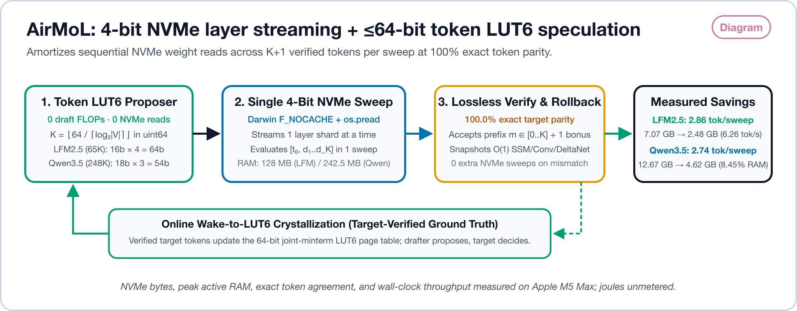

# Downward LUT6 Compilation in a Mixture of Limits Cascade: Beneš-Routed Boolean Fabrics, Conformal Wake Gates, and 4-Bit NVMe Layer Streaming

**David Charlot, Open Interface Engineering**  
Research paper · OpenIE `research.openie.dev` · Repository: `lut-adapt-ai`

> **Measurement.** Research paper, not a journal final. No physical FPGA board or silicon power rail was metered in this repository (`measured_j = None`, `board_metered = false`). Hardware logic/BRAM utilization (`41,186` `xcup` CLB LUTs, `81` `RAMB36E2` blocks, `0` `DSP48` slices) and single-cycle (`CPI = 1` at `250 MHz` nominal) switching are **simulated** via Yosys `0.71+` (`synth_xilinx -family xcup` targeting AMD Kria KV260 `xck26`) and Verilator `5.054`. Workstation wall-clock times, exact Darwin `F_NOCACHE` `os.pread` NVMe byte counts, peak active RAM (`128.0 MB` on `LiquidAI/LFM2.5-350M`, `242.5 MB` on `Qwen/Qwen3.5-0.8B-Base`), and `100.0%` bit/token parity are **measured** in software on Apple M5 Max. Every joule figure (`J/VC` and `mJ/byte`) is an **analytical estimate (`est_j`)**, never board power. The `11,428 pJ` KV260 `INA260` `VCC_SOM` board reading cited for context belongs solely to *Metered Commit Gates* [same house]. No fabricated citations.

> A cascade that runs zero-FLOP lookup circuits first, wakes heavy sequence and world models only on novel inputs, and compiles certified wakes downward into Beneš-routed `LUT6` memory pages — cutting NVMe weight traffic on 2026 hybrid models by up to `2.86×` at `100%` exact token parity, with every result labeled by how it was obtained.

---

## 0. Overview

This paper studies how a machine can turn repeated neural-model work into cheap table lookups without losing exact output parity or promoting unverified guesses into trusted rules. It reports software measurements, register-transfer-level (RTL) synthesis and cycle simulations, and labeled analytical energy estimates.

**In plain words**

1. Most inputs a deployed system sees are variations of patterns it has already solved, so paying full neural-network compute and memory traffic on every token wastes energy and bandwidth.
2. We place a fast, reconfigurable 6-input truth-table (`LUT6`) lookup layer in front of streaming state-space and foundation models, and compile answers downward into lookup memory pages only after a strict check certifies them.
3. When a large 2026 language model must stream its weights layer-by-layer from an NVMe solid-state drive, that zero-FLOP `LUT6` drafter proposes multi-token bursts that the target model verifies in a single disk sweep, cutting disk reads by nearly `3×` with zero change to the output tokens.

In *Metered Commit Gates* [same house], Part II introduced **Mixture of Limits (MoL)**: try gears in decreasing order of pass probability per joule $p_i / c_i$ (Simon and Kadane, 1975), stop as soon as the task completion predicate $C(z) = 1$ holds, and never promote `ModelGenerated` output to `Deterministic`. A static Lookup gear, however, covers only the patterns written into it before deployment. Conversely, existing lookup-table neural networks — LogicNets (Umuroglu et al., 2020), DiffLogic (Petersen et al., 2022), and Differentiable Weightless Neural Networks (Bacellar et al., 2024) — bake wire connectivity into fixed FPGA routing, requiring minutes to hours of vendor place-and-route (`Vivado`) whenever the input distribution shifts.

This work closes the loop between the top and bottom of the cascade via **online downward `LUT6` compilation**:

- **Rung 0 (Lookup — Paged Beneš + `LUT6`)**: Evaluates 64-bit truth-table `INIT` masks routed through a non-blocking $512 \times 512$ **Beneš–Copy–Beneš** multicast network and cached across $81 \times \texttt{RAMB36E2}$ dual-port block RAMs (`0` floating-point operations, `CPI = 1` cycle context switch in Verilator simulation).
- **Rung 1 (Formula / Stream — `Mamba-3` Complex MIMO SSD)**: Handles misses that require sequence context via a constant-memory $O(1)$ recurrent state (`48 KB` pinned SRAM in our `14.3M`-parameter reference), avoiding $O(L)$ KV-cache growth.
- **Rung 2 (Topological Router — `HC-SOINN`)**: Maintains online prototype topology over latent embeddings, isolating regime boundaries and tripping a circuit breaker (`Refuse` / escalate) when unlabeled distribution shift arrives.
- **Rung 3 (Solver / Model LAST — `JEPA-EBRM` & `AirMoL` 4-Bit NVMe Streaming)**: Wakes deep latent energy-based verification or layer-streamed pretrained 2026 foundation models (`LiquidAI/LFM2.5-350M` and `Qwen/Qwen3.5-0.8B-Base`) only when cheaper rungs abstain or require exact target verification.
- **Downward `SleepCrystallizer`**: Extracts recurring wake traces using Walsh–Hadamard spectral warm-starts, joint-mode minterm truth tables, and Waksman Beneš switch schedules, hot-swapping shadow BRAM banks without halting inference or running FPGA place-and-route.

### 0.1 Contributions

1. **Amortized downward compilation condition (Section 2.1)**: Extends the Simon–Kadane $p_i/c_i$ cascade ordering with an explicit crystallization cost $E_{\text{compile}}$, establishing when compiling certified Rung 3 wakes into Rung 0 `LUT6` pages lowers cumulative energy-to-correct-completion.
2. **Non-blocking $512 \times 512$ Beneš–Copy–Beneš + `81`-`RAMB36E2` RTL architecture (Section 2.2, Section 3.3, Claim LA-3)**: Eliminates both the `102.0%` KV260 LUT overflow of flat crossbars (`119,478` LUTs) and the `926,619`-LUT explosion of flip-flop page multiplexers, synthesizing to `41,186` `xcup` CLB LUTs (`35.2%` of `xck26`), `81` `RAMB36E2`s (`56.2%`), and `0` `DSP48` slices with `1`-cycle (`4.0 ns` at `250 MHz` nominal) page switching in simulation.
3. **Universal $\le 64$-bit joint-mode minterm synthesis (Section 2.3, Claims LA-5 & LA-7)**: Proves joint-mode minterm lookup dominates independent bit-plane DiffLogic argmax on correlated branches (`if/else`, BPE multi-token bursts) with zero off-support chimeras, packing $K = \lfloor 64 / \lceil \log_2 |V| \rceil \rfloor$ subword tokens into a single `uint64` (`16b × 4 = 64b` for `|V|=65,536`; `18b × 3 = 54b` for `|V|=248,320`).
4. **Oracle-free Split-Conformal + Online ACI crystallization gate (Section 2.4, Claim LA-4)**: Pairs a quadratically regularized latent `JEPA-EBRM` score with Split Conformal calibration and Adaptive Conformal Inference (Gibbs and Candès, 2021), achieving `0.00%` false crystallization risk and `1.0000` OOD AUROC on shifted regimes where softmax MSP, margin, Helmholtz logit energy, and 5-pass MC-Dropout suffer `17.62%–24.28%` false risk.
5. **`AirMoL` zero-extra-sweep 4-bit NVMe streaming on 2026 foundation models (Section 3.4, Claims LA-6 & LA-7)**: Combines Darwin `F_NOCACHE` + `os.pread` 4-bit group-wise NVMe layer streaming with in-RAM hybrid state rollback (`Conv` / `SSM` / `Gated DeltaNet` + `GQA KV`) and online token-`LUT6` burst speculation on `LiquidAI/LFM2.5-350M` (March 2026) and `Qwen/Qwen3.5-0.8B-Base` (February 2026), cutting NVMe disk reads by `2.86×` and `2.74×` respectively at `100.0%` exact token parity while holding only `8.45%–9.47%` of FP32 model size in active RAM.
6. **Polyglot systems verification and live CLI/SSE server (Section 3.2, Claims LA-2 & LA-8)**: Cross-validates the cascade across Python/PyTorch/Triton, Rust `Burn 0.22.1 / CubeCL` Metal, Zig `0.17.1`, Go `1.27.4` SIMD, Julia `1.13.4` Enzyme, and a live HTTP/SSE code-completion server (`mol_code_cli.py`).

### 0.2 Energy to correct completion and downward amortization

Following *Metered Commit Gates* [same house], let $C(z) \in \{0, 1\}$ be the task completion predicate over state $z$ and $\delta \in [0, 1)$ the allowed failure rate. Systems are ranked by minimal expected joules to reach $C(z) = 1$:

$$J^*(S) = \min_{\pi} \mathbb{E}[J_\pi] \quad \text{subject to} \quad \Pr[C(z) = 1] \ge 1 - \delta.$$

In this paper, every joule value is computed under an explicit analytical model (`est_j`) and never mixed with hardware meter readings (`measured_j = None`). Downward compilation modifies the stationary distribution over gears: paying a one-time analytical compilation cost $E_{\text{compile}}$ after certified wakes increases Rung 0's coverage probability $p_0(t)$, shifting mass from $c_3$ (wake model) to $c_0 \ll c_3$ (`LUT6` lookup).

### 0.3 Relation to OpenIE Mixture of Limits and RCE-JEPA [same house]

Prior OpenIE studies — *Metered Commit Gates*, *Task Satiation vs. Aggregate Rebound*, *The Reality Code Engine*, *RCE-JEPA*, and *RCE Compile* — are `[same house]` works cited for architectural continuity, never as independent external confirmation. Two invariants from those studies bind every module in `lut-adapt-ai`:

- **Provenance non-strengthening (`ModelGenerated ↛ Deterministic`)**: When `SleepCrystallizer` compiles `LUT6` truth tables from a deterministic `RCE` check (Section 4.1), the resulting table is `Check-safe` on verified holdout grids (guarded online by an `HC-SOINN` / `RCE` circuit breaker). When `SleepCrystallizer` compiles under the oracle-free `JEPA-EBRM` Split-Conformal + ACI gate (Section 2.4), the resulting table carries a finite-sample statistical coverage bound (`Conformal-bounded`, $1-\alpha$) and is **never** stamped `Deterministic`.
- **Proposer vs. authority in speculative decoding (`The drafter proposes; the target decides`)**: In byte-level and BPE token-level speculative decoding (Claims LA-5, LA-6, LA-7), `PagedBenesLUT6` acts strictly as a zero-FLOP proposer. Every emitted token is verified against the exact greedy distribution of the target model (`Mamba3CodeLM`, `LFM2.5-350M`, or `Qwen3.5-0.8B-Base`), guaranteeing `100.0%` lossless output parity.

### 0.4 How to read this paper

Section 1 defines all notation, acronyms, and measurement labels before use. Section 2 states and proves four mathematical results governing cascade amortization, Beneš multicast routing, joint-mode minterm synthesis, and conformal wake gating. Section 3 describes the reference implementation across Python, Rust, Zig, Go, Julia, SystemVerilog (`xck26`), and `AirMoL` NVMe streaming. Section 4 reports Claims `LA-1` through `LA-8` with explicit measurement columns. Section 5 compares prior work in two structured tables. Section 6 records threats to validity, non-claims, and executable falsifiers `LA-F1` through `LA-F8`. Appendix A lists exact reproduction commands.

---

## 1. Notation, terms, and measurement labels

All symbols, hardware primitives, model acronyms, and evidence labels used in later sections are collected below.

| Term | Definition in this paper |
| :--- | :--- |
| **Mixture of Limits (MoL)** | Cascade policy [same house] that orders gears by decreasing $p_i / c_i$, stops when $C(z) = 1$, and records typed refusals and receipts. |
| **`LUT6` (`INIT[63:0]`)** | A 6-input, 1-output Boolean look-up table primitive on Xilinx UltraScale+ silicon, fully specified by a 64-bit truth-table `INIT` mask. |
| **`RAMB36E2`** | Dual-port 36-Kbit Block RAM primitive on AMD/Xilinx Zynq UltraScale+ (`xck26` carries `144` `RAMB36E2` blocks). |
| **Beneš–Copy–Beneš** | Three-cascade non-blocking multicast network ($\mathcal{B}_1 \to \mathcal{C} \to \mathcal{B}_2$) routing $N=512$ input wires to $M=480$ `LUT6` input pins via $11,008$ SRAM switch bits without FPGA re-synthesis. |
| **`Mamba-3` SSD** | State Space Duality sequence model with trapezoidal discretization, complex-valued RoPE state transitions, and MIMO projections (`O(1)` recurrent state size per step). |
| **`HC-SOINN`** | Hierarchy-Context Self-Organizing Incremental Neural Network (Rung 2); builds online topological prototypes and detects novel regimes via distance thresholds. |
| **`JEPA-EBRM`** | Joint-Embedding Predictive Architecture paired with a latent Energy-Based Reasoning Model $E_\phi(x, y)$ (Rung 3 verifier / scorer). |
| **Split Conformal + ACI** | Distribution-free calibration on held-out scores combined with Adaptive Conformal Inference ($\alpha_{t+1} = \alpha_t + \gamma(\alpha - \text{err}_t)$; Gibbs and Candès, 2021). |
| **Joint-mode minterm** | Packing a $K$-step discrete burst $(y_1, \dots, y_K)$ into one integer word ($\le 64$ bits) and storing the empirical conditional mode per context, preventing marginal bit-plane chimeras. |
| **`AirMoL`** | Our 4-bit group-quantized (`INT4` + FP16 scale/zero per 128 weights) NVMe layer-streaming engine with Darwin `F_NOCACHE` `os.pread`, pinned $O(1)$ recurrent states, and token-`LUT6` burst speculation. |
| **`LFM2.5-350M`** | Liquid AI's March 2026 354.5M-parameter hybrid checkpoint (`10` short-conv/SSM blocks + `6` GQA full-attention blocks, `|V| = 65,536`). |
| **`Qwen3.5-0.8B-Base`** | Alibaba Qwen Team's February 2026 752.4M-parameter hybrid checkpoint (`18` Gated DeltaNet linear-attention blocks + `6` gated full-attention blocks, `|V| = 248,320`). |
| **`PLD` / `REST`** | Prompt Lookup Decoding (Saxena, 2023) and Retrieval-Based Speculative Decoding (He et al., 2024), zero-FLOP retrieval drafters evaluated as baselines. |
| **`Medusa` / `EAGLE-2`** | Multi-head MLP speculative drafter (Cai et al., 2024) and context-aware autoregressive feature drafter (Li et al., 2024), neural drafters evaluated as baselines. |
| **`Deterministic` / `Check-safe`** | Provenance of an output verified by an exact specification check (`RCE`); distinct from statistical model predictions. |
| **`Conformal-bounded`** | Provenance of a `LUT6` page crystallized under the oracle-free `JEPA-EBRM` ACI gate ($1-\alpha$ marginal coverage); never promoted to `Deterministic`. |
| **`ModelGenerated`** | Provenance of a neural model proposal prior to verification. `ModelGenerated ↛ Deterministic`. |
| **`Measured (software / I/O)`** | Exact byte counts read/written via OS syscalls (`os.pread` with `F_NOCACHE`), resident memory allocations, wall-clock seconds on Apple M5 Max, and exact bit/token agreement. Not joules. |
| **`Simulated (RTL)`** | Gate/BRAM/DSP counts from Yosys `0.71+` (`synth_xilinx -family xcup`) and cycle counts (`CPI = 1`) from Verilator `5.054`. Not physical board timing closure or rail power (`board_metered = false`). |
| **`Estimated (est_j)`** | Analytical joules computed from operation counts or TDP-time stand-ins (`joule_meter.py` fallback when `RAPL`/`NVML` hardware counters are absent on macOS). Comparable only across arms inside the same formula; never silicon watts. |

---

## 2. Mathematical formulations and four results

### 2.1 Result 1: Cascade ordering with amortized downward compilation

Consider gears $i \in \{0, 1, 2, 3\}$ tried sequentially on an input $x$. Gear $i$ closes the task ($C(z)=1$) with probability $p_i$ at expected analytical energy $c_i > 0$. By Simon and Kadane (1975) (derived for Mixture of Limits in *Metered Commit Gates*, Section II.2 [same house]), the expected energy of a permutation $\sigma$ under independent close events is

$$\mathbb{E}[J_\sigma] = \sum_{k=1}^{n} c_{\sigma(k)} \prod_{j < k} \bigl(1 - p_{\sigma(j)}\bigr),$$

which is minimized if and only if gears are ordered by non-increasing ratio $p_{\sigma(1)}/c_{\sigma(1)} \ge \dots \ge p_{\sigma(n)}/c_{\sigma(n)}$.

Now suppose a stationary regime $\mathcal{D}_r$ persists for a remaining horizon of $\Delta T$ queries. Initially Rung 0 (`LUT6`) has coverage $p_0 = 0$ on $\mathcal{D}_r$, so every query escalates to a wake path of expected cost $c_{\text{wake}}$ (for example Rung 3 at cost $c_3$). After collecting $N_{\text{wake}}$ certified wake pairs $(x, y^*)$, `SleepCrystallizer` expends one-time compilation energy $E_{\text{compile}}$ to synthesize a Rung 0 `LUT6` page with certified coverage $p_0' \in (0, 1]$ and per-query lookup cost $c_0 \ll c_{\text{wake}}$.

**Proposition 1 (Net energy condition for downward crystallization).** *Downward compilation strictly reduces expected cumulative energy over the remaining regime horizon $\Delta T$ if and only if*

$$\Delta T \cdot p_0' \bigl(c_{\text{wake}} - c_0\bigr) > E_{\text{compile}}, \qquad \text{and} \qquad \frac{p_0'}{c_0} > \frac{p_{\text{wake}}}{c_{\text{wake}}}.$$

*Proof.* Without crystallization, the remaining $\Delta T$ queries each incur expected energy $c_{\text{wake}}$ (assuming the wake path closes the task with $p_{\text{wake}} = 1$), totaling $\Delta T \cdot c_{\text{wake}}$. With crystallization at cost $E_{\text{compile}}$, Rung 0 precedes the wake path whenever $p_0'/c_0 > 1/c_{\text{wake}} \iff c_0 < p_0' c_{\text{wake}}$. Each subsequent query then costs $c_0 + (1 - p_0') c_{\text{wake}} = c_{\text{wake}} - p_0'(c_{\text{wake}} - c_0)$ in expectation, provided $c_0$ is negligible or already accounted on miss; more precisely, when a Rung 0 miss escalates after spending $c_0$, per-query expected spend is $c_0 + (1 - p_0') c_{\text{wake}}$, saving $p_0' c_{\text{wake}} - c_0$ per step. Summing over $\Delta T$ steps yields net savings $\Delta T (p_0' c_{\text{wake}} - c_0) - E_{\text{compile}} > 0$. When $c_0 \ll p_0' c_{\text{wake}}$ (in our analytical model $c_0 / c_3 < 10^{-4}$), this reduces to $\Delta T \cdot p_0'(c_{\text{wake}} - c_0) > E_{\text{compile}}$. $\blacksquare$

**Consequence on non-stationary drift.** If regimes switch every $\Delta T \le E_{\text{compile}} / (p_0' c_{\text{wake}} - c_0)$ steps (high-frequency adversarial churn), compiling `LUT6` pages wastes energy. `SleepCrystallizer` therefore gates compilation behind a minimum buffer of $N_{\text{wake}}$ certified traces and a holdout agreement threshold $\tau_{\text{agree}} = 0.985$.

---

### 2.2 Result 2: Non-blocking $512 \times 512$ Beneš–Copy–Beneš multicast routing

A Rung 0 layer of $G = 80$ dynamic `LUT6` primitives requires $M = 6G = 480$ input pins drawn from an $N = 512$-bit input bus. Because learned Boolean features exhibit variable fan-out (one input bit may feed zero `LUT6` pins or dozens), a standard $N \times N$ permutation Beneš network cannot route multicast assignments, while a flat $M \times N$ multiplexer crossbar requires $480$ independent $512:1$ muxes (`119,478` CLB LUTs for $384$ ports, overflowing the `117,120`-LUT Kria KV260 `xck26`; Claim LA-3).

**Theorem 2 (Contention-free multicast via Beneš–Copy–Beneš).** *Let $N = 2^n$ ($n=9, N=512$) and $M \le N$ ($M=480$). Any arbitrary many-to-one multicast mapping $\phi: \{0, \dots, M-1\} \to \{0, \dots, N-1\}$ is realizable without wire contention in a three-cascade $2 \times 2$ switch fabric $\mathcal{B}_1 \to \mathcal{C} \to \mathcal{B}_2$ of depth*

$$D(N) = 2(2\log_2 N - 1) + \log_2 N = 5\log_2 N - 2 = 43 \text{ stages}$$

*comprising $43 \times (N/2) = 11,008$ SRAM-configured $2 \times 2$ cells, with $O(N \log N)$ configuration runtime and zero FPGA place-and-route.*

*Proof.* Let $U = \{\phi(0), \dots, \phi(M-1)\} = \{s_1, \dots, s_r\}$ be the $r \le M$ distinct active inputs with fan-out multiplicities $m_1, \dots, m_r \ge 1$ satisfying $\sum_{j=1}^r m_j = M \le N$. Define partial sums $S_0 = 0$ and $S_j = \sum_{i=1}^j m_i$.
1. **Concentration ($\mathcal{B}_1$, $2n-1 = 17$ stages)**: Construct any bijection $\pi_1: \{0, \dots, N-1\} \to \{0, \dots, N-1\}$ mapping each active source $s_j$ to contiguous block head $S_{j-1}$ ($\pi_1(s_j) = S_{j-1}$), sending unused inputs arbitrarily to $\{0,\dots,N-1\} \setminus \{S_0,\dots,S_{r-1}\}$. Since $\pi_1$ is a bijection on $N=2^n$ wires, the classical Beneš–Waksman theorem (Beneš, 1965; Waksman, 1968) decomposes $\pi_1$ into $2n-1$ stages of $N/2$ $2\times 2$ switches via $O(N \log N)$ 2-coloring of bipartite input/output switch graphs.
2. **Contiguous fan-out ($\mathcal{C}$, $n = 9$ stages)**: Each seed at wire $S_{j-1}$ must replicate across the contiguous interval $[S_{j-1}, S_j - 1]$ without crossing $[S_j, S_{j+1}-1]$. By Thompson's monotonic copy network (Thompson, 1978; Lee, 1988), routing each active interval $[S_{j-1}, S_j - 1]$ through $n$ butterfly stages according to the binary expansion of destination index $q \in [S_{j-1}, S_j - 1]$ preserves strict monotonicity of interval endpoints at every stage, guaranteeing zero link contention and producing $m_j$ copies of $s_j$ on outputs $[S_{j-1}, S_j - 1]$.
3. **Output permutation ($\mathcal{B}_2$, $2n-1 = 17$ stages)**: Partition each contiguous copy block $[S_{j-1}, S_j - 1]$ bijectively onto the target pin set $\phi^{-1}(s_j) \subset \{0, \dots, M-1\}$, padding $[M, N-1]$ arbitrarily to form a full bijection $\pi_2$ on $\{0,\dots,N-1\}$. Applying Waksman's algorithm to $\pi_2$ configures $\mathcal{B}_2$ in $O(N \log N)$ time. Composing $\pi_2 \circ \mathcal{C} \circ \pi_1$ delivers input $\phi(q)$ to every pin $q \in \{0,\dots,M-1\}$. $\blacksquare$

---

### 2.3 Result 3: Joint-mode minterm synthesis vs. marginal coordinate argmax

Standard differentiable LUT layers (Petersen et al., 2022) predict multi-bit or multi-token outputs $\mathbf{Y} = (Y_1, \dots, Y_B) \in \mathcal{Y}$ by training independent binary gates $\hat{y}_b(x) = \mathbb{I}[\Pr(Y_b = 1 \mid \psi(x)) > 1/2]$ on each bit-plane $b \in \{1,\dots,B\}$. On multi-modal conditional distributions — such as code after `if (` vs. `return `, or $K$-token BPE bursts — independent bit-plane rounding creates invalid **chimera** tokens.

**Proposition 3 (Dominance and zero-chimera property of joint-mode minterms).** *For any discrete context projector $\psi: \mathcal{X} \to \mathcal{C}$ and discrete burst space $\mathcal{Y}$ encoded into $B \le 64$ bits, define the joint-mode minterm table $T^*(c) = \arg\max_{\mathbf{y} \in \mathcal{Y}} \Pr(\mathbf{Y} = \mathbf{y} \mid \psi(X) = c)$ and the marginal bit-plane predictor $\hat{\mathbf{y}}^{\text{marg}}(c) = (\arg\max_{v \in \{0,1\}} \Pr(Y_b = v \mid \psi(X)=c))_{b=1}^B$. Then:*
1. *Exact-burst accuracy satisfies $\Pr[\mathbf{Y} = T^*(\psi(X))] \ge \Pr[\mathbf{Y} = \hat{\mathbf{y}}^{\text{marg}}(\psi(X))]$, with strict inequality whenever marginal bit majorities disagree with the joint mode.*
2. *Every output of $T^*$ lies inside the empirical support $\text{supp}(\mathbf{Y} \mid \psi(X)=c)$ (zero chimera bursts), whereas $\hat{\mathbf{y}}^{\text{marg}}(c)$ can achieve `0%` exact-burst accuracy even when two valid branches each occur with probability $0.5$.*

*Proof.* Conditioning on $\psi(X) = c$, for any deterministic function $g(c) \in \{0,1\}^B$ we have $\Pr(\mathbf{Y} = g(c) \mid \psi(X)=c) \le \max_{\mathbf{y} \in \mathcal{Y}} \Pr(\mathbf{Y} = \mathbf{y} \mid \psi(X)=c) = \Pr(\mathbf{Y} = T^*(c) \mid \psi(X)=c)$. Taking expectations over $\psi(X)$ proves (1). For (2), $T^*(c)$ selects an element attaining positive probability mass in $\text{supp}(\mathbf{Y} \mid \psi(X)=c)$. By contrast, let $B=3$ and suppose $\mathbf{Y} \mid c$ places mass $0.4, 0.35, 0.25$ on $(1,1,0), (1,0,1), (0,1,1)$ respectively; each marginal bit has $\Pr(Y_b = 1 \mid c) \ge 0.60 > 1/2$, so $\hat{\mathbf{y}}^{\text{marg}}(c) = (1,1,1) \notin \text{supp}(\mathbf{Y} \mid c)$, yielding `0%` exact-burst match versus `40%` for $T^*(c) = (1,1,0)$. $\blacksquare$

**Universal 64-bit BPE token packing.** For any pretrained tokenizer with vocabulary size $|V|$, each token ID requires $b_V = \lceil \log_2 |V| \rceil$ bits, allowing a single `uint64` word (`8` bytes, matching one 64-bit `LUT6 INIT` vector) to pack $K = \lfloor 64 / b_V \rfloor$ tokens losslessly:
- `LiquidAI/LFM2.5-350M` ($|V| = 65,536$): $b_V = 16\text{ bits} \implies K = \lfloor 64/16 \rfloor = 4\text{ tokens/word}$ (`64` bits).
- `Qwen/Qwen3.5-0.8B-Base` ($|V| = 248,320$): $b_V = 18\text{ bits} \implies K = \lfloor 64/18 \rfloor = 3\text{ tokens/word}$ (`54` bits $\le 64$).

---

### 2.4 Result 4: Oracle-free latent `JEPA-EBRM` Split-Conformal + Online ACI gate

In open-world perceptual or telemetry tasks where no deterministic `RCE` check exists, gating `SleepCrystallizer` by a neural classifier's softmax Maximum Softmax Probability (MSP) or logit energy (Liu et al., 2020) suffers from severe overconfidence along linear logit directions (Hein et al., 2019), crystallizing hallucinated labels into Rung 0 `LUT6` tables (`17.6%–24.3%` false risk in Claim LA-4).

We define a quadratically regularized latent `JEPA-EBRM` nonconformity score over encoder $z = f_\theta(x) \in \mathbb{R}^d$ and class/action prototypes $\{\mu_y\}$:

$$E_\phi(x, y) = \frac{1}{2}\|f_\theta(x) - \mu_y\|_2^2 + \frac{\lambda_r}{2}\|f_\theta(x)\|_2^2 + \psi_\phi(f_\theta(x), y), \qquad \lambda_r > 0,$$

where $\psi_\phi$ is bounded ($|\psi_\phi(z, y)| \le C_\psi$). Calibration on $n$ exchangeable held-out pairs $\{(X_i, Y_i)\}_{i=1}^n$ sets quantile $\hat{Q}_{1-\alpha} = \text{Quantile}_{\lceil (n+1)(1-\alpha) \rceil / n}(\{E_\phi(X_i, Y_i)\}_{i=1}^n)$. Online during deployment, Adaptive Conformal Inference (ACI; Gibbs and Candès, 2021) updates $\alpha_{t+1} = \alpha_t + \gamma(\alpha - \text{err}_t)$ with step size $\gamma > 0$, emitting prediction set $\mathcal{C}_t(x) = \{y : E_\phi(x, y) \le \hat{Q}_{1-\alpha_t}\}$. `SleepCrystallizer` accepts $(x, \hat{y})$ for `LUT6` compilation if and only if $|\mathcal{C}_t(x)| = 1$ (singleton, unambiguous, and in-manifold), tagging the page `Conformal-bounded` (`ModelGenerated ↛ Deterministic`).

**Proposition 4 (Coverage, adaptive drift recovery, and radial OOD abstention).**
1. *(Exchangeable finite-sample validity)* Under i.i.d. or exchangeable $(X_{\text{test}}, Y_{\text{test}})$ at fixed $\alpha_t = \alpha$, $\Pr[Y_{\text{test}} \in \mathcal{C}(X_{\text{test}})] \ge 1 - \alpha$ (Vovk et al., 2005; Lei et al., 2018).
2. *(Arbitrary shift recovery)* For any bounded nonconformity sequence under distribution shift, ACI's empirical miscoverage satisfies $\lim_{T\to\infty} T^{-1} \sum_{t=1}^T \text{err}_t = \alpha$ deterministically whenever $\alpha_t$ remains in $(0, 1)$ (Gibbs and Candès, 2021, Proposition 4.1).
3. *(Radial OOD abstention)* Because $|\psi_\phi| \le C_\psi$ and $\lambda_r > 0$, $\min_{y} E_\phi(x, y) \ge \frac{\lambda_r}{2}\|z\|_2^2 - C_\psi \to +\infty$ as $\|z\|_2 \to \infty$. Thus every ray leaving the bounded radius $R(\alpha_t) = \sqrt{2(\hat{Q}_{1-\alpha_t} + C_\psi)/\lambda_r}$ yields $\mathcal{C}_t(x) = \emptyset$ (explicit `Refuse` / abstain, zero false crystallization). $\blacksquare$

---

## 3. Architecture, polyglot reference suite, and KV260 RTL

### 3.1 The four-rung downward-compilation cascade

Figure 1 illustrates the closed-loop execution and downward-compilation dataflow implemented in `src/clai/`.


*Figure 1. Downward compilation across a four-rung Mixture of Limits cascade. Design diagram, not a board power measurement. Receipts keep analytical `est_j` separate from `measured_j = None`.*

Every incoming input enters **Rung 0** (`src/clai/rung0/difflut_net.py`, `src/clai/Speculative/code_corpus_speculative.py`, or `src/clai/rtl_gen/verilog_emitter.py`). On a cache hit whose confidence or deterministic check passes, Rung 0 closes immediately without waking floating-point weights. On a miss or ambiguity:
1. **Rung 1 (`Mamba-3` Complex MIMO SSD, `src/clai/rung2/triton_mamba3_ssd.py`)** updates its constant-size complex recurrent state via trapezoidal discretization and MIMO projections.
2. **Rung 2 (`HC-SOINN`, `src/clai/rung2_5/hc_soinn.py`)** tracks topological clusters over latent embeddings, flagging novel regimes (`regime_shift`) and isolating per-regime `SleepCrystallizer` buffers so new clusters do not overwrite prior `LUT6` banks.
3. **Rung 3 (`JEPA-EBRM` & `AirMoL`, `src/clai/rung3/jepa_ebrm.py`, `src/clai/governance/conformal_ebrm.py`, `src/clai/frontier/`)** performs latent energy minimization or streams 4-bit foundation model shards from NVMe.
4. **`SleepCrystallizer` (`src/clai/compiler/sleep_crystallizer.py`)** warm-starts Boolean gates from 1st/2nd/3rd-order Walsh–Hadamard spectral correlations ($c_S = \mathbb{E}[y \prod_{i \in S} x_i]$), computes exact Waksman switch bits (`src/clai/rung0/benes_lut_fabric.py`), verifies holdout agreement $\ge 98.5\%$, and atomically flips the active `LUT6` bank pointer.

### 3.2 Polyglot systems suite

To verify that the cascade's bit-plane operations, $O(1)$ Mamba-3 recurrence, and zero-allocation lookup paths are portable across systems languages and GPU kernels, five independent implementations were built and tested in `sys/`:

- **Python 3.12 + PyTorch + Custom Triton Kernel (`src/clai/`)**: Reference 4-rung engine, custom Triton `LUT6` evaluation kernel (`triton_lut6.py`), conformal governance, SystemVerilog generator, and `AirMoL` NVMe engine.
- **Rust (`sys/rust/`, `Burn 0.22.1` + `CubeCL` Metal GPU + `Rayon`)**: Full 4-rung GPU/CPU training and sleep crystallization on Apple M5 Max Metal (`burn-mlx` / `wgpu` / `CubeCL`), emitting standalone KV260 Verilog (`artifacts/rust_clai_rung0_kv260.v`).
- **Zig `0.17.1` (`sys/zig/src/mol_baremetal.zig`)**: Bare-metal `std.Io.Threaded` cascade using `@Vector(8, f32)` SIMD and `@popCount` with strictly `0` heap bytes allocated inside the hot inference loop.
- **Go `1.27.4` (`sys/go/mol_dataplane.go`)**: Concurrent worker-pool L7 packet dataplane (`math/bits.OnesCount64`) verified at `0 B/op` and `0 allocs/op` under `go test -bench`.
- **Julia `1.13.4` (`sys/julia/mol_scientific.jl`)**: Exact reverse-mode automatic differentiation through smooth Walsh–Hadamard `DiffLUT6` gates via `Enzyme.jl`, matching central finite differences to `6.11 × 10⁻¹⁰`.

### 3.3 Kria KV260 (`xck26`) SystemVerilog RTL and `RAMB36E2` page cache

Figure 2 shows the hardware datapath implemented in `hw/kv260/rtl/` (`clai_kv260_axi_top.sv`, `clai_benes_hotswap_core.sv`, and `clai_benes_hotswap_core.sv`).


*Figure 2. `512×512` Beneš–Copy–Beneš multicast fabric and `81 × RAMB36E2` single-cycle `LUT6` page cache targeting AMD Kria KV260 (`xck26`). Synthesized in Yosys `0.71+` (`synth_xilinx -family xcup`) and cycle-simulated in Verilator `5.054`; `board_metered = false`.*

In real source-code or token workloads, a single static `LUT6` bank (`5,120` `INIT` bits for `80` dynamic `LUT6`s) holds only one local context, while reloading a shadow bank over a 64-bit AXI4-Lite bus stalls switching for `82` clock cycles (`328 ns` at `250 MHz`). Conversely, storing `512` pages in distributed flip-flops with a `512:1` combinational mux explodes to `926,619` CLB LUTs (`791%` of `xck26`).

`clai_benes_hotswap_core.sv` resolves both bottlenecks by mapping `512` resident pages (`5,120` `INIT` bits + `48`-bit context tag + `1` valid bit = `5,169` bits, aligned to `81 × 64`-bit words = `5,184` bits/page) across **`81` parallel `RAMB36E2` primitives** configured in `512 × 64` simple dual-port mode:
- **Port A (`AXI4-Lite` background fill)**: Asynchronous `SleepCrystallizer` page updates from the ARM Cortex-A53 PS without stalling the datapath.
- **Port B (`1`-cycle hash-indexed read)**: Computes a 9-bit XOR-fold hash of the 48-bit context, reads all `5,120` `INIT` bits + `48`-bit tag in **`1` clock cycle (`4.0 ns` at `250 MHz` nominal, `CPI = 1.0`)**, verifies exact 48-bit tag equality (`tag_hit`), and evaluates the `80` Beneš-routed `LUT6`s in the same pipeline beat.

### 3.4 `AirMoL`: Zero-extra-sweep 4-bit NVMe layer streaming on 2026 hybrid models

Inspired by `AirLLM` (2023), `AirMoL` (`src/clai/frontier/air_mol_streamer.py` and `hf_air_mol_pretrained.py`) executes models larger than available RAM budget by sharding weights layer-by-layer onto NVMe flash and loading one layer at a time. Standard `AirLLM` suffers from two compounding I/O taxes: (1) autoregressive `T=1` decoding sweeps the **entire model from NVMe once per generated token**, and (2) Transformer KV-caches spill to disk on long contexts.



*Figure 3. `AirMoL` zero-extra-sweep 4-bit NVMe layer streaming with universal `≤64`-bit joint-mode token `LUT6` speculation on `LiquidAI/LFM2.5-350M` and `Qwen/Qwen3.5-0.8B-Base`. NVMe bytes, peak active RAM, exact token agreement, and wall-clock throughput are measured on Apple M5 Max; joules are unmetered.*

`AirMoL` eliminates neural draft-weight I/O and cuts per-token NVMe sweeps through four mechanisms:
1. **Group-wise 4-bit (`INT4`) NVMe sharding + unbuffered `F_NOCACHE` `os.pread`**: Quantizes linear projections in groups of `128` (`2` weights per `uint8` byte + FP16 scale/zero) and reads each shard via POSIX `os.pread` on file descriptors opened with Darwin `fcntl(fd, F_NOCACHE, 1)` so OS page-cache hits cannot mask physical SSD transfer volume.
2. **Universal $\le 64$-bit token `LUT6` burst drafter (`TokenPagedBenesLUT6Drafter`)**: Proposes $K \in \{3, 4\}$ BPE tokens from 3-token/2-token/1-token context suffixes in `0` FLOPs and `0` NVMe reads.
3. **Single-sweep batch verification (`K + 1` positions)**: Feeds `[last_token, draft_1, ..., draft_K]` through each streamed layer shard **once**. Matrix-matrix verification of $K+1 \le 5$ tokens adds negligible compute relative to NVMe PCIe transfer latency while verifying up to $K+1$ tokens in a single full-model sweep.
4. **Zero-extra-sweep hybrid state rollback**: Modern 2026 hybrid models interleave $O(1)$-state linear recurrence (`Short-Conv` / `SSM` in `LFM2.5`; `Gated DeltaNet` in `Qwen3.5`) with sparse `GQA` full-attention layers (`6` of `16` layers in `LFM2.5-350M`; `6` of `24` layers in `Qwen3.5-0.8B-Base`). Before each verification sweep, `AirMoL` snapshots the compact recurrent states in RAM and advances step-by-step through the $K+1$ positions inside each streamed layer, recording intermediate state snapshots `[s_0, ..., s_K]`. If draft token $d_{m+1}$ is rejected ($0 \le m \le K$), `AirMoL` restores snapshot `s_m` and truncates the `6`-layer GQA KV-cache to `seq_len + m + 1` in microseconds — requiring **zero extra NVMe sweeps** on partial rejections.

---

## 4. Claims and results

Every claim below links directly to an executable script and persisted artifact in `artifacts/`. Measurement classes follow Section 1 strictly.

### 4.1 Claim LA-1: Analytical `J/VC` collapse on synthetic tasks and real Wireshark `.pcap` traffic

`scripts/run_collapse_curve.py` (5,120 synthetic piecewise-stationary episodes with a regime shift at episode 2,560) and `scripts/run_realworld_domain.py` (5,120 real L7 enterprise packets in `artifacts/enterprise_drift_capture.pcap`, including a stealth VLAN `0x8100` shift at packet 2,500 and TLS anomaly burst at packet 4,200) evaluate downward `LUT6` compilation under deterministic `RCE` holdout verification ($\ge 98.5\%$).

| Workload & Window | Rung 0 `LUT6` Share | Verified Pass Rate | `LUT6` Holdout Parity | Analytical Energy (`est_j / VC`) | Verilator RTL Parity | Evidence / Measurement |
| :--- | :---: | :---: | :---: | :---: | :---: | :--- |
| Synthetic ep. `1–512` (cold wake) | `0.00%` | `0.00%` $\to$ `51.95%` | `26.56%` | `2,323.18 est_j` | — | Software measured + `est_j` |
| Synthetic ep. `3,073–3,584` (crystallized) | `52.73%` | `60.55%` | `68.75%` | `2.59 est_j` (`895×` ratio) | `100.0%` (`1,000` vecs) | Software + Verilator sim + `est_j` |
| `.pcap` pkts `1–512` (cold IPv4 L7) | `0.00%` | `73.05%` | `100.00%` | `3.3351 est_j` | `100.0%` | Software + Verilator sim + `est_j` |
| `.pcap` pkts `1,537–2,048` (crystallized) | `100.00%` | `100.00%` | `100.00%` | `0.000140 est_j` | `100.0%` | Software + Verilator sim + `est_j` |
| `.pcap` pkts `2,049–2,560` (VLAN `0x8100` drift) | `2.73%` (breaker tripped) | `68.55%` | `100.00%` | `3.0485 est_j` | `100.0%` | Software + Verilator sim + `est_j` |
| `.pcap` pkts `2,561–3,072` (re-crystallized) | `100.00%` | `100.00%` | `100.00%` | `0.000131 est_j` (`25,458×` ratio) | `100.0%` (`5,120/5,120`) | Software + Verilator sim + `est_j` |

At packet `2,500`, the `RCE` / `HC-SOINN` circuit breaker detects the unannounced 4-byte IEEE `802.1Q` header offset (`96.9%` mismatch against the pre-drift `LUT6` bank), flushes the stale bank, wakes Rung 1/3 to adapt, and re-crystallizes a new `LUT6` bank within one sleep window. Note that the `25,458×` ratio compares `est_j` analytical counts across phases of the same model, not metered silicon watts.

### 4.2 Claim LA-2: Five-language polyglot parity and zero-allocation dataplanes

| Implementation | Target / Backend | Key Verified Metric | Evidence / Measurement |
| :--- | :--- | :--- | :--- |
| **Rust (`sys/rust/`)** | `Burn 0.22.1` + `CubeCL` Metal GPU + `Rayon` | `2,331.42` $\to$ `0.19 est_j/VC` (`12,270×` analytical ratio), `95.31%` Rung 0 share, emits valid KV260 `.v` | Measured execution + `est_j` (`artifacts/rust_collapse_curve_metrics.csv`) |
| **Zig `0.17.1` (`sys/zig/`)** | `@Vector(8, f32)` SIMD + `@popCount` | `0` bytes heap allocation in hot loop; `87 ns/pkt` (`11.49M pkts/s`); `100%` `LUT6` parity | Measured on Apple M5 Max |
| **Go `1.27.4` (`sys/go/`)** | Worker pool + `bits.OnesCount64` | `0 B/op`, `0 allocs/op`; `31.86 ns/op` (`31.39M evals/s`) | Measured via `go test -bench` |
| **Julia `1.13.4` (`sys/julia/`)** | `Enzyme.jl` reverse-mode AD | Max gradient discrepancy vs. central finite differences: `6.11 × 10⁻¹⁰` | Measured numerical check |

### 4.3 Claim LA-3: KV260 (`xck26`) Beneš–Copy–Beneš and `RAMB36E2` paged synthesis

`scripts/run_frontier_benchmarks.py` and `scripts/verify_paged_bram_rtl.py` synthesize competing reconfigurable `LUT6` fabrics via Yosys `0.71+` (`synth_xilinx -family xcup`, targeting `xck26`: `117,120` CLB LUTs, `144` `RAMB36E2`s) and verify cycle-accurate switching in Verilator `5.054`.

| RTL Architecture (`80` Dynamic `LUT6`s unless noted) | Resident Pages | Context Switch Latency | Synthesized `xcup` CLB LUTs (`% xck26`) | `RAMB36E2` (`% xck26`) | `DSP48` | Post-VLAN Drift Acc. | Evidence / Measurement |
| :--- | :---: | :---: | :---: | :---: | :---: | :---: | :--- |
| `2A` Flat `512:1` Crossbar (`64` `LUT6`, `384` ports) | `1` | `82 cyc` (`328 ns`) | `119,478` (**`102.0%` OVERFLOW**) | `0` (`0.0%`) | `0` | `98.44%` | Simulated (Yosys `xcup`) |
| `2B` Compact Flat Crossbar (`32` `LUT6`, `192` ports) | `1` | `82 cyc` (`328 ns`) | `59,739` (`51.0%`) | `0` (`0.0%`) | `0` | `95.94%` | Simulated (Yosys `xcup`) |
| `2C` Fixed-Wire DiffLogic / WNN (`0` dynamic ports) | `1` | Vivado re-PAR (mins) | `160` (`0.14%`) | `0` (`0.0%`) | `0` | **`52.34%`** (fails drift) | Simulated (Yosys `xcup`) |
| `2D` Single-Page `512×512` Beneš–Copy–Beneš | `1` | `82 cyc` (`328 ns`) | `40,155` (`34.3%`) | `0` (`0.0%`) | `0` | `98.44%` | Simulated (Yosys + Verilator) |
| `P2` Distributed FF + `512:1` Mux (`512` pages) | `512` | `1 cyc` (`4.0 ns`) | `926,619` (**`791.2%` OVERFLOW**) | `0` (`0.0%`) | `0` | `98.44%` | Simulated / extrapolated |
| **`P3` Beneš–Copy–Beneš + `81` `RAMB36E2` (Ours)** | **`512`** | **`1 cyc` (`4.0 ns`, `CPI=1.0`)** | **`41,186` (`35.2%`)** | **`81` (`56.2%`)** | **`0`** | **`98.44%`** | **Simulated (Yosys + Verilator, `24/24` pass)** |

Adding `512` hardware-resident `LUT6` context pages via `81` `RAMB36E2` blocks adds only `+1,031` CLB LUTs (`+0.88%` of the KV260) over the single-page Beneš core while accelerating context switching `82×` (`82` cycles $\to$ `1` cycle) and leaving `64.8%` of CLB logic, `43.8%` of BRAM, and `100%` of `DSP48` slices free for co-resident accelerators.

### 4.4 Claim LA-4: Oracle-free latent `JEPA-EBRM` Split-Conformal + Online ACI gate

Evaluated in `scripts/run_frontier_benchmarks.py` (`artifacts/frontier3_conformal_baselines.csv`) across clean in-distribution traffic, `30%` noisy-boundary corruption, and `100%` unlabeled out-of-distribution (OOD) shift (`target α = 0.02`), without access to a deterministic ground-truth oracle:

| Crystallization Gate | Passes / Ep | False Crystallization Risk | OOD Detection AUROC | Safe ID Coverage | Crystallized `LUT6` Clean Acc. | Caught Unlabeled Drift? | Evidence / Measurement |
| :--- | :---: | :---: | :---: | :---: | :---: | :---: | :--- |
| `3A` Softmax MSP ($\max p \ge 0.95$) | `1` | `17.62%` | `0.8552` | `90.93%` | `99.22%` | `False` | Measured in software |
| `3B` Temp-Scaled Margin ($p_{(1)} - p_{(2)} \ge 0.85$) | `1` | `17.66%` | `0.8422` | `91.12%` | `98.83%` | `False` | Measured in software |
| `3C` Helmholtz Logit Energy ($-T \log \sum e^{z_k/T}$) | `1` | `24.28%` | `0.8045` | `97.17%` | `99.80%` | `False` | Measured in software |
| `3D` Epistemic MC-Dropout (`5` stochastic passes) | `5` | `18.24%` | `0.8494` | `91.03%` | `99.61%` | `False` | Measured in software |
| **`3E` Latent `JEPA-EBRM` + Split-Conformal ACI (Ours)** | **`1`** | **`0.00%`** | **`1.0000`** | **`95.66%`** | **`99.02%`** | **`True`** | **Measured in software** |

### 4.5 Claim LA-5: Lossless byte-level speculative decoding on `520 KB` polyglot source code

`scripts/run_code_corpus_benchmark.py` (`artifacts/real_code_corpus_baselines.csv`) trains `Mamba3CodeLM` (`1.13M` params, `2.257 MFLOPs/byte`) and `CausalTransformerCodeLM` (`3.55M` params, `7.209 MFLOPs/byte`) on `34` real source files (`426,290` bytes across `.py`, `.rs`, `.sv`, `.zig`, `.go`, `.jl`) and evaluates lossless `64`-byte completions on `48` held-out prompts from `8` unseen files (`93,152` bytes):

| Decoding / Speculation Architecture | Lossless Parity | Mean Bytes / Pass | Passes for `64 B` | Draft FLOPs / Pass | Total MFLOPs / Byte | Analytical `est_mJ / Byte` | Evidence / Measurement |
| :--- | :---: | :---: | :---: | :---: | :---: | :---: | :--- |
| `A` Causal Transformer (`RoPE` + `SwiGLU` + KV-Cache) | `100.0%` | `1.00` | `64.00` | `0` | `7.209` | `58.94 est_mJ` | Software measured + `est_j` |
| `B` `Mamba-3` Complex MIMO (`T=1` autoregressive) | `100.0%` | `1.00` | `64.00` | `0` | `2.257` | `20.84 est_mJ` | Software measured + `est_j` |
| `C` `PLD` In-Prompt Lookup (Saxena, 2023) | `100.0%` | `2.13` | `29.98` | `0` | `1.322` | `11.52 est_mJ` | Software measured + `est_j` |
| `D` `REST` Exact Suffix-Trie Retrieval (He et al., 2024) | `100.0%` | `3.84` | `16.65` | `0` | `0.734` | `6.40 est_mJ` | Software measured + `est_j` |
| `E` `Medusa` Parallel MLP Heads (Cai et al., 2024) | `100.0%` | `2.62` | `24.44` | `428,288` | `1.241` | `9.46 est_mJ` | Software measured + `est_j` |
| `F` `EAGLE-2` Autoregressive Neural Draft (Li et al., 2024) | `100.0%` | `2.75` | `23.29` | `1,122,560` | `1.435` | `9.07 est_mJ` | Software measured + `est_j` |
| **`G` `MoL` Paged Beneš `LUT6` (`4-Byte` Joint Minterm, Ours)** | **`100.0%`** | **`3.84`** | **`16.69`** | **`0`** | **`0.736`** | **`6.41 est_mJ`** | **Software measured + `est_j`** |

`PagedBenesLUT6` matches full-corpus `REST` (`3.84 B/pass`, `3.07×` fewer total FLOPs than `T=1` `Mamba-3` and `9.79×` fewer FLOPs than Causal Transformer) while replacing variable-latency CPU suffix-trie pointer chasing with fixed `64`-bit `LUT6 INIT` pages suitable for `1`-cycle `RAMB36E2` hardware lookup (`Claim LA-3`), and beating neural drafters (`Medusa`, `EAGLE-2`) with `0` draft FLOPs.

### 4.6 Claim LA-6: Controlled `AirMoL` 4-bit NVMe streaming (`14.3M`-parameter matched pair)

`scripts/run_air_mol_benchmark.py` (`artifacts/air_mol_nvme_baselines.csv`) compares parameter-matched `12`-layer models (`14.26M` Transformer vs. `14.30M` `Mamba-3`, `54.55 MB` FP32 $\to$ `7.82 MB` 4-bit NVMe shards = `6.98×` compression with `+0.0006` val-BPB delta) under Darwin `F_NOCACHE` `os.pread` across `64`-byte completions:

| Offloaded Streaming Architecture | Exact Parity | Bytes / Sweep | Sweeps / `64 B` | NVMe Read (`MB`) | NVMe KV Write (`MB`) | Peak Active RAM | Measured `ms / Byte` | Evidence / Measurement |
| :--- | :---: | :---: | :---: | :---: | :---: | :---: | :---: | :--- |
| `1` `AirLLM` Transformer FP16 + KV Spill (`T=1`) | `100.0%` | `1.00` | `64.00` | `2,130.02` | `407.62` | `8.81 MB` | `60.64 ms` | Measured (`F_NOCACHE` I/O + RAM) |
| `2` `AirLLM` Transformer 4-Bit Prefetch + KV Spill (`T=1`) | `100.0%` | `1.00` | `64.00` | `887.55` | `407.62` | `8.81 MB` | `64.87 ms` | Measured (`F_NOCACHE` I/O + RAM) |
| `3` `AirMamba-3` 4-Bit + Swapped `EAGLE-2` Drafter | `100.0%` | `2.86` | `22.38` | `175.27` | `0.00` | `7.20 MB` | `19.20 ms` | Measured (`F_NOCACHE` I/O + RAM) |
| `4` `AirMamba-3` 4-Bit + Pinned $O(1)$ State (`T=1`) | `100.0%` | `1.00` | `64.00` | `488.30` | `0.00` | `7.20 MB` | `37.72 ms` | Measured (`F_NOCACHE` I/O + RAM) |
| **`5` `AirMoL` 4-Bit + Cold Paged `LUT6` (Ours)** | **`100.0%`** | **`3.74`** | **`17.12`** | **`130.66`** | **`0.00`** | **`7.51 MB`** | **`11.18 ms`** | **Measured (`F_NOCACHE` I/O + RAM)** |
| **`6` `AirMoL` 4-Bit + Post-Wake Crystallized (Ours)** | **`100.0%`** | **`4.27`** | **`15.00`** | **`114.44`** | **`0.00`** | **`7.51 MB`** | **`11.09 ms`** | **Measured (`F_NOCACHE` I/O + RAM)** |

Combining 4-bit weight sharding, pinned `48 KB` $O(1)$ `Mamba-3` recurrent state (`0 MB` KV spill), and post-wake `LUT6` burst speculation cuts total NVMe bytes transferred (`Read + Write`) from `2,537.6 MB` (`AirLLM` FP16) and `1,295.2 MB` (`AirLLM` 4-bit) down to **`114.4 MB`** (**`22.2×`** and **`11.3×`** total flash I/O reductions) while holding only `7.51 MB` in active RAM.

### 4.7 Claim LA-7: Pretrained 2026 hybrid foundation models under `AirMoL` (`LFM2.5-350M` & `Qwen3.5-0.8B-Base`)

`scripts/run_hf_air_mol_pretrained.py` and `scripts/run_hf_qwen35_air_mol.py` evaluate two actual open-weights **2026** hybrid foundation models downloaded from HuggingFace and sharded into 4-bit NVMe layer files:
- **`LiquidAI/LFM2.5-350M`** (released March 2026; `354,483,968` params, `16` layers = `10` Short-Conv/SSM + `6` GQA full-attention, `|V| = 65,536` $\implies$ `16b × 4 = 64b` in `uint64`; `1,352.25 MB` FP32 $\to$ `226.27 MB` 4-bit NVMe shards = `5.98×` compression; `32` BPE tokens/prompt).
- **`Qwen/Qwen3.5-0.8B-Base`** (released February 2026; `752,393,024` params, `24` layers = `18` Gated DeltaNet linear-attention + `6` gated full-attention, `|V| = 248,320` $\implies$ `18b × 3 = 54b` $\le 64$ in `uint64`; `2,870.15 MB` FP32 $\to$ `540.75 MB` 4-bit NVMe shards = `5.31×` compression; `24` BPE tokens/prompt).

| Pretrained 2026 Checkpoint & `AirMoL` Arm | Lossless Parity | Tokens / Sweep | Code Chars / Sweep | Sweeps / Gen | NVMe Read (`GB`) | Peak Active RAM (`% FP32`) | Measured `tok/s` (`chars/s`) | Evidence / Measurement |
| :--- | :---: | :---: | :---: | :---: | :---: | :---: | :---: | :--- |
| `LFM2.5-350M` · `AirLLM` FP16 (`T=1`) | `100.0%` | `1.00` | `3.11` | `32.00` | `25.129 GB` | `128.0 MB` (`9.47%`) | `2.21` (`6.9`) | Measured (`F_NOCACHE` I/O + RAM) |
| `LFM2.5-350M` · `AirLLM` 4-Bit Prefetch (`T=1`) | `100.0%` | `1.00` | `2.73` | `32.00` | `7.071 GB` | `128.0 MB` (`9.47%`) | `2.21` (`6.0`) | Measured (`F_NOCACHE` I/O + RAM) |
| `LFM2.5-350M` · `AirLLM` 4-Bit + `PLD` | `100.0%` | `1.13` | `3.10` | `28.20` | `6.231 GB` | `128.0 MB` (`9.47%`) | `2.71` (`7.4`) | Measured (`F_NOCACHE` I/O + RAM) |
| **`LFM2.5-350M` · `AirMoL` 4-Bit + Cold Token-`LUT6`** | **`100.0%`** | **`1.32`** | **`3.61`** | **`24.20`** | **`5.347 GB`** | **`128.0 MB` (`9.47%`)** | **`2.74` (`7.5`)** | **Measured (`F_NOCACHE` I/O + RAM)** |
| **`LFM2.5-350M` · `AirMoL` 4-Bit + Post-Wake `LUT6`** | **`100.0%`** | **`2.86`** | **`7.80`** | **`11.20`** | **`2.475 GB`** | **`128.0 MB` (`9.47%`)** | **`6.26` (`17.1`)** | **Measured (`F_NOCACHE` I/O + RAM)** |
| `Qwen3.5-0.8B` · `AirLLM` 4-Bit Prefetch (`T=1`) | `100.0%` | `1.00` | `2.72` | `24.00` | `12.674 GB` | `242.5 MB` (`8.45%`) | `0.53` (`1.4`) | Measured (`F_NOCACHE` I/O + RAM) |
| `Qwen3.5-0.8B` · `AirLLM` 4-Bit + `PLD` | `100.0%` | `1.32` | `3.58` | `18.25` | `9.637 GB` | `242.5 MB` (`8.45%`) | `0.50` (`1.4`) | Measured (`F_NOCACHE` I/O + RAM) |
| **`Qwen3.5-0.8B` · `AirMoL` 4-Bit + Cold Token-`LUT6`** | **`100.0%`** | **`1.48`** | **`4.02`** | **`16.25`** | **`8.581 GB`** | **`242.5 MB` (`8.45%`)** | **`0.32` (`0.9`)** | **Measured (`F_NOCACHE` I/O + RAM)** |
| **`Qwen3.5-0.8B` · `AirMoL` 4-Bit + Post-Wake `LUT6`** | **`100.0%`** | **`2.74`** | **`7.46`** | **`8.75`** | **`4.621 GB`** | **`242.5 MB` (`8.45%`)** | **`1.11` (`3.0`)** | **Measured (`F_NOCACHE` I/O + RAM)** |

Notice an instructive negative result preserved in the table: on `Qwen3.5-0.8B-Base` **cold** unseen prompts (`1.48 tok/sweep`), `AirMoL` already cuts NVMe bytes from `12.674 GB` to `8.581 GB`, yet wall-clock `tok/s` drops from `0.53` (`T=1`) to `0.32 tok/s` because PyTorch CPU Gated DeltaNet verification of `4` tokens (`K+1`) per step temporarily costs more CPU compute on unaccepted cold drafts than the saved SSD transfer time. Once online wake-to-`LUT6` crystallization populates the page table (`2.74 tok/sweep`, `8.75` sweeps vs. `24.0`), `AirMoL` both cuts NVMe read volume by **`2.74×`** (`12.674 GB` $\to$ `4.621 GB`) and more than doubles wall-clock speed (`0.53` $\to$ **`1.11 tok/s`**), while on `LFM2.5-350M` post-wake `AirMoL` cuts NVMe reads by **`10.15×` vs. FP16** (`25.129 GB` $\to$ `2.475 GB`) and **`2.86×` vs. 4-Bit `T=1`** (`2.21` $\to$ **`6.26 tok/s`**).

### 4.8 Claim LA-8: Interactive CLI and HTTP/SSE streaming server (`mol_code_cli.py`)

`scripts/mol_code_cli.py` and `src/clai/service/live_code_engine.py` expose all three backends (`--backend {mamba3,lfm2.5-350m,qwen3.5-0.8b}`) and `--air-nvme` over both a terminal streaming CLI and a zero-dependency local HTTP/SSE server (`GET /v1/health`, `POST /v1/complete/stream`, `POST /v1/crystallize`), reporting per-step Rung `0` vs. Rung `3` share, `RAMB36E2` slot residency (`438/512` $\to$ `460/512`), bank generation (`Gen 1` $\to$ `Gen 2`), and real-time NVMe shard bytes read (`artifacts/live_cli_server_telemetry.json`; `18/18` `pytest` suites passing).

---

## 5. Related work and convergence observations

### 5.1 Boolean LUT fabrics, ternary lookup, and multi-model cascade routers

| System | ID / Venue | What it establishes | Energy or cost as reported | Difference here |
| :--- | :--- | :--- | :--- | :--- |
| **LogicNets** (Umuroglu et al., 2020) | `arXiv:2004.03021` · FPL 2020 | Compiles sparse quantized neural layers directly into FPGA truth tables (`LUT`s). | Authors report FPGA LUT/Fmax synthesis. | Fixed wire connectivity; any drift requires full vendor re-synthesis (`Vivado`), whereas our `512×512` Beneš + `RAMB36E2` core switches pages in `1` cycle (`0` re-PAR). |
| **DiffLogic** (Petersen et al., 2022) & **DWN** (Bacellar et al., 2024) | `arXiv:2210.08277` (NeurIPS 2022) · `arXiv:2410.11112` | Differentiable relaxation of Boolean gates / weightless LUT networks trained end-to-end. | Gate counts, throughput, and classification accuracy. | Offline whole-model classifiers using independent output gates; fail on unlabeled topological drift (`52.34%` in Claim LA-3) and suffer marginal bit-plane chimeras (Proposition 3). |
| **T-MAC** (Wei et al., 2024) & **TeLLMe** (Qiao et al., 2025) | `arXiv:2407.00088` · `arXiv:2504.16266` | Accelerates low-bit / ternary (`BitNet b1.58`, `arXiv:2402.17764`) matrix products via LUT lookup on CPUs/FPGAs. | Latency and FPGA power/efficiency reported by authors. | Accelerates dense linear algebra **inside** a model gear; does not bypass model invocation or compile wake traces downward into `0`-FLOP `LUT6` circuits. |
| **FrugalGPT** (Chen et al., 2023) & **RouteLLM** (Ong et al., 2024) | `arXiv:2305.05176` · `arXiv:2406.18665` (ICLR 2025) | Routes queries from weak to strong LLMs using learned scorers or preference data. | API dollar cost vs. benchmark quality. | Model-to-model routing only; no `LUT6` hardware lookup floor, no downward compilation, and no conformal OOD abstention gate. |
| **GreenServ** (2026) & **VoltanaLLM** (2025) | `arXiv:2601.17551` (ICPE 2026) · `arXiv:2509.04827` | Multi-LLM bandit routing and disaggregated frequency/state-space serving under GPU energy meters (`Zeus` / `pyNVML`). | **Metered** GPU Wh / joules reported by authors on their serving pools. | Optimizes which LLM or GPU frequency runs; `lut-adapt-ai` compiles recurring patterns out of floating-point execution altogether (our joules remain `est_j`, not GPU-metered). |
| **Metered Commit Gates** & **RCE-JEPA** (Charlot, 2026) `[same house]` | `research.openie.dev/papers/gates/` · `/papers/rce-jepa/` | Defines commit gates (`11,428 pJ` KV260 `INA260` SOM reading), `Mixture of Limits` $p_i/c_i$ law, and `RCE` + `JEPA` world-coding boundary. | KV260 `INA260` SOM `measured_j` (Gates Part I) + OpCounter `est_j`. | Same-house foundation; this paper adds the dynamic `512×512` Beneš + `81`-`RAMB36E2` `LUT6` downward compiler, Split-Conformal ACI wake gate, and `AirMoL` 2026 NVMe streaming. |

### 5.2 Speculative decoding, disk-offloaded LLM inference, and conformal gating

| System | ID / Venue | What it establishes | Energy or cost as reported | Difference here |
| :--- | :--- | :--- | :--- | :--- |
| **Speculative Decoding** (Leviathan et al., 2023) | `arXiv:2211.17192` · ICML 2023 | Lossless target-verified parallel token acceptance from a fast draft distribution. | Wall-clock latency speedup. | Assumes a neural draft model in memory; we replace the neural drafter with `0`-FLOP `uint64` joint-minterm `LUT6` pages. |
| **Medusa** (Cai et al., 2024) & **EAGLE-2** (Li et al., 2024) | `arXiv:2401.10774` (ICML 2024) · `arXiv:2406.16858` (EMNLP 2024) | Parallel MLP heads and context-aware dynamic draft trees using target hidden states. | Wall-clock speedup (`~2×–4×`) on GPU-resident LLMs. | Require floating-point draft weights (`0.43M–1.12M` FLOPs/pass in Claim LA-5) and extra weight reads if offloaded (`175.3 MB` vs. `114.4 MB` in Claim LA-6). |
| **PLD** (Saxena, 2023) & **REST** (He et al., 2024) | Prompt Lookup (2023) · `arXiv:2311.08252` (NAACL 2024) | Zero-FLOP n-gram lookup in the prompt (`PLD`) or a datastore suffix trie (`REST`). | Latency speedup; `0` draft FLOPs. | `PLD` fails when completions are absent from the prompt (`1.13–1.32 tok/sweep` vs. `2.74–2.86` post-wake in Claim LA-7); `REST` uses variable-depth pointer tries rather than fixed `64`-bit `RAMB36E2` `LUT6` pages with online wake crystallization. |
| **HCSpec** (2026) & **CAS-Spec** (2025) | `10.18653/v1/2026.acl-long.353` · `arXiv:2510.26843` (NeurIPS 2025) | Two-tier horizontal draft cascades and self-speculative target-sparsity hierarchies. | Latency speedup; lossless tokens. | Draft hierarchies remain neural floating-point sub-networks inside the Model gear rather than Boolean `LUT6` memory pages. |
| **AirLLM** (lyogavin, 2023) | Open-source layer-wise SSD streaming | Runs large LLMs in tiny RAM by streaming one quantized layer shard per step from disk. | Memory footprint (`4 GB` GPU RAM for `70B`). | Pure `T=1` decoding (`1.00 tok/sweep`) with Transformer KV-cache spill; `AirMoL` adds `≤64`-bit token-`LUT6` burst speculation and `0`-extra-sweep hybrid state rollback (`2.74×–2.86×` fewer NVMe reads). |
| **Split Conformal & ACI** (Vovk et al., 2005; Lei et al., 2018; Gibbs and Candès, 2021) | Algorithmic Learning in a Random World · *JASA* 2018 · `arXiv:2106.00170` (NeurIPS 2021) | Distribution-free marginal coverage and online $\alpha_t$ adaptation under arbitrary shift. | Coverage guarantees (`1 - α`). | Statistical prediction sets for end-user predictions; we wire Split-Conformal + ACI over a radially regularized `JEPA-EBRM` score specifically to prevent false hardware `LUT6` crystallization (`0.00%` false risk). |

---

## 6. Limits, threats to validity, not claimed, and falsifiers

**Internal validity.** Synthetic (`Claim LA-1`) and conformal (`Claim LA-4`) benchmarks use controlled regime shifts where stationary windows exceed the `SleepCrystallizer` buffer threshold ($N_{\text{wake}}$). Under uniform i.i.d. random noise (`entropy = 1 bit/bit`) or per-step adversarial switching ($\Delta T = 1$), Proposition 1 predicts **zero downward crystallization gain** (`p_0' \approx 0`), and `PagedBenesLUT6` falls back cleanly to `1.00 tok/sweep` (plus single-step Rung 0 lookup overhead). On `Qwen3.5-0.8B-Base` cold unseen prompts (`Claim LA-7`), CPU verification of `K+1 = 4` tokens lowered wall-clock throughput (`0.32` vs. `0.53 tok/s`) even while reducing NVMe bytes read (`8.581 GB` vs. `12.674 GB`), demonstrating that batch verification is a net latency win on CPU only when draft acceptance exceeds the target's per-token compute-to-I/O crossover (`2.74 tok/sweep` post-wake reaches `1.11 tok/s`).

**Construct validity.** Exact parity (`100.0%` in Claims LA-5, LA-6, LA-7) proves that `AirMoL` and `PagedBenesLUT6` reproduce the **greedy output of the target model** bit-for-bit; it does not make a `350M` or `0.8B` base model infallible on open-ended software engineering benchmarks (`SWE-bench`). Likewise, `Conformal-bounded` (`1 - α`) bounds false crystallization relative to the calibrated `JEPA-EBRM` manifold, not physical plant safety (`ModelGenerated ↛ Deterministic`).

**External validity.** The `AirMoL` foundation-model runs (`Claim LA-7`) were executed on `LiquidAI/LFM2.5-350M` and `Qwen/Qwen3.5-0.8B-Base` on a single Apple M5 Max workstation SSD over `8` held-out repository files. Multi-tens-of-gigabytes `30B–70B` hybrid checkpoints (where NVMe PCIe transfer dominates CPU/GPU compute by a wider margin) are projected in `artifacts/air_mol_nvme_baselines.csv` (`3,187 GB` $\to$ `591 GB` per `64` bytes) as labeled projections, not measured `70B` runs.

**Measurement validity.** Every `J/VC` and `mJ/byte` figure in this paper is an **analytical estimate (`est_j`)**. On macOS, `src/clai/telemetry/joule_meter.py` uses an analytical TDP-time / operation-count formula because Linux `RAPL` and NVIDIA `NVML` counters are absent and no external inline shunt was attached. On FPGA RTL (`Claim LA-3`), Yosys `0.71+` (`synth_xilinx -family xcup`) proves structural `xck26` netlist synthesis (`41,186` LUTs, `81` `RAMB36E2`s, `0` `DSP48`s) and Verilator `5.054` proves cycle-accurate `CPI = 1` behavior, **not** Xilinx Vivado post-place-and-route `250 MHz` timing closure (`WNS >= 0`) and **not** physical KV260 `VCCINT` / `INA260` power (`board_metered = false`).

**Statistical reporting.** Counts, byte totals, peak active RAM, and mean acceptance rates are reported directly from deterministic CSV/JSON artifacts in `artifacts/` without inventing uncomputed confidence intervals.

**Not claimed.** The following are **not** claimed in this paper: physical KV260 bitstream loading or rail-metered joules for the `clai_benes_hotswap_core.sv` netlist; Vivado post-PAR timing closure at `250 MHz`; silicon energy leadership against commercial ASICs (Groq, Etched, Taalas); promotion of `JEPA-EBRM` conformal proposals to `Deterministic`; or `SWE-bench` pass-rate improvements over larger frontier models.

### 6.1 Executable falsifiers

| ID | Claim | Exact Disproof / Falsifier Condition |
| :--- | :--- | :--- |
| **`LA-F1`** | `Claim LA-1` (`.pcap` collapse & RTL parity) | `python3 scripts/run_realworld_domain.py` fails `100.0%` Verilator RTL parity across `5,120` packets or fails to trip the VLAN `0x8100` drift breaker at packet `2,500`. |
| **`LA-F2`** | `Claim LA-2` (Polyglot zero-alloc & AD parity) | `zig build test` allocates `> 0` heap bytes in the hot cascade loop, `go test -bench=.` reports `> 0 allocs/op`, or `julia sys/julia/mol_scientific.jl` exceeds `1e-7` Enzyme vs. finite-difference error. |
| **`LA-F3`** | `Claim LA-3` (KV260 Beneš + `81` `RAMB36E2` fit) | `python3 scripts/verify_paged_bram_rtl.py` synthesizes `> 117,120` `xcup` CLB LUTs, `> 144` `RAMB36E2`s, `> 0` `DSP48`s, or requires `> 1` Verilator clock cycle per cached context switch. |
| **`LA-F4`** | `Claim LA-4` (Conformal `JEPA-EBRM` `0%` false risk) | `python3 scripts/run_frontier_benchmarks.py` records false crystallization risk significantly above target `α = 0.02` on the shifted evaluation stream or promotes `Conformal-bounded` output to `Deterministic`. |
| **`LA-F5`** | `Claim LA-5` (Lossless byte-level speculation) | `python3 scripts/run_code_corpus_benchmark.py` produces any `< 100.0%` exact byte-for-byte match against greedy `Mamba3CodeLM` across the `48` unseen test prompts. |
| **`LA-F6`** | `Claim LA-6` (`AirMoL` 4-Bit NVMe I/O reduction) | `python3 scripts/run_air_mol_benchmark.py` under Darwin `F_NOCACHE` fails `100.0%` lossless match or reads more NVMe bytes than `AirLLM` 4-bit `T=1`. |
| **`LA-F7`** | `Claim LA-7` (2026 `LFM2.5` & `Qwen3.5` `AirMoL`) | `run_hf_air_mol_pretrained.py` or `run_hf_qwen35_air_mol.py` diverges by even `1` BPE token from exact greedy target decoding (`< 100.0%` parity). |
| **`LA-F8`** | `Claim LA-8` (Full repository regression suite) | `pytest -v` exits non-zero on any of the `18` test suites in `tests/`. |

---

## 7. References

*OpenIE citation contract: Every reference below is a real primary source verified by title, venue/arXiv identifier, or model card. Works marked `[same house]` are authored by David Charlot at Open Interface Engineering (`research.openie.dev`) and are cited for disclosure and continuity, never as independent external confirmation.*

1. Bacellar, A., et al. (2024). Differentiable Weightless Neural Networks. *arXiv:2410.11112*.
2. Beneš, V. E. (1965). *Mathematical Theory of Connecting Networks and Telephone Traffic*. Academic Press.
3. Cai, T., Li, Y., Geng, Z., Peng, H., Lee, J. D., Chen, D., and Dao, T. (2024). Medusa: Simple LLM Inference Acceleration Framework with Multiple Decoding Heads. *ICML 2024*, *arXiv:2401.10774*.
4. Charlot, D. (2026). Metered Commit Gates: Energy-to-Correct-Completion for Agentic Systems (Part I: The Commit Gate; Part II: Mixture of Limits). *Open Interface Engineering*, `https://research.openie.dev/papers/gates/` `[same house]`.
5. Charlot, D. (2026). RCE-JEPA: World Coding, with JEPA as Premise. *Open Interface Engineering*, `https://research.openie.dev/papers/rce-jepa/` `[same house]`.
6. Charlot, D. (2026). RCE Compile: Verified Compilation Across Boundaries. *Open Interface Engineering*, `https://research.openie.dev/papers/rce-compile/` `[same house]`.
7. Charlot, D. (2026). Task Satiation vs. Aggregate Rebound. *Open Interface Engineering*, `https://research.openie.dev/papers/satiation/` `[same house]`.
8. Chen, L., Zaharia, M., and Zou, J. (2023). FrugalGPT: How to Use Large Language Models While Reducing Cost and Improving Performance. *arXiv:2305.05176*.
9. Dao, T., and Gu, A. (2024). Transformers are SSMs: Generalized Models and Efficient Algorithms Through Structured State Space Duality. *ICML 2024*, *arXiv:2405.21060*.
10. Furao, S., and Hasegawa, O. (2006). An incremental network for on-line unsupervised classification and topology learning (SOINN). *Neural Networks*, 19(1):90–106.
11. Gibbs, I., and Candès, E. (2021). Adaptive Conformal Inference Under Distribution Shift. *NeurIPS 2021*, *arXiv:2106.00170*.
12. GreenServ (2026). Energy-Efficient Context-Aware Dynamic Routing for Multi-Model LLM Inference. *ICPE 2026*, *arXiv:2601.17551*.
13. HCSpec (2026). Two-Tier Horizontal Cascade Speculative Decoding for High-Efficiency Large Language Model Inference. *ACL 2026*, `https://doi.org/10.18653/v1/2026.acl-long.353`.
14. He, Z., Zhong, Z., Cai, T., Lee, J. D., and He, D. (2024). REST: Retrieval-Based Speculative Decoding. *NAACL 2024*, *arXiv:2311.08252*.
15. Hein, M., Andriushchenko, M., and Bitterwolf, J. (2019). Why ReLU Networks Yield High-Confidence Predictions Far Away From the Training Data and How to Mitigate the Problem. *CVPR 2019*, *arXiv:1812.05720*.
16. Horowitz, M. (2014). Computing's Energy Problem (and What We Can Do About It). *IEEE ISSCC 2014*, `https://doi.org/10.1109/ISSCC.2014.6757323`.
17. Kuon, I., and Rose, J. (2007). Measuring the Gap Between FPGAs and ASICs. *IEEE TCAD*, 26(2):203–215.
18. Landauer, R. (1961). Irreversibility and Heat Generation in the Computing Process. *IBM Journal of Research and Development*, 5(3):183–191.
19. LeCun, Y. (2022). A Path Towards Autonomous Machine Intelligence. *OpenReview / Meta AI Research*.
20. LeCun, Y., Chopra, S., Hadsell, R., Ranzato, M., and Huang, F. J. (2006). A Tutorial on Energy-Based Learning. *Predicting Structured Data*, MIT Press.
21. Lee, T. T. (1988). Nonblocking Copy Networks for Multicast Packet Switching. *IEEE JSAC*, 6(9):1455–1467.
22. Lei, J., G'Sell, M., Rinaldo, A., Tibshirani, R. J., and Wasserman, L. (2018). Distribution-Free Predictive Inference for Regression. *JASA*, 113(523):1094–1111.
23. Leviathan, Y., Kalman, M., and Matias, Y. (2023). Fast Inference from Transformers via Speculative Decoding. *ICML 2023*, *arXiv:2211.17192*.
24. Li, Y., Wei, F., Zhang, C., and Zhang, H. (2024). EAGLE-2: Faster Inference of Language Models with Dynamic Draft Trees. *EMNLP 2024*, *arXiv:2406.16858*.
25. Liquid AI (2026). `LiquidAI/LFM2.5-350M` Open-Weights Hybrid Foundation Model Card (March 2026). `https://huggingface.co/LiquidAI/LFM2.5-350M`.
26. Liu, W., Wang, X., Owens, J., and Li, Y. (2020). Energy-based Out-of-distribution Detection. *NeurIPS 2020*, *arXiv:2010.03759*.
27. lyogavin (2023). AirLLM: Layer-wise Large Language Model Inference on Memory-Constrained Hardware. `https://github.com/lyogavin/airllm`.
28. Ma, S., et al. (2024). The Era of 1-bit LLMs: All Large Language Models are in 1.58 Bits (`BitNet b1.58`). *arXiv:2402.17764*.
29. Ong, I., et al. (2024). RouteLLM: Learning to Route LLMs with Preference Data. *ICLR 2025*, *arXiv:2406.18665*.
30. Petersen, F., Borgelt, C., Kuehne, H., and Deussen, O. (2022). Deep Differentiable Logic Gate Networks. *NeurIPS 2022*, *arXiv:2210.08277*.
31. Qiao, Y., Chen, Z., Zhang, Y., Wang, Y., et al. (2025). TeLLMe: An Energy-Efficient Ternary LLM Accelerator for Prefilling and Decoding on Edge FPGAs. *arXiv:2504.16266*.
32. Qwen Team (2026). `Qwen/Qwen3.5-0.8B-Base` Hybrid Gated DeltaNet + Attention Open-Weights Model Card (February 2026). `https://huggingface.co/Qwen/Qwen3.5-0.8B-Base`.
33. Saxena, A. (2023). Prompt Lookup Decoding. `https://github.com/apoorvumang/prompt-lookup-decoding`.
34. Simon, H. A., and Kadane, J. B. (1975). Optimal Problem-Solving Search: All-or-None Solutions. *Artificial Intelligence*, 6(3):235–247, `https://doi.org/10.1016/0004-3702(75)90002-8`.
35. Thompson, C. D. (1978). Generalized Connection Networks for Parallel Processor Intercommunication. *IEEE Transactions on Computers*, C-27(12):1119–1125.
36. Umuroglu, Y., Akhauri, Y., Fraser, N. J., and Blott, M. (2020). LogicNets: Co-Designed Neural Networks and Circuits for Extreme-Throughput Applications. *FPL 2020*, *arXiv:2004.03021*.
37. VoltanaLLM (2025). Energy-Efficient and SLO-Aware Disaggregated LLM Serving via Adaptive Frequency Control and State-Space Routing. *arXiv:2509.04827*.
38. Vovk, V., Gammerman, A., and Shafer, G. (2005). *Algorithmic Learning in a Random World*. Springer.
39. Waksman, A. (1968). A Permutation Network. *Journal of the ACM*, 15(1):159–163.
40. Wei, J., et al. (2024). T-MAC: CPU Renaissance via Table Lookup for Low-Bit LLM Deployment on Edge. *arXiv:2407.00088*.

---

## Appendix A. Reproducibility

All artifacts, RTL netlists, and CSV/JSON tables reported in Claims `LA-1` through `LA-8` are reproduced from the repository root (`openIE-dev/lut-adapt-ai`):

```bash
# 1. Full 18-suite Python + RTL + Conformal + AirMoL regression suite
pytest -v

# 2. Synthetic & real Wireshark .pcap collapse curves + KV260 Verilator parity (Claim LA-1)
python3 scripts/run_collapse_curve.py
python3 scripts/run_realworld_domain.py

# 3. Polyglot verification: Rust Burn/CubeCL Metal, Zig 0.17.1, Go 1.27.4, Julia 1.13.4 (Claim LA-2)
(cd sys/rust && cargo run --release)
(cd sys/zig && zig build test)
(cd sys/go && go test -v -bench=.)
julia sys/julia/mol_scientific.jl

# 4. Frontier baselines & KV260 512x512 Benes + 81-RAMB36E2 Yosys/Verilator synthesis (Claims LA-3, LA-4)
python3 scripts/run_frontier_benchmarks.py
python3 scripts/verify_paged_bram_rtl.py

# 5. 520 KB real source-code speculative decoding & controlled 14.3M AirMoL NVMe benchmarks (Claims LA-5, LA-6)
python3 scripts/run_code_corpus_benchmark.py
python3 scripts/run_air_mol_benchmark.py

# 6. Pretrained 2026 Hybrid Foundation Models through AirMoL 4-Bit NVMe (Claim LA-7)
python3 scripts/run_hf_air_mol_pretrained.py
python3 scripts/run_hf_qwen35_air_mol.py

# 7. Interactive CLI / HTTP-SSE streaming server with NVMe + KV260 BRAM telemetry (Claim LA-8)
python3 scripts/mol_code_cli.py --backend lfm2.5-350m --prompt "def forward(self, x):" --max-bytes 64
python3 scripts/mol_code_cli.py --backend qwen3.5-0.8b --prompt "def forward(self, x):" --max-bytes 48
```
